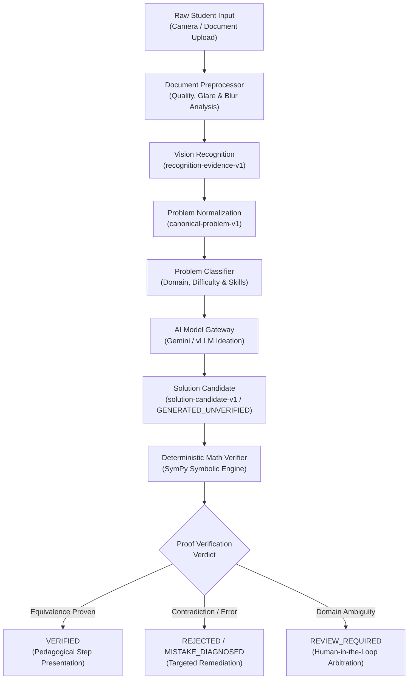

# Verified AI Learning Platform

[](https://openjdk.org/projects/jdk/21/)
[](https://spring.io/projects/spring-boot)
[](https://swift.org/)
[](https://fastapi.tiangolo.com/)
[](https://www.sympy.org/)
[](https://www.postgresql.org/)
[-success?style=for-the-badge&logo=shield&logoColor=white)](#zero-secret-development--runtime-isolation)

> **Production-grade, verification-centered AI mathematics learning and tutoring platform.**  
> Decoupling untrusted generative AI ideation from deterministic mathematical proof verification.

---

## 1. Executive Overview

In STEM education, standard generative AI solutions suffer from a fatal flaw: **they hallucinate plausible-looking mathematics**. Large Language Models frequently commit subtle sign errors, violate domain constraints, invent unjustified premises, or fabricate false proofs with supreme confidence.

**Verified AI** solves this fundamentally by enforcing an immutable architectural invariant:

$$\text{AI Solution Candidate} \neq \text{Verified Mathematical Truth}$$

Every step, transformation, assumption, and final answer generated by an AI model is treated as **untrusted, unverified student-facing candidate data**. No solution is ever presented to a learner as verified until it is independently evaluated and proven by a **deterministic, non-generative symbolic computer algebra system (CAS) and numeric verification engine**.

---

### Current authored delivery — Sprint 6.7

Analyze My Work now has bounded real-set/domain verification, native photo review and gateway integration,
17 evidence-gated diagnoses, native semantic diff, verified twins/methods, mastery/passport and forward V030–V032
persistence in source: **TARGETED_REPAIR_PASSED** (latest owner run `20261104-002119-IQLWzE`, `unresolvedFailures=[]`).
All 5 test failures originally observed across verifier, backend, and iOS UI suites have been verifiably resolved in targeted runs.
Full current-source acceptance remains `PENDING_OWNER`; production release remains `BLOCKED / NOT_AUTHORIZED`.
General handwriting coverage and unbounded mathematics are not claimed; supported scope and release boundaries are explicit.

See the [Sprint 6.7 implementation map](docs/verified_ai_learning_platform_docs_v4/sprints/phase06_solution_experience_and_tutoring/SPRINT_6.7_IMPLEMENTATION_MAP.md),
[execution report](docs/verified_ai_learning_platform_docs_v4/sprints/phase06_solution_experience_and_tutoring/SPRINT_6.7_EXECUTION_REPORT.md)
and [file manifest](docs/verified_ai_learning_platform_docs_v4/sprints/phase06_solution_experience_and_tutoring/SPRINT_6.7_FILE_MANIFEST.md).

### Previous local delivery — Sprint 6.6

The bounded deterministic progressive hint slice and owner-requested evidence reconciliation are
complete: **TARGETED_RECONCILIATION_PASSED** (2026-11-02, run `20261102-214452-cv4eye9f`).
Owner evidence covers 185 iOS tests and 218 backend cases across the prior run and one focused repair;
20 Socratic and 18 hint synthetic cases reconciled, with no unresolved cases.

This is scoped cross-run evidence. Full current-source acceptance remains
`PENDING_FULL_CURRENT_SOURCE_RUN`, hosted CI `NOT_VERIFIED`, shared upgrades `BLOCKED` and production
`NOT_AUTHORIZED`. Hint coverage is bounded to two-step linear equations; verified reveal/live AI remain
unavailable. Feature flags default off. The working tree is prepared for owner Git review; no commit
or push was performed by the agent.

See the [Sprint 6.6 execution report](docs/verified_ai_learning_platform_docs_v4/sprints/phase06_solution_experience_and_tutoring/SPRINT_6.6_EXECUTION_REPORT.md)
and [complete file manifest](docs/verified_ai_learning_platform_docs_v4/sprints/phase06_solution_experience_and_tutoring/SPRINT_6.6_FILE_MANIFEST.md).

## 2. System Architecture

Verified AI is engineered as a decoupled, multi-tiered modular platform:

```
+-----------------------------------------------------------------------------------+
|                              iOS Client (apps/ios)                               |
|   Swift 6 / SwiftUI • LaTeX Formula Rendering • Document Capture & Camera OCR     |
|   Step-by-Step Pedagogical Proof Navigation • Zero Provider Secrets on Client     |
+-----------------------------------------------------------------------------------+
                                         │  HTTPS / REST (OpenAPI 3.1)
                                         ▼
+-----------------------------------------------------------------------------------+
|                        Core Backend API (services/api)                            |
|       Java 21 • Spring Boot 4 • Spring Modulith Modular Monolith Architecture     |
|                                                                                   |
|  ┌───────────────┐ ┌────────────────┐ ┌────────────────┐ ┌─────────────────────┐  |
|  │ Problem Parse │ │ Classification │ │ Solution Store │ │ Tutoring & Mastery  │  |
|  └───────────────┘ └────────────────┘ └────────────────┘ └─────────────────────┘  |
|  ┌─────────────────────────────────────────────────────────────────────────────┐  |
|  │              Controlled AI Model Gateway (ConfiguredAiModelGateway)         │  |
|  │    Prompt & Schema Registry • Byte-Level Artifact Integrity (SHA-256)       │  |
|  │    PostgreSQL Distributed Spend Guard & Budget Ledger (AiSpendGuard)        │  |
|  └─────────────────────────────────────────────────────────────────────────────┘  |
+-----------------------------------------------------------------------------------+
              │                                                │
   Internal HTTP / REST (Signed)                     Internal Bounded HTTPS
              ▼                                                ▼
+------------------------------------+       +------------------------------------+
|  Deterministic Math Verifier       |       |       Multi-Provider AI Layer      |
|     (services/math-verifier)       |       |  • Google Gemini API               |
|  Python 3.12 • FastAPI • SymPy CAS |       |    (gemini-2.5-flash / pro)        |
|  • Step Equivalence Verification   |       |  • Self-Hosted vLLM                |
|  • Domain & Constraint Analysis    |       |    (qwen3.5-4b-bf16)               |
|  • Calculus Boundary Checking      |       |  • Hermetic Test Doubles           |
|  • Numeric Diagnostic Probing      |       |    (LOCAL_FIXTURE)                 |
+------------------------------------+       +------------------------------------+
```

---

## 3. Core Capabilities & Subsystems

### A. Tripartite Architecture
1. **Native iOS Application (`apps/ios`):**
   - Built with modern Swift 6, SwiftUI, and structured concurrency.
   - Features document/camera problem scanning, OCR image preprocessing, responsive step-by-step math rendering, interactive mistake highlighting, and offline state caching.
   - **Zero-Secret Boundary:** Does not hold, receive, or store any third-party AI provider credentials.
2. **Spring Modulith Core API (`services/api`):**
   - Java 21 modular monolith utilizing Spring Modulith for compile-time and test-time architectural boundary verification.
   - Bounded contexts include `problem`, `solving`, `verification`, `tutoring`, `mistake`, `mastery`, `curriculum`, and `billing`.
   - S3-compatible document storage (MinIO / AWS S3) with presigned URLs and image validation.
3. **Deterministic Verification Engine (`services/math-verifier`):**
   - High-performance, memory-bounded Python 3.12 service using SymPy.
   - Verifies arithmetic, algebraic transformations, equation solving, inequalities, limits, derivatives, and definite integrals.
   - Employs multi-algorithm arbitration: algebraic equality, relational reasoning, and randomized high-precision numerical counterexample probing.

### B. Controlled AI Gateway & Provider Abstraction
- **Google Gemini API Integration (`GeminiAiProviderAdapter`):**
  - Fully integrated backend adapter supporting official Google Gemini models (`gemini-2.5-flash`, `gemini-2.5-pro`, `gemini-2.0-flash`).
  - Structured output decoding with strict JSON Schema constraints (`responseMimeType: application/json`).
  - High-throughput, bounded concurrency managed via `Semaphore`, connect/read timeouts, and automatic retry classification.
- **Self-Hosted vLLM Adapter (`VllmSolveProviderAdapter`):**
  - Dedicated adapter for private, on-premise execution of open-weights models (`Qwen/Qwen3.5-4B`).
  - Strict token bounding, tokenizer verification, and context length limits.
- **Prompt & Output Schema Governance:**
  - Immutably versioned prompts (`prompts/solver/v002.md`, `prompts/vision-recognition/v001.md`, etc.) and output schemas (`schemas/solution-candidate.schema.json`, `schemas/problem-parse.schema.json`).
  - Verified at startup via byte-level SHA-256 artifact integrity digests (`ArtifactIntegrity`).

### C. Financial Protection & Distributed Spending Guard
- **`PostgresAiSpendGuard`:**
  - Row-level database locks serialize budget reservations across distributed instances.
  - Granular limits enforced across multiple accounting dimensions: Per-Attempt, Per-Request, Per-Session, User-Daily, User-Monthly, Provider-Monthly, and Global-Monthly.
- **Fail-Closed Default (`paid-disabled-v1`):**
  - All paid AI routes default to a zero-budget ceiling (`0` micros). Any unauthorized attempt to invoke a billable model is blocked at the gateway before any network packet is dispatched.

---

## 4. Zero-Secret Development & Runtime Isolation

The repository is hardened under a comprehensive, evidence-based security architecture (verified under the **SEC-001 through SEC-015** behavioral test suite):

| Security Standard | Target Policy | Enforcement Mechanism |
| :--- | :--- | :--- |
| **SEC-001** | Environment Isolation | Strict allowlist execution; parent process secrets are stripped. |
| **SEC-002** | Filesystem Access Control | Hard deny rules for `~/.ssh`, `~/.aws`, `~/.codex`, Keychain, and credential stores. |
| **SEC-003** | Sandbox Fail-Closed Mode | Agent tooling enforces `failIfUnavailable: true` and `allowUnsandboxedCommands: false`. |
| **SEC-004** | Symlink Traversal Resistance | Symbolic link traversal pointing outside the repository root is blocked and rejected. |
| **SEC-005** | Cross-Agent Isolation | Tokens and session state across Codex, Claude Code, and Gemini are strictly unreadable. |
| **SEC-006** | Host Mount Exclusion | Curated sanitized workspace mirrors exclude all secret-bearing files (`.env*`, `*.key`, `*.pem`). |
| **SEC-007** | Container Privilege Drop | Containers run as non-root (UID 1000) with `--cap-drop=ALL` and `no-new-privileges:true`. |
| **SEC-008** | Network Egress Controls | Model execution policies enforce `network_access = false` unless explicitly authorized. |
| **SEC-009** | Secret Scanner & Log Masking | Pre-commit regex scanner masks detections as `[POTENTIAL_SECRET_DETECTED_REDACTED]`. |
| **SEC-010** | Safe Observability | Logback logging patterns automatically redact HTTP Bearer tokens and credentials. |
| **SEC-011** | Spend Guard Protection | Production AI spending routes are locked to `DISABLED` under `paid-disabled-v1`. |
| **SEC-012** | Strict Schema Validation | Tooling configurations are validated against binary AST schemas (`validate_configs.py`). |
| **SEC-013** | Quality & Contracts Check | 321 canonical documentation artifacts and API contracts verified continuously. |
| **SEC-014** | Least-Privilege CI | GitHub Actions workflows operate with `permissions: contents: read`. |
| **SEC-015** | Client-Side Key Isolation | iOS app tree is audited to verify zero third-party AI provider keys. |

---

## 5. Repository Layout

```
.
├── .agents/                      # Agent instruction rules and security policies
├── .claude/                      # Claude Code project settings and permissions
├── .codex/                       # OpenAI Codex configuration layer
├── .devcontainer/                # Isolated non-root Docker development container
├── .github/                      # Hardened CI/CD workflows (Backend, iOS, Security)
├── apps/
│   └── ios/                      # Native Swift 6 / SwiftUI iOS application
├── docs/                         # Canonical product, architecture & domain documentation
│   └── verified_ai_learning_platform_docs_v4/
├── infra/
│   ├── local/                    # Local Docker Compose services (Postgres, Redis, MinIO)
│   └── security/                 # System-level policy templates (Codex requirements, etc.)
├── packages/
│   ├── contracts/                # OpenAPI 3.1 specifications and shared API contracts
│   ├── curriculum/               # Mathematics skill ontology and curriculum taxonomies
│   └── schemas/                  # Authoritative JSON Schemas (canonical problem, solution candidate)
├── scripts/
│   ├── dev/                      # Isolated container runtime scripts
│   ├── quality/                  # Documentation and contract validation tooling
│   └── security/                 # Pre-commit hooks, secret scanning & SEC test suite
└── services/
    ├── api/                      # Spring Boot 4 / Java 21 Modular Monolith
    └── math-verifier/            # FastAPI / Python 3.12 / SymPy Deterministic Engine
```

---

## 6. Getting Started & Local Development

### Prerequisites
- **macOS** (14+ recommended) or **Linux**
- **Java 21 JDK** (OpenJDK 21 / Temurin)
- **Python 3.12+**
- **Docker** & **Docker Compose**
- **Xcode 16+** (for iOS development)
- **Node.js 20+** (for tooling validation)

### 1. Environment Bootstrap
Run the environment verification probe:
```bash
make doctor
```

Initialize local configuration from sanitized templates:
```bash
make bootstrap
```

### 2. Start Supporting Infrastructure
Spin up local PostgreSQL 16, Redis 7, MinIO S3, and the Math Verifier service:
```bash
make up
```

Verify services are healthy:
- API Server: `http://localhost:8080/actuator/health`
- Math Verifier: `http://localhost:8090/health`
- MinIO Console: `http://localhost:9001`

### 3. Run Verification & Test Suites
Execute the full test pipeline:
```bash
# Run backend Spring Modulith and ArchUnit architecture boundary tests
make test

# Run quality checks (docs, OpenAPI contracts, and schema consistency)
make check

# Run the complete SEC-001 through SEC-015 behavioral security suite
bash scripts/security/test_credential_isolation.sh
```

---

## 7. Mathematical Solving & Verification Lifecycle



---

## 8. Canonical Documentation

The platform's comprehensive specifications and current inventory are maintained in the
[Documentation Manifest](docs/verified_ai_learning_platform_docs_v4/DOCUMENTATION_MANIFEST.md), starting at:

- [Master Documentation Index](docs/verified_ai_learning_platform_docs_v4/00_MASTER_INDEX.md)
- [Product Vision & Core Positioning](docs/verified_ai_learning_platform_docs_v4/product/01_PRODUCT_VISION_AND_POSITIONING.md)
- [System Architecture Overview](docs/verified_ai_learning_platform_docs_v4/architecture/11_SYSTEM_ARCHITECTURE_OVERVIEW.md)
- [Domain Invariants & Mathematical Rules](docs/verified_ai_learning_platform_docs_v4/domain/10_DOMAIN_INVARIANTS_AND_BUSINESS_RULES.md)
- [Zero-Secret Credential Isolation Directives](.agents/rules/credential-isolation.md)

---

## 9. License & Integrity

Licensed under the [MIT License](LICENSE) (or proprietary commercial terms as defined by the repository owner).  
All mathematical evaluation criteria, prompt artifacts, and output schemas are cryptographically signed and version-controlled.
