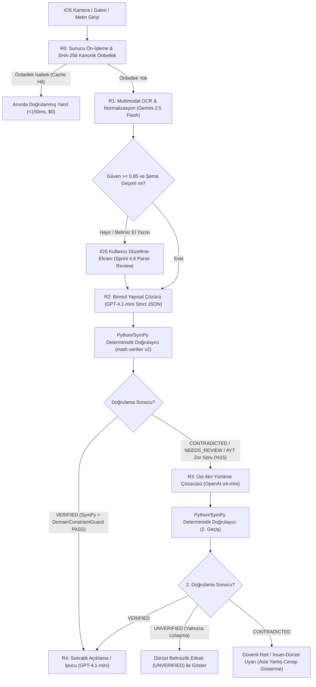

# 77 — Production Mathematical AI Model Landscape, Build-vs-Buy Strategy, Multi-Model Routing, and Benchmark Protocol

- **Research & Decision Date:** 2026-10-31
- **Status:** CANONICAL AI STRATEGY & ROUTING SPECIFICATION (V6)
- **Governing Documents:** `adr/ADR-005_API_FIRST_PROGRESSIVELY_PROPRIETARY_AI_STRATEGY.md`, `adr/ADR-007_SELF_HOSTED_MODELS_ONLY_AFTER_TCO_AND_QUALITY_GATES.md`, `adr/ADR-008_MANAGED_CLOUD_API_ROUTING_AND_QWEN_4B_DE_PROMOTION.md`, `ai/25_AI_ORCHESTRATION_AND_MODEL_ROUTING.md`

---

## 1. 2026 Mathematical AI Model Landscape (Güncel Model Ekosistemi)

### 1.1 Neden AIME / Olimpiyat Skorları Öğrenci Uygulaması Kalitesini Göstermez?
Akademik liderlik tabloları (`AIME 2024/2025`, `MATH-500`, `OlympiadBench`) modelleri temiz LaTeX metinler ve tek bir nihai tam sayı cevabı üzerinden ölçer. Oysa gerçek bir öğrencinin telefon kamerasından gelen soruda başarıyı belirleyen 4 faktör şunlardır:
1. **Multimodal Görsel Ayrıştırma (OCR Fidelity):** Kötü ışıkta çekilmiş eğik el yazısı, üstü çizilmiş karalamalar ve Türkçe soru kökleri.
2. **Sıkı Yapısal Şema Uyumu (`CanonicalMathDocument` JSON Schema Adherence):** Modelin uydurma operatör üretmeden, `services/math-verifier` tarafından deterministik olarak yürütülebilecek geçerli bir AST/JSON ağacı döndürmesi.
3. **Ara Adım Tutarlılığı ve Pedagojik Dil:** Sadece nihai cevabı bulmak değil, lise/YKS veya Calculus 101 öğrencisinin anlayacağı berrak Türkçe/İngilizce ara adımlar üretmek.
4. **Düşünme Tokenı (Reasoning Token) Maliyet Disiplini:** Basit bir doğrusal denklem için `8,000` gizli düşünme tokenı harcayan bir model, birim ekonomiyi ve 5 saniyelik etkileşimli gecikme hedefini (SLO) çökertir.

### 1.2 Yönetilen Bulut API Modelleri (Proprietary API Models — Ekim 2026)

| Model | Sağlayıcı | Modalite | Fiyat (`1M` Giriş / `1M` Çıkış USD) | Yapısal JSON / Şema Uyumu | Türkçe & YKS Kalitesi | Üretim Rolü (`ADR-008`) |
|---|---|---|---|---|---|---|
| **Gemini 2.5 Flash** | Google Vertex / AI Studio | Metin + Görsel (VLM) | `\$0.30` / `\$2.50` (Düşünmesiz baz daha düşük) | Çok Yüksek (`responseSchema`) | Çok Yüksek | **Birincil OCR & Görsel Ayrıştırma (`R1`)** ve hızlı yedek çözücü. |
| **GPT-4.1-mini** | OpenAI | Metin + Görsel | `\$0.40` / `\$1.60` (Önbellekli giriş `\$0.10`) | **Sınıfının En İyisi** (`Strict Structured Outputs`) | Çok Yüksek | **Birincil Yapısal Çözücü (`R2`)** ve **Sokratik Eğitmen (`R4`)**. |
| **OpenAI o4-mini** | OpenAI | Akıl Yürütme + Görsel | `\$1.10` / `\$4.40` | Çok Yüksek | Yüksek | **Doğrulayıcı Tetiklemeli Üst Çözücü (`R3` Escalation)** (`max_completion_tokens <= 2048`). |
| **Gemini 2.5 Pro** | Google | Akıl Yürütme + Görsel | `\$1.25` / `\$10.00` (`<=200k` bağlam) | Çok Yüksek | Çok Yüksek | Karmaşık el yazısı + çok adımlı AYT/Calculus zor kuyruk (hard-tail) yedeği. |
| **GPT-4.1 / GPT-5 / o3** | OpenAI | Sınır (Frontier) Modeller | `\$2.00` / `\$8.00` (`o3`: `\$2.00` / `\$8.00`) | Çok Yüksek | Çok Yüksek | Yalnızca çevrimdışı altın veri seti (`verified-ai-eval-v2`) referans hakemliği; canlı V1 trafiğinde maliyet nedeniyle kapalı. |
| **Claude Sonnet 4** | Anthropic | Metin + Görsel | `\$3.00` / `\$15.00` | Yüksek | Yüksek | Çok iyi pedagojik anlatım; ancak birim maliyeti `GPT-4.1-mini`'nin ~9 katı olduğu için canlı varsayılan rotada kullanılmaz. |

### 1.3 Açık Ağırlıklı Modeller (Open-Weight Models — Ekim 2026)

| Model | Lisans | Boyut / Mimari | Tahmini VRAM (BF16 / INT4) | Güçlü Yönü | Kritik Risk / Zayıflık |
|---|---|---|---|---|---|
| **Qwen/Qwen3.5-4B** (Sprint 5.4-RM adayı) | Apache-2.0 | 4B Yoğun (Dense) | `~8.5 GB` / `~3.2 GB` (`+KV cache`) | Tek GPU'ya sığar, ticari lisansı temiz. | **Kritik Zayıflık:** 4B ölçeğinde karmaşık JSON şemalarında (`CanonicalMathDocument`) sentaks hatası oranı yüksektir; Türkçe YKS hikâye sorularında denklem kurma başarısı yetersizdir (`ADR-008` ile V1'de donduruldu). |
| **Qwen3-8B / Qwen3.5-9B** | Apache-2.0 | 8B–9B Yoğun | `~18 GB` / `~5.5 GB` | Faz 13'te ince ayar (LoRA/SFT) için en dengeli açık ağırlık tabanı. | Ham (zero-shot) kullanımda `GPT-4.1-mini` kadar güvenilir şema disiplini sunmaz. |
| **Qwen3-30B-A3B / Qwen3.5-35B-A3B** | Apache-2.0 | MoE (`30B–35B` toplam, `3B` aktif) | `~65–72 GB` / `~18–20 GB` | MoE sayesinde 3B hızında 30B+ matematiksel kapasite. | Tüm uzman (expert) ağırlıkları bellekte tutulduğu için tekil küçük GPU'ya sığmaz; yönetilen sunucusuz API (Together/Fireworks) üzerinden çağrılmalıdır. |
| **DeepSeek-R1-0528 (671B MoE)** | MIT | 671B MoE (`37B` aktif) | Çoklu H100/H200 düğümü | Açık ağırlık dünyasının en güçlü matematiksel akıl yürütme modeli (`~87.5%` AIME). | Öz-barındırma (self-hosting) solo kurucu için imkânsızdır; yalnızca yönetilen sıfır veri saklamalı (zero-retention) API üzerinden `R3` yedeği olarak kullanılabilir. |
| **DeepSeek-Math-V2** | Apache-2.0 / MIT (Revizyona bağlı) | Uzmanlaşmış matematik modeli | 7B–70B varyantları | Teorem ve sembolik türetme odaklı. | Lisans metni commit revizyonuna göre sabitlenmelidir; genel JSON şema uyumu ek SFT gerektirir. |
| **Qwen2.5-VL-72B / 7B-Instruct** | Apache-2.0 | Multimodal VLM | `~145 GB` / `~16 GB` | Açık ağırlıklı en iyi el yazısı ve formül OCR ailesi. | `Gemini 2.5 Flash` API yedek rotası (`R1 Fallback`) olarak yönetilen sağlayıcıdan kullanılabilir. |

---

## 2. Technical Audit of `Qwen/Qwen3.5-4B` (`vLLM`) Decision

Sprint 5.4-RM kapsamında seçilen `Qwen/Qwen3.5-4B@851bf6e806efd8d0a36b00ddf55e13ccb7b8cd0a` adayı teknik ve ekonomik denetim sonucunda **V1 Birincil Çözücü rolünden çıkarılmıştır (`ADR-008`)**:

1. **Kanıt Eksikliği:** 240 vakalık `math-routing-research-v001` veri setinde tek bir canlı çıkarım (inference) dahi koşulmamıştır.
2. **Bilişsel Kapasite Sınırı:** 4 milyar parametreli bir modelden aynı anda (a) Türkçe bağlamsal problemi anlaması, (b) hatasız cebirsel adımlar kurması ve (c) derin iç içe geçmiş `CanonicalMathDocument` AST JSON şemasını sıfır sentaks hatasıyla üretmesi beklenemez.
3. **TCO Çelişkisi:** Öğrenci trafiği akşam 19:00–23:30 saatleri arasında yoğunlaşır (`%15–18` günlük ortalama GPU doluluğu). 7/24 kiralanan tek bir GPU'nun (`\$650–\$2,912/ay`) sabit maliyeti, 1,000 ücretli öğrencide toplam `\$290.50/ay` tutan yönetilen `Gemini 2.5 Flash + GPT-4.1-mini` API maliyetinin **2.2x ila 10x üzerindedir**.

---

## 3. Build vs. Buy vs. Fine-Tune vs. Self-Host Decision Matrix (Yap / Satın Al / İnce Ayar / Öz-Barındırma Karar Matrisi)

Değerlendirilen 6 Mimari Seçenek:
- **Opsiyon 1:** Sadece Yönetilen Sınır/Hızlı API (`Managed Cloud APIs`)
- **Opsiyon 2:** Yönetilen API + Deterministik Sembolik Doğrulayıcı (`SymPy` + `VerificationPolicy`) — **SEÇİLEN V1 MİMARİSİ**
- **Opsiyon 3:** Barındırılan Açık Ağırlıklı Model API (`Together` / `Fireworks` / `DeepInfra`)
- **Opsiyon 4:** Özel GPU Üzerinde Öz-Barındırma (`vLLM` / `SGLang`)
- **Opsiyon 5:** Göreve Özel İnce Ayarlı Küçük Model (`LoRA` / `QLoRA` 8B–9B) + Sembolik Doğrulayıcı (Faz 13)
- **Opsiyon 6:** Sıfırdan Model Eğitimi (`Pretraining from scratch` — **KESİNLİKLE YASAK**)

| Alt Sistem (Subsystem) | V1 Kararı (0–10,000 Ücretli Kullanıcı) | V2 / Faz 13 Kararı (>25,000 Ücretli Kullanıcı) | Gerekçe ve Ekonomik Kanıt |
|---|---|---|---|
| **1. Kamera Görüntü Ön-İşleme** | **KENDİN YAP (Build In-House)** | **KENDİN YAP** | iOS VisionKit + Backend Java2D deterministik ve sıfır marjinal maliyetlidir (Zaten kodlandı). |
| **2. Multimodal Matematik OCR (`VISION_PARSE`)** | **OPSİYON 2 (`Gemini 2.5 Flash` API)** | **OPSİYON 3/5 (`Qwen2.5-VL-7B` Fine-Tuned)** | V1'de görsel başına `~\$0.0004` maliyetle en yüksek el yazısı/Türkçe başarımı verir. |
| **3. Problem Normalizasyonu (`CanonicalMathDocument`)** | **OPSİYON 2 (`GPT-4.1-mini` Strict JSON)** | **OPSİYON 5 (`Qwen3-8B` LoRA SFT)** | Sıkı JSON şema garantisi V1'de kritiktir; 50,000+ doğrulanmış örnek biriktiğinde 8B modele distile edilir. |
| **4. Birincil Çözücü (`PRIMARY_SOLVE`)** | **OPSİYON 2 (`GPT-4.1-mini` + `SymPy`)** | **OPSİYON 2 + OPSİYON 3 Hibrit** | Hız (`~2.5 sn`), maliyet (`~\$0.0024/çözüm`) ve şema doğruluğu dengesinde rakipsizdir. |
| **5. Zor Kuyruk / İkincil Çözücü (`SECONDARY_SOLVE`)** | **OPSİYON 2 (`o4-mini` Koşullu %15)** | **OPSİYON 2/3 (`o4-mini` / `DeepSeek-R1`)** | Yalnızca `SymPy` doğrulaması başarısız olduğunda veya AYT/Calculus zor sorularda tetiklenir. |
| **6. Deterministik Matematik Doğrulayıcı (`math-verifier`)** | **KENDİN YAP (`Python` + `SymPy` V2)** | **KENDİN YAP (`SymPy` + `Z3` eklentisi)** | **Şirketin çekirdek fikri mülkiyetidir (Core IP).** Dışarıdan alınamaz, LLM'e devredilemez. |
| **7. Öğrenci El Yazısı Hata Teşhisi (`Analyze My Work`)** | **OPSİYON 2 (`Gemini Flash` + `SymPy` Diff)** | **OPSİYON 2 + Özel Sınıflandırıcı** | VLM satırları okur; `SymPy` hangi satırda cebirsel eşitliğin bozulduğunu deterministik kanıtlar. |
| **8. Sokratik İpucu ve Açıklama (`TUTOR_EXPLAIN`)** | **OPSİYON 2 (`GPT-4.1-mini`)** | **OPSİYON 3/5** | Doğrulanmış kanonik çözüm adımlarına (`CanonicalSolution`) sıkıca bağlı (grounded) çalışır. |
| **9. Hata Taksonomisi ve Beceri Sınıflandırma** | **KURAL TABANLI + `GPT-4.1-mini`** | **OPSİYON 5 (`DeBERTa-v3` / `Qwen3-4B`)** | V1'de ekstra servis maliyeti yaratmadan çözücü çıktısından alınır. |
| **10. Hakimiyet (Mastery) ve Unutma Eğrisi Motoru** | **KENDİN YAP (Deterministik BKT-Lite + Decay)** | **KENDİN YAP + GBDT Kalibrasyonu** | Bilişsel matematik formülüdür; LLM kullanmak hem pahalı hem de kararsızdır. |

### 3.1 Öz-Barındırma (Self-Hosting) ve İnce Ayar (Fine-Tuning) İçin 6 Nicel Tetikleme Kapısı (`Gate 1`..`Gate 6`)
Aşağıdaki **6 kapının tamamı aynı anda** sağlanmadan hiçbir mühendislik zamanı GPU kiralama, `vLLM` kümesi kurma veya LoRA eğitimi için harcanamaz (`adr/ADR-007_SELF_HOSTED_MODELS_ONLY_AFTER_TCO_AND_QUALITY_GATES.md`):
1. **Kapı 1 — Ölçek Eşiği:** En az **25,000 aktif ücretli abone** VEYA tek bir görevde aylık **> `\$4,000` bulut API faturası**.
2. **Kapı 2 — Veri Seti ve Rıza Eşiği:** `adr/ADR-006_PRODUCTION_STUDENT_DATA_NOT_TRAINING_DATA_BY_DEFAULT.md` uyarınca açık eğitim izni alınmış, PII-arındırılmış ve `SymPy` tarafından `%100` doğrulanmış en az **25,000 temiz örnek**.
3. **Kapı 3 — Kalite Eşdeğerliği:** `verified-ai-eval-v2` (500 vakalık altın veri seti) üzerinde bulut API baz çizgisinden en fazla `%1.0` daha düşük doğruluk ve `>= %99.2` JSON şema geçerliliği.
4. **Kapı 4 — Gerçek TCO Avantajı:** 7/24 GPU kirası + boşta kalma (idle) maliyeti + yedek API taşması + mühendis bakım saati toplamının, yönetilen API faturasından **en az `%35` daha ucuz** olması.
5. **Kapı 5 — Gecikme (Latency) SLO:** Akşam pik saatlerde (20:00–23:00) `p95 <= 4.5 sn` yanıt süresi.
6. **Kapı 6 — Sıfır Kesintili Geri Dönüş (Instant Rollback):** `VllmSolveProviderAdapter` çöktüğünde 1 saniye içinde `OpenAiSolveProviderAdapter` rotasına otomatik dönüş.

---

## 4. Production Multi-Model Routing Architecture (`R0`–`R4`)

### Katman Bazlı Bütçe ve Gecikme Hedefleri (Per-Stage SLOs)
- **`R0` (Kanonik Önbellek):** `p95 < 50 ms`, Maliyet `\$0.00`. Aynı ders kitabı/deneme sınavı sorusunu çeken 2. öğrencide AI maliyeti sıfırlanır.
- **`R1` (`Gemini 2.5 Flash` OCR & Parse):** `p50 = 0.9 sn`, `p95 = 1.8 sn`, Ort. Maliyet `\$0.00080`.
- **`R2` (`GPT-4.1-mini` Birincil Çözücü):** `p50 = 1.8 sn`, `p95 = 3.2 sn`, Ort. Maliyet `\$0.00240`.
- **`SymPy` (`math-verifier` V2):** `p50 = 0.08 sn`, `p95 = 0.35 sn` (Hard CPU timeout: `1,500 ms`), Maliyet `~ \$0.00001`.
- **`R3` (`o4-mini` Koşullu Üst Çözücü — İsteklerin ~%15'i):** `p50 = 3.8 sn`, `p95 = 6.5 sn`, Tetiklendiğinde Maliyet `\$0.01100` (Beklenen ort. katkı: `0.15 × \$0.011 = \$0.00165`).

---

## 5. Evaluation Benchmark Design (`verified-ai-eval-v2` — 500 Vaka, 4 Eksen)

Mevcut 18 sentetik vakalık yerel test (`evaluations/baselines/solver-release-policy-v1.json`) yalnızca CI duman testi (smoke test) olarak korunacak; model seçimi ve sürüm onayı için **500 vakalık katmanlı (stratified) `verified-ai-eval-v2` altın veri seti** kullanılacaktır:

### 5.1 10 Alt Küme (Slices — Her biri 50 Vaka = Toplam 500 Vaka)
1. `SLICE_01_ARITH_PREALGEBRA` (Rasyonel sayılar, üslü/köklü ifadeler — 50 vaka)
2. `SLICE_02_ALGEBRA_POLYNOMIAL` (Çarpanlara ayırma, özdeşlikler, rasyonel sadeleştirme — 50 vaka)
3. `SLICE_03_EQUATIONS_SINGLE_MULTI_ROOT` (1. ve 2. dereceden denklemler, mutlak değer, `FiniteSet` çoklu kök — 50 vaka)
4. `SLICE_04_DOMAIN_TRAP_EXTRANEOUS` (Paydayı sıfır yapan yalancı kökler, çift kök içi negatif, logaritma tanım kümesi — 50 vaka)
5. `SLICE_05_INEQUALITIES_INTERVALS` (Eşitsizlik sistemleri, işaret tablosu, açık/kapalı aralıklar — 50 vaka)
6. `SLICE_06_TYT_TURKISH_WORD_PROBLEMS` (Özgün yazılmış Türkçe hikâyeli yaş, yüzde, hareket, işçi, oran-orantı soruları — 50 vaka)
7. `SLICE_07_AYT_FUNCTIONS_TRIG_LOG` (Fonksiyon bileşkesi/tersi, trigonometri, logaritma, diziler — 50 vaka)
8. `SLICE_08_CALCULUS_LIMIT_DERIV_INT` (Limit $0/0$, türev zincir kuralı, teğet/ekstremum, belirli/belirsiz integral — 50 vaka)
9. `SLICE_09_STUDENT_HANDWRITTEN_MISTAKES` (`Analyze My Work` için kasıtlı öğrenci el yazısı hataları içeren çok satırlı çözümler — 50 vaka)
10. `SLICE_10_AMBIGUOUS_UNSUPPORTED_REFUSAL` (Okunaksız fotoğraf, eksik veri, kapsam dışı 3D geometri -> Güvenli red testi — 50 vaka)

### 5.2 Dört Bağımsız Ölçüm Ekseni ve Üretim Çıkış Kapıları (Release Gates)
- **Eksen 1 — Multimodal OCR & Normalizasyon:** Matematiksel AST Tam Eşleşme `>= %92.0` (Temiz baskı `>= %96.0`, El yazısı `>= %88.0`).
- **Eksen 2 — Çözücü Doğruluğu ve Şema Geçerliliği:** Şema geçerliliği `>= %99.2`; Desteklenen kapsamda `VERIFIED` çözüm oranı `>= %88.0`; Yalancı kök (`SLICE_04`) yakalama oranı `>= %95.0`.
- **Eksen 3 — İlk Hatalı Adım Teşhisi (`SLICE_09`):** Öğrencinin el yazısındaki ilk hatalı satırı (`First Wrong Step Index`) tam isabetle bulma oranı `>= %85.0`.
- **Eksen 4 — Doğrulayıcı Güvenliği (Zero False-Verified Gate):** Hatalı bir çözüme `VERIFIED` etiketi verilme oranı **kesinlikle `0.000` (Sıfır Tolerans)**.
