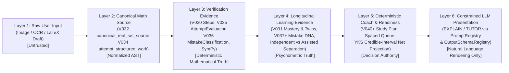

# 90 — Learning OS Domain Contracts, Database Lineage, and Platform Integration

## Document Metadata

| Field | Value |
|---|---|
| **Document ID** | `DOC-90` |
| **Canonical Path** | `architecture/90_LEARNING_OS_DOMAIN_CONTRACTS_AND_PLATFORM_INTEGRATION.md` |
| **Title** | Learning OS Domain Contracts, Database Lineage, and Platform Integration |
| **Status** | `CANONICAL_ARCHITECTURE_SPECIFICATION` (`CANDIDATE_CONTRACTS_V1_GATED_BY_SPRINT_ACCEPTANCE`) |
| **Owner** | Principal Software Architect, Senior Backend/Data Architect & Senior iOS/Android Architect |
| **Date / Version** | `2026-11-07` / `v1.0.0` |
| **Baseline Commit** | `e39bafe88ea369f98c96a65497a94462dc79ef33` (`main`) |
| **Governing ADRs** | `adr/ADR-004_SEPARATE_PYTHON_MATH_VERIFIER.md`, `adr/ADR-003_PROVIDER_NEUTRAL_AI.md`, `adr/ADR-002_MODULAR_MONOLITH_OVER_MICROSERVICES.md`, `adr/ADR-009_CANONICAL_SOLUTION_SET_ALGEBRA_AND_DOMAIN_GUARD.md`, `adr/ADR-010_NATIVE_2D_MATH_RENDERING_AND_STEP_DIFF_HIGHLIGHTING.md` |

---

## 1. Purpose

This document specifies the domain-driven architecture, Spring Modulith module boundaries (`com.verifiedai.*`), five-layer trust pipeline, 13 versioned candidate API/domain contracts, planned Flyway migration lineage (`V037+`), YKS Performance Coach domain architecture, and cross-platform iOS/Android integration rules for the **Verified AI Learning OS**.

It ensures that future coding agents implementing Sprints `7.5` through `12.10` build directly upon the real repository codebase (`services/api/`, `services/math-verifier/`, `apps/ios/VerifiedAI/`) without introducing package drift or duplicate database schemas.

---

## 2. Sources and Evidence Classification

- `SOURCE_VERIFIED`: Verified directly against `services/api/src/main/java/com/verifiedai/`, `services/api/src/main/resources/db/migration/platform/V001..V036`, `services/math-verifier/app/`, `apps/ios/VerifiedAI/`, `architecture/14_API_DESIGN_AND_CONTRACTS.md`, `domain/10_DOMAIN_INVARIANTS_AND_BUSINESS_RULES.md`, `domain/46_CURRICULUM_SKILL_ONTOLOGY_AND_TAXONOMY.md`, and `domain/47_MATHEMATICAL_CANONICAL_REPRESENTATION.md`.
- `ENGINEERING_ESTIMATE`: Planned migration schemas (`V037`–`V049`), endpoint latency SLAs, and Android parity architecture (`Sprint 12.10`).

---

## 3. Five-Layer Architectural Trust Boundary (`INV-ARCH-TRUST-001`)

The Verified AI Learning OS enforces a strict, unidirectional epistemic trust hierarchy across all services:



**Hard Architectural Invariant:** Layer 6 (LLM Presentation) has **read-only access** to structured outputs from Layers 3–5 and **zero write access** to Layers 2–5. If an LLM call times out, fails schema validation, or hits `PostgresAiSpendGuard` (`V016`/`V017`), Layers 2–5 still complete 100% deterministically and return verified structured cards to the client.

---

## 4. Spring Modulith Package Ownership Map (`services/api/src/main/java/com/verifiedai/`)

All backend code resides under the canonical root package `com.verifiedai` (`SOURCE_VERIFIED` — never `com.verifiedlearning`):

| Module Package | Current State at `e39bafe` | Authoritative Domain Ownership in Learning OS | Allowed Outbound Dependencies |
|---|---|---|---|
| `com.verifiedai.attempt` | Implemented (`V030`–`V036`) | `StudentAttempt`, `AttemptStructuredWork`, `AttemptEvaluation`, `AttemptMistakeClassification`, `AttemptLearningEvidence`, `CounterfactualTwinDrill` (`V031`). | `mistake`, `curriculum`, `solving`, `ai`, `privacy` |
| `com.verifiedai.mistake` | Implemented (`MistakeTaxonomy`, `MistakeClassificationDecision`) | `MistakeTaxonomy` (`mistake-category-v1`; v2 is future), `LearnerMistakeDnaProfile` (`V037`), exposure-adjusted Beta-Binomial calculator, recurrence state machine, OCR dispute rollback. | `curriculum`, `privacy`, `shared` |
| `com.verifiedai.mastery` | Scaffolded (`package-info.java`) | `LearnerSkillMastery` (`V031` ownership migration/facade in `Sprint 7.6`), `EvidenceStratifiedMasteryPolicy` (`bkt-lite-v1`/`v2`), prerequisite graph propagation, half-life decay $R_{u,s}(t)$. | `curriculum`, `mistake`, `privacy`, `shared` |
| `com.verifiedai.studyplan` | Scaffolded (`package-info.java`) | `NextBestActionEngine` (`Sprint 8.1`), `TargetedTwinOrchestrator` (`Sprint 8.2`), `SpacedRepetitionScheduler` (`Sprint 8.3`), `DailyCoachSessionService` (`Sprint 8.4`). | `mastery`, `mistake`, `attempt`, `curriculum`, `exam`, `billing`, `privacy` |
| `com.verifiedai.tutoring` | Implemented (`TutorSession`, `SocraticPolicy`, `HintPolicy`) | 3-rung Socratic repair sessions, `TriggeredMicroLessonService` (`Sprint 8.5`). | `attempt`, `mistake`, `ai`, `billing`, `privacy` |
| `com.verifiedai.exam` | Scaffolded (`package-info.java`) | `ExamDefinition` (`TYT`, `AYT`, `IB`, `AP`, `SAT`), `ExamSession` (`Sprint 9.1/9.2`), post-exam mistake attribution (`Sprint 9.6`), `ExamReadinessProjectionService` & YKS Net-Gain Simulator (`Sprint 9.7`). | `curriculum`, `mastery`, `mistake`, `attempt`, `billing`, `privacy` |
| `com.verifiedai.billing` | Implemented (`EntitlementApplicationService`, `AppleBillingApplicationService`) | Tiered entitlements (`FREE`, `PRO`, `COACH_PRO`, `YKS_SEASON_PASS`, `TUTOR_COPILOT_PACK`), quota ledgers (`Sprint 10.1–10.3`), Google Play Billing (`Sprint 12.10`). | `account`, `privacy`, `shared` |
| `com.verifiedai.analytics` | Scaffolded (`package-info.java`) | Brier/ECE psychometric calibration (`Sprint 7.9`), `WeeklyDigestService` & 1-click Tutor PDF export (`Sprint 8.6`), funnel & unit-economics telemetry (`Sprint 10.4`). | `mastery`, `mistake`, `exam`, `billing`, `privacy` |
| `com.verifiedai.account` | Implemented | User identity, age-band verification (`13–17` vs `18+`), `ConsentGatedCoachLinkService` (`Sprint 12.7`). | `privacy`, `shared` |

---

## 5. Planned Database Migration Lineage (`V037`–`V049`)

All existing migrations (`V001`–`V023`, `V027`–`V042`) remain immutable. Active migration head is `V042__mastery_calibration_and_retention_snapshots.sql`. Future sprints allocate sequential Flyway versions starting at `V043`:

| Planned Version | Target Sprint | Migration Name & Core Tables | Relationship to Existing Tables |
|---|---|---|---|
| **`V037`–`V042`** *(COMPLETED)* | `Phase 7` (`Sprints 7.5–7.10`) | `V037__add_learner_mistake_dna_profiles.sql`<br>`V038__evidence_stratified_mastery.sql`<br>`V039__socratic_scaffolding.sql`<br>`V040__verified_twin_verifications.sql`<br>`V041__whiteboard_vector_stream.sql`<br>`V042__mastery_calibration_and_retention_snapshots.sql` | Fully implemented and certified in Phase 7 exit gate. |
| **`V043`** *(PLANNED)* | `Sprints 8.1 & 8.4` | `V043__next_best_action_and_daily_coach.sql`<br>• `learner_recommendations` (`id`, `user_id`, `target_skill_code`, `target_mistake_code`, `priority_score`, `rationale_code`)<br>• `daily_coach_sessions` (`id`, `user_id`, `local_date`, `preferred_mode`, `status`)<br>• `daily_coach_tasks`. | Integrates `H-13` Dual-Mode (Solver vs Socratic) and deterministic 15-minute coach hub. |
| **`V044`** *(PLANNED)* | `Sprint 8.2` | `V044__verified_twin_ladder_and_templates.sql`<br>• Extends `counterfactual_twin_drills` with 3-variant ladder (`VARIANT_A`, `VARIANT_B`, `VARIANT_C`), generation tier and 60s independent lock. | Extends `V031` / `V040` twin drills. |
| **`V045`** *(PLANNED)* | `Sprints 8.3 & 8.5` | `V045__spaced_review_queue_and_rebalancing.sql`<br>• `spaced_review_queue` ($t_{\text{due}}$ calculated from $R_{u,s}(t)=0.72$)<br>• `study_plan_rebalance_events` (non-punitive missed-day recovery). | Driven by `V042` retention snapshots. |
| **`V046`** *(PLANNED)* | `Sprint 8.6` | `V046__micro_lesson_cards.sql`<br>• `micro_lesson_catalog` (`mistake_code`, `locale`, `card_payload_json`, `verification_hash`)<br>• `learner_micro_lesson_completions`. | Content-hashed pre-verified micro-lesson cards. |
| **`V050`–`V051`** *(SHIPPED)* | `Sprints 8.7 & 8.8` | `V050__study_session_orchestration.sql` & `V051__gamification_streaks_and_achievements.sql`<br>• `study_sessions` & `study_session_checkpoints` (`V050` offline-safe state machine)<br>• `learner_streaks`, `learner_daily_streak_ledger` & `learner_achievements` (`V051` independent verification streaks & pedagogical milestones only, `training_eligible = FALSE`). | Pure deterministic session & non-manipulative gamification engine. |
| **`V052`** *(SHIPPED)* | `Sprint 8.9` | `V052__weekly_learner_digests.sql`<br>• `weekly_learner_digests` (`digest_id`, `user_id`, `week_iso`, `week_start_date`, `week_end_date`, `digest_payload_json`, `training_eligible = FALSE`). | Powers on-device 1-click Tutor/Parent PDF share packet. |
| **`V049`–`V051`** *(PLANNED)* | `Sprints 9.1–9.7` | `exam_definitions`, `exam_topic_weights`, `exam_sessions`, `exam_session_items` (`V049`); `candidate_profiles` & `candidate_syllabus_uploads` (`V050`, `H-14`); `exam_readiness_projections` (`V051`, $\widehat{\text{Net}}_{u,E}$). | Comprehensive ÖSYM YKS & University Calculus assessment engine. |
| **`V052`** *(PLANNED)* | `Sprint 9.8` | `V052__pre_exam_study_sessions_and_cheat_sheets.sql`<br>• `pre_exam_study_sessions` & personal cheat sheet metadata (`H-15`). | Powers 48-hour pre-exam personal trap & formula sheets. |
| **`V053`–`V054`** *(PLANNED)* | `Sprints 10.1 & 12.7`| `entitlement_quota_ledgers` (`V053`); `coach_student_links` & `user_privacy_consents` (`V054`). | Extends `com.verifiedai.billing` and `com.verifiedai.privacy`. |

---

## 6. Candidate Domain & API Contracts Catalog (`CANDIDATE_CONTRACT_V1`)

All 13 candidate contracts follow the standard envelope and error semantics in `architecture/14_API_DESIGN_AND_CONTRACTS.md`:

| Contract ID | Endpoint / Event Name | Owner Module | Consumers | Schema Version | Idempotency Strategy | Timeout & Fallback Behavior | Privacy Classification |
|---|---|---|---|---|---|---|---|
| **`CNT-LOS-01`** | `GET /v1/mistake-passport`<br>`AttemptMistakeDnaSummaryContract` | `com.verifiedai.mistake` | iOS/Android `MistakePassportView`, `studyplan` | `mistake-passport-v1` | Read-only `GET` (ETag cached) | `400ms` SLA; falls back to last cached snapshot on client | `STUDENT_CONFIDENTIAL` (Summary shared with linked Tutor if consented) |
| **`CNT-LOS-02`** | `POST /api/v1/problem-sessions/{problemId}/attempts/{id}/steps/{stepIndex}/correct-ocr`; `POST /api/v1/mistakes/{eventId}/dispute` | `attempt`, `mistake` | Existing iOS Attempt Analysis | `attempt-ocr-correction-request-v1`, `mistake-dispute-request-v1` | Required Idempotency-Key; owner-locked atomic exclusion/reprojection | Correction returns REEVALUATION_REQUIRED; no V038/mastery writes. <250 ms rollback target pending owner measurement. | `STUDENT_CONFIDENTIAL` |
| **`CNT-LOS-03`** | `POST /v1/attempts/{attemptId}/twins`<br>`POST /v1/twins/{twinId}/submit` | `com.verifiedai.attempt`, `com.verifiedai.studyplan` | iOS/Android `TwinChallengeView` | `verified-twin-v1` | Deterministic key `(source_attempt_id, variant_tier)` | Tier-1 deterministic `<400ms`; Tier-2 hybrid `<3,500ms`; fail-closed refusal if unverified | `STUDENT_CONFIDENTIAL` |
| **`CNT-LOS-04`** | `GET /api/v1/mastery/skills`, optional `representationVersion=2` | `com.verifiedai.mastery` | iOS AttemptAnalysis, ProblemReview | `mastery-skills-v1`, model `bkt-lite-v2` | Owner-scoped query, mutations use immutable evidence IDs | Deterministic replay at server time. 250 ms read target pending measurement. | `STUDENT_CONFIDENTIAL` |
| **`CNT-LOS-05`** | `GET /v1/mastery/graph?curriculum={code}` | `com.verifiedai.mastery`, `com.verifiedai.curriculum` | iOS/Android `MasteryGraphExplorer` | `skill-graph-v1` | Static DAG + user overlay | `300ms` SLA; cached curriculum DAG in memory | `STUDENT_CONFIDENTIAL` |
| **`CNT-LOS-06`** | `GET /v1/coach/today-summary`<br>`POST /v1/coach/missions/{id}/complete`<br>`PATCH /v1/coach/preferences` | `com.verifiedai.studyplan` | iOS/Android `CoachHubView` | `daily-coach-v1` | `(user_id, local_date)` unique constraint | `350ms` SLA; supports `preferred_mode` (`SOLVER` vs `SOCRATIC`); localized fallback template | `STUDENT_CONFIDENTIAL` |
| **`CNT-LOS-07`** | `GET /v1/study-plan/spaced-queue` | `com.verifiedai.studyplan` | iOS/Android `SpacedReviewView` | `spaced-queue-v1` | Deterministic sort by $R_{u,s}(t)$ | `250ms` SLA; pure SQL/Java calculation | `STUDENT_CONFIDENTIAL` |
| **`CNT-LOS-08`** | `GET /v1/micro-lessons/{mistakeCode}` | `com.verifiedai.tutoring` | iOS/Android `MicroLessonSheet` | `micro-lesson-v1` | Content hash by `(mistakeCode, locale)` | `200ms` pre-verified card; optional Socratic follow-up under spend guard | `PUBLIC_CURRICULUM` + `STUDENT_PROGRESS` |
| **`CNT-LOS-09`** | `GET /v1/reports/weekly/{weekIso}`<br>`POST /v1/reports/weekly/{weekIso}/share-packet` | `com.verifiedai.analytics` | iOS/Android `WeeklyReportView`, Tutor/Parent PDF | `weekly-digest-v1` | `(user_id, week_iso)` | `500ms` SLA; strips all PII/chat/photos before generating share payload | `SHAREABLE_AGGREGATE_ONLY` |
| **`CNT-LOS-10`** | `POST /v1/exams/sessions`<br>`POST /v1/exams/sessions/{id}/submit` | `com.verifiedai.exam` | iOS/Android `ExamSessionView` | `exam-session-v1` | `Idempotency-Key` on session start & submit | Server-authoritative clock; offline grace buffer `120s` | `STUDENT_CONFIDENTIAL` |
| **`CNT-LOS-11`** | `GET /v1/exams/readiness?examCode={code}` | `com.verifiedai.exam` | iOS/Android `ExamReadinessHub` | `exam-readiness-v1` | Read-only projection | `350ms` SLA; returns `[netLow, netMid, netHigh]` + top ROI skills | `STUDENT_CONFIDENTIAL` |
| **`CNT-LOS-12`** | `GET /v1/billing/entitlements` | `com.verifiedai.billing` | All client features & backend guards | `entitlement-v2` | Signed JWS transaction ID | `150ms` SLA; fail-safe to cached entitlement + `FREE` baseline quota | `BILLING_SENSITIVE` |
| **`CNT-LOS-13`** | `POST /v1/coach-links/invite`<br>`POST /v1/coach-links/{id}/revoke` | `com.verifiedai.account` | iOS/Android Settings, Tutor Co-Pilot (`Sprint 12.7`) | `coach-link-v1` | Single-use 15m invite token | `<200ms` revocation SLA; immediate cache invalidation | `PRIVACY_CRITICAL` |
| **`CNT-LOS-14`** | `POST /v1/candidate/syllabus-ingest` | `com.verifiedai.exam` | iOS/Android Exam Setup (`Screen 8-9`) | `candidate-syllabus-v1` | `(user_id, image_hash)` cache key | `1,500ms` SLA; extracts timetable dates & topics via Gemini Flash OCR | `STUDENT_CONFIDENTIAL` |
| **`CNT-LOS-15`** | `GET /v1/exams/cheat-sheet/{examCode}` | `com.verifiedai.exam` | iOS/Android Pre-Exam Cram (`Screen 11`) | `cheat-sheet-v1` | ETag cache by `(user_id, examCode, as_of_date)` | `300ms` SLA; pre-synthesized personal 48h trap & formula sheet | `STUDENT_CONFIDENTIAL` |

### 6.1 Canonical JSON Payload Examples for Core Contracts

#### `CNT-LOS-01`: `GET /v1/mistake-passport` (`mistake-passport-v1`)
```json
{
  "schemaVersion": "mistake-passport-v1",
  "userId": "usr_01J9X8Z...",
  "taxonomyVersion": "attempt-taxonomy-v2",
  "categoryVersion": "mistake-category-v1",
  "summary": {
    "conqueredTrapsCount": 4,
    "activeRecurringTrapsCount": 2,
    "pendingRetentionCount": 1,
    "independentTransferRate": 0.714
  },
  "activeTraps": [
    {
      "mistakeCode": "INEQ_NEGATIVE_MULT_NO_FLIP",
      "category": "INEQUALITY_DIRECTION",
      "canonicalSkillCode": "MATH.EQUATIONS.INEQUALITIES_BASIC",
      "localizedTitle": "Negatif Çarpan/Bölen Eşitsizlik Yön Tuzağı",
      "recurrenceState": "RECURRING_PATTERN",
      "smoothedPropensity": 0.312,
      "priorityScore": 84.5,
      "decayedErrorCount": 2.65,
      "decayedExposureCount": 6.40,
      "lastCounterexample": {
        "variable": "x",
        "witnessValueLatex": "0",
        "brokenStepLatex": "x - 3 > -4",
        "expectedStepLatex": "x - 3 < -4"
      },
      "remediationAction": {
        "actionType": "SOLVE_VERIFIED_TWIN",
        "availableTwinId": "twn_01J9Y2A...",
        "independentPassesRequired": 2,
        "independentPassesCompleted": 0
      }
    }
  ]
}
```

#### `CNT-LOS-11`: `GET /v1/exams/readiness?examCode=TR_YKS_AYT_MATH` (`exam-readiness-v1`)
```json
{
  "schemaVersion": "exam-readiness-v1",
  "examCode": "TR_YKS_AYT_MATH",
  "totalQuestions": 40,
  "scoringRule": "CORRECT_MINUS_QUARTER_WRONG",
  "epistemicConfidence": 0.62,
  "confidenceTier": "MODERATE",
  "projectedNetInterval": {
    "estimatedNetLow": 23.5,
    "estimatedNetMid": 26.2,
    "estimatedNetHigh": 28.8
  },
  "netLostToActiveTraps": 2.75,
  "highRoiStudyAllocations": [
    {
      "canonicalSkillCode": "MATH.CALCULUS.DIFFERENTIATION.CHAIN_RULE",
      "examQuestionWeight": 3.5,
      "currentRetentionScore": 0.54,
      "independentCompetenceScore": 0.42,
      "activeTrapCode": "CALC_CHAIN_RULE_OMITTED",
      "expectedNetGainPerStudyHour": 1.15
    }
  ]
}
```

---

## 7. YKS (TYT / AYT) Performance Coach Domain Architecture

To serve the primary Turkish market wedge (`product/82`) without hardcoding Turkey-only assumptions into the core math engine:
1. **Curriculum-Agnostic Math Kernel:** `services/math-verifier/` and `com.verifiedai.mistake` operate on universal mathematical ASTs and canonical skill codes (`MATH.ALGEBRA.*`, `MATH.FUNCTIONS.*`, `MATH.CALCULUS.*`).
2. **Exam Profile Overlay (`com.verifiedai.exam`):** Exam-specific rules are stored as declarative `ExamDefinition` configurations:
   - `TR_YKS_TYT_MATH`: 40 questions, $\text{Net} = C - 0.25 W$, heavy weighting on Number Sense, Ratios/Proportions, Linear/Quadratic Equations, Functions, and Data/Counting (`Grade 9–10 MEB Maarif Modeli`).
   - `TR_YKS_AYT_MATH`: 40 questions, $\text{Net} = C - 0.25 W$, heavy weighting on Polynomials, Quadratics, Inequalities, Functions & Transformations, Logarithms, Sequences, Trigonometry, Limits & Continuity (`~2–3 Q`), Derivatives (`~4 Q`), and Integrals (`~4 Q`).
   - `INTL_IB_MATH_AA_HL`, `INTL_AP_CALC_BC`, `INTL_SAT_MATH`: Plug into the exact same `ExamDefinition` contract in `Sprint 12.6` by swapping the topic weight vector $w_{E,s}$ and scoring formula!

---

## 8. Native Android Architecture & Cross-Platform Parity (`Sprint 12.10`)

When `Sprint 12.10` unlocks after iOS V1 validation:
- **Repository Path:** `apps/android/` (Kotlin 2.x, Jetpack Compose, Coroutines/Flow, Room offline cache, Retrofit/OkHttp, Google Play Billing Library v7).
- **2D Native Math Rendering Parity (`ADR-010`):** Android uses a native Compose `Canvas` / custom layout math typesetter consuming the **exact same `MathVisualizationPayload` and `StepDiffHighlight` token AST** produced by `services/math-verifier/app/verifiers/math_visualization.py` and `attempt_diff.py` as iOS (`apps/ios/VerifiedAI/`).
- **Golden Parity Contract Suite:** A shared cross-platform JSON fixture suite (`tests/contracts/learning_os_golden_fixtures/`) validates that iOS Swift DTOs and Android Kotlin `@Serializable` DTOs parse identical responses across all 13 contracts (`CNT-LOS-01` through `CNT-LOS-13`).

---

## 9. Requirements, Assumptions, Non-Goals, and Acceptance Criteria

### 9.1 Requirements
- `ARCH-LOS-001`: Spring Modulith boundary tests (`ModularityTests`) must verify zero cyclic dependencies across `attempt`, `mistake`, `mastery`, `studyplan`, `exam`, `tutoring`, and `billing`.
- `ARCH-LOS-002`: Every external AI call must be wrapped by a deterministic fallback so API endpoints never return `500` when an LLM provider is degraded or spend-capped.
- `ARCH-LOS-003`: All new endpoints must enforce user ownership (`@AuthenticationPrincipal` `user_id` match) or verified `coach_student_links` RBAC projection.

### 9.2 Acceptance Criteria
1. OpenAPI / contract schema validation passes across all implemented endpoints.
2. Flyway migration verification confirms clean forward execution from `V001` through `V036` and planned `V037+`.

---

## 10. Risks and Open Decisions

- **Risk `R-ARCH-01` (Cross-Module Transaction Contention on Attempt Submission):** Updating `student_attempts`, `attempt_evaluations`, `attempt_mistake_classifications`, `learner_mistake_dna_profiles`, `learner_skill_mastery`, and `counterfactual_twin_drills` in one synchronous HTTP request could increase p95 latency.
  - *Mitigation:* Keep `AttemptEvaluation` (`V035`) + `AttemptMistakeClassification` (`V036`) + `MistakeDna` (`V037`) + `Mastery` (`V038`) synchronous (`< 40 ms` pure CPU/DB work after verifier returns), and pre-compute the `CounterfactualTwinDrill` (`V031`) either inline (Tier-1 deterministic `< 150 ms`) or via an immediate outbox event (`< 500 ms`).
- **Open Decision `OD-ARCH-01`:** Whether to store exported Weekly Tutor PDFs in object storage or generate them on-device on iOS/Android from the signed `weekly-digest-v1` JSON payload (recommended: **generate PDF on-device using native `ImageRenderer`/`PDFKit` on iOS and `PdfDocument` on Android** — `$0.00` server storage cost and maximum student privacy!).

---

## 11. Cross-References

- `architecture/14_API_DESIGN_AND_CONTRACTS.md`
- `domain/10_DOMAIN_INVARIANTS_AND_BUSINESS_RULES.md`
- `domain/46_CURRICULUM_SKILL_ONTOLOGY_AND_TAXONOMY.md`
- `domain/47_MATHEMATICAL_CANONICAL_REPRESENTATION.md`
- `learning/83_VERIFIED_MISTAKE_DNA_AND_MISTAKE_PASSPORT_SPECIFICATION.md`
- `learning/84_VERIFIED_TWIN_PRACTICE_AND_INDEPENDENT_LEARNING_ENGINE.md`
- `learning/85_PERSONAL_AI_MATHEMATICS_COACH_AND_DAILY_LEARNING_EXPERIENCE.md`
- `learning/86_LEARNING_OUTCOMES_RETRIEVAL_PRACTICE_AND_MASTERY_EVALUATION.md`
- `security/89_STUDENT_COACH_PRIVACY_MINOR_SAFETY_AND_TEACHER_ACCESS.md`

## Sprint 7.5 implementation reconciliation

`GET /api/v1/mistakes/dna` supplies FREE top-two profiles or entitled owner history, and
`GET /api/v1/mistakes/{eventId}/effective-state` supplies per-attempt correction status. Full CNT-LOS-01 Passport remains
Sprint 7.7. The actual taxonomy remains mistake-category-v1 (17 codes/five direct skills); deterministic evidence bands
replace unsupported numerical confidence claims. The attempt-owned adapter validates immutable evidence and exact
source skill provenance; mistake owns aggregation and append-only exclusion. Synchronous DB-only refresh uses the shared
account lock; evaluation network calls remain outside transactions. See Sprint 7.5's execution report under phase07 for
source/test ownership. All execution-dependent acceptance remains pending; no new module dependency points back to attempt.
