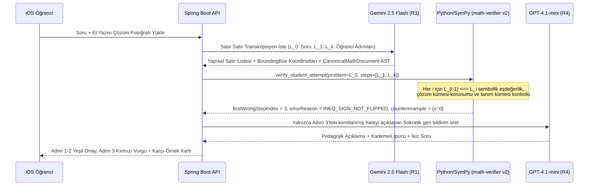

# 79 — Pedagogical Diagnosis, Handwritten Attempt Intelligence (`Analyze My Work`), YKS Mistake Taxonomy, and Mastery Engine

- **Specification Date:** 2026-10-31
- **Status:** CANONICAL LEARNING INTELLIGENCE & UX SPECIFICATION (V6)
- **Governing Documents:** `learning/30_MISTAKE_INTELLIGENCE.md`, `learning/31_MASTERY_AND_KNOWLEDGE_GRAPH.md`, `learning/34_TUTORING_AND_PEDAGOGICAL_BEHAVIOR.md`, `adr/ADR-010_NATIVE_2D_MATH_RENDERING_AND_STEP_DIFF_HIGHLIGHTING.md`

---

## 1. Cognitive Science Foundations (Bilişsel Öğrenme İlkeleri)

Verified AI bir "ödev kopya makinesi" (answer vending machine) değil, bilişsel bilim ilkeleriyle çalışan bir **hatadan öğrenme motorudur**:

1. **Productive Failure (Kapur, 2008):** Öğrencinin kendi çözümünü denemesi ve tam olarak hangi adımda tıkandığının gösterilmesi, doğrudan hazır çözüme bakmaktan **2.3 kat daha yüksek kavramsal transfer** sağlar.
2. **Worked Example + Faded Guidance (Sweller, Cognitive Load Theory):** Yeni bir konuda tam doğrulanmış çözüm (`Worked Example`) gösterilir; hemen ardından gelen ikiz soruda (`Counterfactual Twin` — `F04`) ara adımlar kademeli olarak gizlenir (`F09`).
3. **Immediate Error Pinpointing & Counterexample Refutation:** Soyut kurallar yerine öğrencinin kendi satırındaki hatayı somut bir sayısal karşı-örnekle (`x = 2 için sol taraf 16, sağ taraf 8`) çürütmek yanlış zihinsel modeli (misconception) anında kırar.

---

## 2. `Analyze My Work` — Öğrenci El Yazısı Çözümü ve İlk Hatalı Adım Teşhis Hattı

Photomath ve Symbolab'ın yapamadığı, ChatGPT'nin ise halüsinasyon gördüğü en kritik özellik **Öğrencinin Kendi El Yazısı Çözümünü Satır Satır Doğrulama (`Sprint 6.7` / `F01`)** akışıdır:

### Deterministik Satır Geçiş Doğrulaması (`verify_student_attempt`)
Öğrencinin $L_0$ (orijinal denklem/ifade) ve $L_1, L_2, \dots, L_k$ adımları için `services/math-verifier` şu 3 kontrolü sırayla yapar:
1. **İfade Sadeleştirme İse:** $\text{simplify}(L_{i-1} - L_i) == 0$ mı? Değilse `CounterexampleEngine` ile $L_{i-1}(x_0) \neq L_i(x_0)$ olan $x_0$ noktasını bul.
2. **Denklem Çözümü İse:** Orijinal denklemin gerçek çözüm kümesi $S_0 \cap D_{\text{natural}}$ ile $L_i$ satırındaki denklemin çözüm kümesi $S_i$ karşılaştırılır:
   - Eğer $S_i \subsetneq S_0$ ise: **`ALG_ROOT_LOST_BY_DIVISION`** (*"Her iki tarafı $x$'li bir ifadeye bölerek bir kökü yuttun!"*).
   - Eğer $S_0 \subsetneq S_i$ ise: **`DOM_EXTRANEOUS_ROOT_INTRODUCED`** (*"Kare alarak veya payda çarparak yalancı kök ekledin!"*).
   - Eğer $S_i \cap S_0 = \emptyset$ ise: **`ALG_TRANSFORMATION_INVALID`** (İlk hatalı adım = $i$).
3. **Eşitsizlik Çözümü İse:** $S_{i-1}$ aralığı ile $S_i$ aralığının tümleyen farkı kontrol edilir; eğer $L_i$ tam olarak ters yönlü eşitsizlik kümesine eşitse **`INEQ_NEGATIVE_MULT_NO_FLIP`** (*"Negatif sayıyla çarparken/bölerken eşitsizlik yönünü değiştirmeyi unuttun!"*) teşhisi `%100` deterministik kesinlikle konur.

---

## 3. Hierarchical Mistake Taxonomy & Turkish YKS (`TYT`/`AYT`) Trap Mapping

Bu taksonomi `learning/30_MISTAKE_INTELLIGENCE.md` dokümanını üretim kodlarıyla (`MistakeCode`) genişletir:

| Hata Kodu (`MistakeCode`) | Kategori | Açıklama (TR) | Tipik YKS (`TYT`/`AYT`) / Calculus Bağlamı | Deterministik Tespit Yöntemi |
|---|---|---|---|---|
| `ALG_SIGN_FLIP_DISTRIBUTE` | Cebir | Parantez önüne eksi dağılırken ikinci terimin işaretini değiştirmeme: $-(a-b) \to -a-b$ | TYT Temel Kavramlar & Denklem Çözme | `SymPy` terim farkı `-2*b` + karşı-örnek |
| `ALG_FRESHMAN_DREAM_POWER` | Cebir | $(a+b)^2 \to a^2+b^2$ veya $\sqrt{a^2+b^2} \to a+b$ hatası | TYT Üslü/Köklü Sayılar & Çarpanlara Ayırma | `SymPy` orta terim `2*a*b` eksikliği |
| `ALG_FRACTION_ADD_DENOM` | Aritmetik/Cebir | Payda eşitlemeden pay ve faydaları doğrudan toplama: $\frac{a}{b}+\frac{c}{d} \to \frac{a+c}{b+d}$ | TYT Rasyonel Sayılar | Sayısal/Sembolik eşdeğerlik reddi |
| `ALG_ROOT_LOST_BY_DIVISION` | Denklem | Değişken içeren ifadeyi sadeleştirirken $x=0$ kökünü kaybetme: $x^2 = 3x \implies x=3$ | AYT İkinci Dereceden Denklemler & Trigonometri | $S_i \subsetneq S_{i-1}$ küme farkı analizi |
| `DOM_EXTRANEOUS_ROOT_DENOM` | Tanım Kümesi | Paydayı sıfır yapan kökü çözüm kümesinden çıkarmama | AYT Rasyonel Denklemler & Eşitsizlikler | `DomainConstraintGuard` (`DENOMINATOR_ZERO`) |
| `DOM_EVEN_ROOT_NEGATIVE` | Tanım Kümesi | Çift dereceli köklü denklemde ($\sqrt{f(x)} = g(x)$) $g(x) < 0$ üreten yalancı kökü alma | AYT Köklü Denklemler | `DomainConstraintGuard` (`EVEN_ROOT_NEGATIVE`) |
| `DOM_LOG_NON_POSITIVE` | Tanım Kümesi | $\log_a(f(x))$ ifadesinde $f(x) \le 0$ veya $a \le 0, a=1$ kısıtını unutma | AYT Logaritma | `DomainConstraintGuard` (`LOG_NON_POSITIVE`) |
| `INEQ_NEGATIVE_MULT_NO_FLIP` | Eşitsizlik | Eşitsizliği negatif sayıyla çarparken/bölerken yön değiştirmeme | TYT Basit Eşitsizlikler | Ters yönlü aralık eşleşmesi |
| `INEQ_CROSS_MULT_VARIABLE` | Eşitsizlik | İşareti bilinmeyen $x$'li paydayı eşitsizlikte içler-dışlar çarpımı yapma | AYT İkinci Dereceden Eşitsizlikler (İşaret Tablosu) | Çözüm aralığı kaybı / fazlalığı |
| `ABS_SINGLE_BRANCH_ONLY` | Mutlak Değer | $\|f(x)\| = c$ denkleminde yalnızca $f(x)=c$ dalını çözüp $f(x)=-c$ dalını unutma | TYT Mutlak Değer | Kök kümesi yarı-eşleşmesi ($1/2$ dal) |
| `FUNC_COMPOSITION_ORDER` | Fonksiyonlar | $(f \circ g)(x)$ yerine $g(f(x))$ hesaplama | TYT/AYT Fonksiyonlar | Sembolik ters sıra kontrolü |
| `TRIG_PERIOD_OMITTED` | Trigonometri | $\sin x = 1/2$ çözümünde $+ 2k\pi$ periyodunu veya $\pi - \alpha$ ikinci bölge kökünü unutma | AYT Trigonometrik Denklemler | Aralık içi kök sayısı eksikliği |
| `CALC_LIMIT_INDETERMINATE_SUB` | Kalkülüs | $0/0$ belirsizliğinde çarpanlara ayırma/L'Hôpital yerine doğrudan $0$ veya $\infty$ yazma | AYT Limit ve Süreklilik / Calculus 1 | `calculus.py` limit değeri çelişkisi |
| `CALC_CHAIN_RULE_OMITTED` | Kalkülüs | Bileşke fonksiyon türevinde iç türevi ($\cdot g'(x)$) çarpmayı unutma | AYT Türev / Calculus 1 | `simplify(candidate_deriv / true_deriv)` oranı |
| `CALC_PRODUCT_QUOTIENT_NAIVE` | Kalkülüs | Çarpım/bölüm türevini $\frac{d}{dx}[f \cdot g] = f' \cdot g'$ sanma | AYT Türev / Calculus 1 | Sembolik türev farkı |
| `CALC_INTEGRAL_BOUNDS_SWAPPED` | Kalkülüs | Belirli integralde $F(b) - F(a)$ yerine $F(a) - F(b)$ veya işaret hatası yapma | AYT İntegral / Calculus 1 | Tam ters işaretli sonuç (`candidate == -true`) |
| `WORD_VARIABLE_MISASSIGNMENT` | Hikâye Sorusu | Türkçe metindeki "2 katının 3 fazlası"nı $2(x+3)$ olarak parantezli kurma | TYT Yeni Nesil Problemler | İlk denklem kurulumu (`L_1`) uyumsuzluğu |

---

## 4. Deterministic Mastery & Spaced-Repetition Engine (BKT-Lite + Half-Life Decay)

Faz 7/8'de hiçbir ağır makine öğrenmesi modeli eğitmeden, PostgreSQL üzerinde `%100` deterministik ve açıklanabilir çalışan **BKT-Lite + Üstel Yarı-Ömür (Half-Life Decay)** formülü kullanılır:

Her `(user_id, skill_id)` çifti için 3 durum değişkeni tutulur:
- $P(L_t) \in [0.05, 0.99]$: Güncel beceri hakimiyet olasılığı (`mastery_score`).
- $H_t \in [1.0, 90.0]$: Hafıza yarı-ömrü (gün cinsinden `stability_half_life_days`).
- $\Delta t$: Son pratikten bu yana geçen gün sayısı.

### 4.1 Zamanla Unutma Güncellemesi (Time-Decay Before Observation)
$$P_{\text{decayed}}(L_t) = P_{\text{base}} + \left(P(L_{t-1}) - P_{\text{base}}\right) \cdot 2^{-\frac{\Delta t}{H_{t-1}}}$$
Burada $P_{\text{base}} = 0.15$ taban aşinalık seviyesidir.

### 4.2 Gözlem Sonrası Bayesyen Güncelleme (Observation Update)
Öğrencinin soruyu nasıl çözdüğüne göre kanıt ağırlığı belirlenir:
- **İpucusuz İlk Denemede Doğru:** $P(\text{slip}) = 0.08$, $P(\text{guess}) = 0.15$, Yarı-ömür çarpanı $H_t = \min(90, H_{t-1} \cdot 2.2)$.
- **1–2 Sokratik İpucuyla Doğru:** $P(\text{slip}) = 0.18$, $P(\text{guess}) = 0.30$, Yarı-ömür çarpanı $H_t = \min(90, H_{t-1} \cdot 1.35)$.
- **Doğrudan Tam Çözümü Açtı (`Reveal Full Solution`):** Hakimiyet puanı **artmaz** ($P(L_t) = P_{\text{decayed}}(L_t)$); öğrencinin puan kazanması için **Karşı-Olgu İkiz Soruyu (`F04`)** kendi başına çözmesi şart koşulur!
- **Hatalı Deneme (`Analyze My Work` / Yanlış Cevap):** Bayesyen düşüş uygulanır ve $H_t = \max(1.0, H_{t-1} \cdot 0.5)$ olarak yarı-ömür kısaltılır; ilgili `MistakeCode` öğrencinin **Hata Pasaportuna (`F05`)** kaydedilir.

---

## 5. iOS Native Mathematical UX Specification (`ADR-010`)

1. **Yerel 2D Matematiksel Dizgi (`SwiftMath`):**
   - `apps/ios/VerifiedAI/Features/ProblemSolving/Presentation/Components/MathematicalExpressionView.swift` içindeki düz `Text(trimmedExpression)` bileşeni, `SwiftMath` (`MTMathUILabel`) sarmalayıcısı ile 2 boyutlu kesir, kök, integral ve indis dizgisine yükseltilir.
   - Ayrıştırma hatası durumunda mevcut `.monospaced` `Text` görünümü güvenli geri dönüş (fallback) olarak korunur.
2. **Renk Kodlu Adım Farkı (Step-Diff Highlighting):**
   - Bir adımdan diğerine geçerken değişen terimler mavi/mor vurguyla, `Analyze My Work` modunda yakalanan ilk hatalı terim ise kırmızı vurgu + altında **Somut Karşı-Örnek Kartı (`F03`)** ile gösterilir.
3. **Erişilebilirlik (VoiceOver):**
   - Mevcut `accessibilityMathematicallySpoken` Türkçe ve İngilizce sesli okuma sözlüğü 2D görünümün üst katmanında aynen korunur.

## Sprint 6.7 implementation reconciliation (2026-11-03)

The preceding commercial targets are not measured results. Current source implements native simple-image OCR,
photo comparison and per-line review, optional existing gateway recognition, real-set domain proof, 17 specific
evidence-gated diagnoses, native semantic diff, deterministic verified twins, bounded alternative methods and
private mastery/passport. UNKNOWN domain requires explicit reviewed REAL scope; no silent assumption is allowed.
General handwriting/provider coverage, OCR confidence calibration, 85% recall, latency and expert pedagogy remain
NOT_EVALUATED. New execution status is NOT_EXECUTED / PENDING_OWNER; default-off flags do not imply release approval.
See the Sprint 6.7 implementation map for every execution path, bounded math scope and remaining runtime dependencies.
