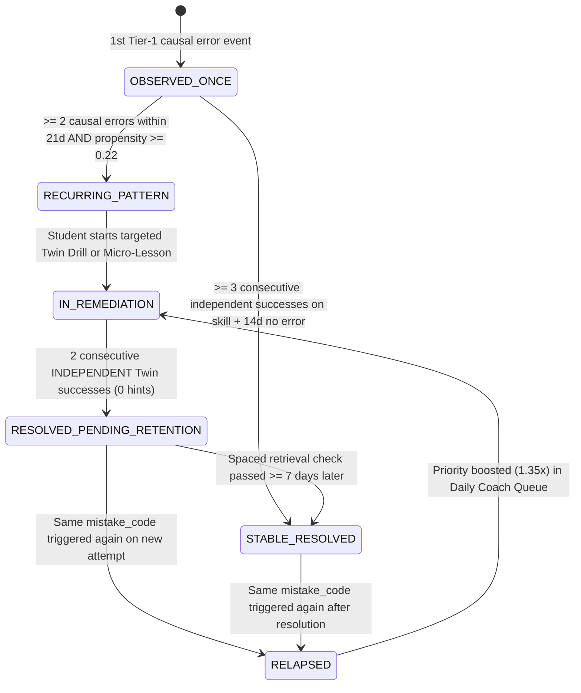

# 83 — Verified Mistake DNA and Mistake Passport Specification

## Document Metadata

| Field | Value |
|---|---|
| **Document ID** | `DOC-83` |
| **Canonical Path** | `learning/83_VERIFIED_MISTAKE_DNA_AND_MISTAKE_PASSPORT_SPECIFICATION.md` |
| **Title** | Verified Mistake DNA and Mistake Passport Specification |
| **Status** | `CANONICAL_LEARNING_SPECIFICATION` (`SPRINT_7_4_SOURCE_COMPLETE_SPRINT_7_5_TO_7_10_PLANNED`) |
| **Owner** | Senior Mathematics Verification Engineer & Learning Systems Architect |
| **Date / Version** | `2026-11-07` / `v1.0.0` |
| **Baseline Commit** | `e39bafe88ea369f98c96a65497a94462dc79ef33` (`main`) |
| **Governing ADRs** | `adr/ADR-004_SEPARATE_PYTHON_MATH_VERIFIER.md`, `adr/ADR-009_CANONICAL_SOLUTION_SET_ALGEBRA_AND_DOMAIN_GUARD.md`, `adr/ADR-010_NATIVE_2D_MATH_RENDERING_AND_STEP_DIFF_HIGHLIGHTING.md`, `adr/ADR-011_FOCUSED_V1_COMMERCIAL_LAUNCH_GATE_BEFORE_PHASE_08_13.md` |

---

## 1. Purpose

This specification defines the **Verified Mistake DNA** (internal longitudinal learner misconception model) and the **Mistake Passport** (learner-facing "Exam Trap Radar & Conquered Traps" experience).

Unlike conventional homework apps that store a flat list of failed questions or generic AI tutors that summarize chat logs into vague prose, the Verified Mistake DNA is a **mathematically grounded, exposure-adjusted, causally filtered ledger of specific mathematical misconceptions** anchored in deterministic step evaluations (`V035`) and versioned mistake classifications (`V036`).

---

## 2. Sources and Evidence Classification

- `SOURCE_VERIFIED`: Directly verified against `services/api/src/main/java/com/verifiedai/mistake/MistakeTaxonomy.java`, `services/api/src/main/java/com/verifiedai/attempt/AttemptMistakeClassification.java`, `services/api/src/main/resources/db/migration/platform/V031__add_pedagogical_diagnosis_twin_drills_and_mastery.sql`, `V035__attempt_evaluations.sql`, `V036__attempt_mistake_classifications.sql`, and `learning/30_MISTAKE_INTELLIGENCE.md`.
- `EMPIRICAL_RESEARCH`: Grounded in error-analysis and formative feedback literature (Education Endowment Foundation *Teacher Feedback to Improve Pupil Learning*; Metcalfe, 2017, *Learning from Errors*, Annual Review of Psychology).
- `ENGINEERING_ESTIMATE`: Schema extensions (`V037+`), aggregation query budgets, and state-transition thresholds for Sprints `7.5`–`7.10`.
- `FOUNDER_HYPOTHESIS`: Product adoption and retention lift from non-stigmatizing "Exam Trap Passport" framing.

---

## 3. Existing Architecture Relationship (`SOURCE_VERIFIED`)

### 3.1 Implemented Foundation in `V030`–`V036`
1. **`V030__create_student_attempt_and_step_verification_lifecycle.sql`**: Persists `student_attempts` and `student_attempt_steps` (`step_index`, `raw_latex`, `canonical_latex`, `step_verdict`, `error_code`, `counterexample_json`).
2. **`V031__add_pedagogical_diagnosis_twin_drills_and_mastery.sql`**: Persists `learner_mistake_events` (`id`, `user_id`, `attempt_id`, `step_number`, `error_code`, `taxonomy_version`, `canonical_skill_code`, `severity`, `remediated`, `remediated_by_twin_id`, `created_at`) and `learner_skill_mastery`.
3. **`V035__attempt_evaluations.sql`**: Persists `attempt_evaluations` (`evaluation_version = 'attempt-evaluation-v1'`, `overall_outcome`, `first_error_step_index`, `step_evaluations_json`).
4. **`V036__attempt_mistake_classifications.sql`**: Persists `attempt_mistake_classifications` (`classification_version = 'attempt-mistake-classification-v1'`, `policy_version = 'evidence-classifier-v1'`, `taxonomy_version = 'attempt-taxonomy-v2'`, `category_version = 'mistake-category-v1'`, `primary_mistake_code`, `primary_category`, `primary_skill_code`, `confidence`, `classification_status`, `evidence_status`, `step_classifications_json`).
5. **`com.verifiedai.mistake.MistakeTaxonomy` (`SOURCE_VERIFIED`)**:
   - Defines 10 canonical `Category` values: `ALGEBRAIC_MANIPULATION`, `ARITHMETIC_SLIP`, `SIGN_ERROR`, `DOMAIN_RESTRICTION`, `INEQUALITY_DIRECTION`, `FUNCTION_AND_TRANSFORMATION`, `CALCULUS_RULE_APPLICATION`, `LOGICAL_EQUIVALENCE`, `PROBLEM_INTERPRETATION`, `UNCLASSIFIED`.
   - Defines 17 specific mistake codes (including `ALG_SIGN_FLIP_DISTRIBUTE`, `ALG_FRACTION_ADD_DENOM`, `ALG_INVALID_CANCELLATION`, `ALG_SQUARE_BOTH_SIDES_EXTRANEOUS`, `ALG_LOST_ROOT_DIVISION`, `ALG_DOMAIN_EXCLUSION_MISSED`, `ALG_QUADRATIC_FORMULA_MISAPPLIED`, `INEQ_NEGATIVE_MULT_NO_FLIP`, `FUNC_COMPOSITION_ORDER`, `CALC_CHAIN_RULE_OMITTED`, `CALC_PRODUCT_RULE_MISAPPLIED`, `CALC_CONSTANT_INTEGRATION_OMITTED`, `ARITH_BASIC_COMPUTATION`, `STEP_NON_EQUIVALENT_TRANSFORM`, `STEP_GAP_TOO_WIDE`, `FINAL_ANSWER_MISMATCH_ONLY`, `UNCLASSIFIED`).

### 3.2 What Remains to Complete the Mistake DNA Engine (Sprints `7.5`–`7.10`)
While `V031` records individual `learner_mistake_events` and `V036` classifies single attempts, the platform still needs:
- **Sprint 7.5:** Longitudinal aggregation table (`learner_mistake_dna_profiles` / `learner_recurring_mistake_patterns` in `V037+`), exposure-adjusted rate computation, and recurrence state transitions.
- **Sprint 7.7:** Learner-facing Mistake Book & Mistake Passport API + iOS UI (`apps/ios/VerifiedAI/Features/MistakePassport/`).
- **Sprint 7.8:** Remediation loop closure linking Twin Drill independent completion back to Mistake DNA resolution.

---

## 4. Formal Mathematical Model of the Verified Mistake DNA

### 4.1 Causal First-Error Filtering Invariant (`INV-MDNA-001`)

Let an attempt $A$ consist of ordered student steps $S_1, S_2, \dots, S_k$ evaluated by `AttemptEvaluation` (`V035`).

1. **Primary Causal Error Only:** Only the step $S_{i^*}$ where $i^* = \text{first\_error\_step\_index}$ is eligible to emit a primary `CAUSAL_MISTAKE_EVENT` into the learner's Mistake DNA profile.
2. **Downstream Propagation Suppression:** Any subsequent step $S_j$ ($j > i^*$) marked as `DOWNSTREAM_PROPAGATION` (where the student applied a valid algebraic operation to the already-corrupted expression from $S_{i^*}$) **MUST NOT** increment mistake counts or lower skill mastery.
3. **Secondary errors:** deferred. Sprint 7.5 admits exactly one primary cause per evaluation, with no inferred confidence or secondary causal events.

### 4.2 Implemented Deterministic Evidence Eligibility (`INV-MDNA-002`)

Sprint 7.5 preserves V036's actual contract: SIGNATURE_SUPPORTED + DETERMINISTIC_EVIDENCE +
STRUCTURAL_AND_DISPROOF + AUTO_DETECTED, accepted evaluation/execution/source/work lineage, and a confirmed causal prefix.
There is no numeric classification confidence in V036. Earlier 0.80/0.65 tentative tiers are not implemented or inferred;
ambiguous, unsupported, generic disproof and review-required diagnoses have zero DNA/mastery mutation.
Only the five existing MistakeTaxonomy.SKILLS mappings are authoritative. Propensity also requires a matching accepted
primary skill for the exact canonical source, active compatible ontology and tag accepted before work submission.
Successful denominators require NO_ERROR_ESTABLISHED plus a verified final answer and all steps VALID_EQUIVALENT.
Missing tagging or unmapped errors remain auditable without a propensity. No secondary causal exceptions are implemented.
See the Sprint 7.5 specification and execution report for the complete eligible-cohort contract.

### 4.3 Exposure-Adjusted Recurring Mistake Rate (`INV-MDNA-003`)

Raw mistake counts punish active learners: a student who solves 100 rational equation problems and misses 5 domain exclusions (`ALG_DOMAIN_EXCLUSION_MISSED`) is far stronger than a student who solves 6 problems and misses 4, even though the first student has more raw errors ($5 > 4$).

For learner $u$, mistake code $m$, and mapped skill cluster $s(m)$:

1. **Exponentially Time-Decayed Exposure and Error Counts:**
   Given attempt timestamps $t_k$ and current time $t_{\text{now}}$, with mistake half-life $h_m = 21\text{ days}$:
   $$w_k = 2^{-(t_{\text{now}} - t_k) / h_m}$$
   $$N_{u, s(m)}^{\text{decayed}} = \sum_{k \in \text{Attempts}(u, s(m))} w_k, \qquad E_{u, m}^{\text{decayed}} = \sum_{k \in \text{CausalErrors}(u, m)} w_k$$

2. **Empirical Bayes (Beta-Binomial) Smoothed Mistake Propensity Score $\theta_{u,m} \in [0, 1]$:**
   $$\theta_{u,m} = \frac{E_{u,m}^{\text{decayed}} + \alpha_0 \mu_m}{N_{u, s(m)}^{\text{decayed}} + \alpha_0}$$
   where $\mu_m \in (0.02, 0.25)$ is the baseline prior error rate for mistake code $m$ (initialized at $0.10$) and $\alpha_0 = 4.0$ is the prior pseudocount strength.

3. **Future, unimplemented Severity-Weighted Priority Score $P_{u,m} \in [0, 100]$ (Used by Daily Coach & Study Planner):**
   $$P_{u,m} = 100 \cdot \theta_{u,m} \cdot \omega_{\text{severity}}(m) \cdot \omega_{\text{exam}}(s(m)) \cdot (1 - \rho_{\text{remediated}}(u,m))$$
   where:
   - $\omega_{\text{severity}}(m) = 1.0$ for structural misconceptions (`DOMAIN_RESTRICTION`, `INEQUALITY_DIRECTION`, `CALCULUS_RULE_APPLICATION`, `LOGICAL_EQUIVALENCE`), $0.85$ for `ALGEBRAIC_MANIPULATION` / `SIGN_ERROR`, and $0.50$ for isolated `ARITHMETIC_SLIP`.
   - $\omega_{\text{exam}}(s(m)) \in [0.5, 1.5]$ is the target exam frequency weight (e.g., high weight for AYT Limits/Derivatives or TYT Functions).
   - $\rho_{\text{remediated}}(u,m) \in [0, 0.75]$ is the verified twin remediation discount factor.

---

## 5. Mistake DNA Lifecycle & Recurrence State Machine

The six states are a forward contract. Sprint 7.5 only projects OBSERVED_ONCE and RECURRING_PATTERN,
including reversal after exclusion/decay. The other transitions below require Sprint 7.8 evidence and are not executable yet.
Removing all effective errors removes a profile without awarding resolution. Each owner/code/skill tuple is independent:

### 5.1 State Transition Rules (`SOURCE_VERIFIED` + `ENGINEERING_ESTIMATE`)

1. **`OBSERVED_ONCE`**: Logged in Mistake Book history, but not yet flagged as a systemic "Recurring Exam Trap" unless severity is `HIGH` (`ALG_DOMAIN_EXCLUSION_MISSED`, `INEQ_NEGATIVE_MULT_NO_FLIP`, `CALC_CHAIN_RULE_OMITTED`).
2. **`RECURRING_PATTERN`**: Triggered when raw causal count in the last 21 days is $\ge 2$ AND smoothed propensity $\theta_{u,m} \ge 0.22$. Appears in the top **Active Exam Traps** section of the Mistake Passport.
3. **`IN_REMEDIATION`**: Active while the learner has an assigned Counterfactual Twin pack or micro-lesson open.
4. **`RESOLVED_PENDING_RETENTION`**: Achieved ONLY when the student completes at least **two verified independent attempts** (`evidence_type = 'INDEPENDENT'`, zero hints, solution not revealed prior to submission) on problems exercising the exact mistake hazard without repeating error $m$.
5. **`STABLE_RESOLVED` ("Conquered Trap Badge")**: Awarded when the learner passes a delayed spaced-retrieval check at least $\Delta t \ge 7\text{ days}$ after initial remediation.
6. **`RELAPSED`**: If the learner commits mistake $m$ again after reaching `RESOLVED_PENDING_RETENTION` or `STABLE_RESOLVED`, the pattern transitions to `RELAPSED`, scheduling an immediate 48-hour spaced review twin.

---

## 6. Learner Dispute, OCR Correction, and Rollback Contract

Handwriting OCR and camera captures can misread a minus sign, exponent, or subscript. If a student is falsely accused of a mistake due to an OCR misread, trust collapses immediately.

### 6.1 Self-Service Dispute Actions (`INV-MDNA-004`)
The existing Attempt Analysis offers “Edit misread step” and “Report incorrect diagnosis”. V035/V036 rows are never
modified. V037 append-only dispute/correction operations and V034 revision lineage define effective exclusion.
Dispute atomically excludes the whole observation from both error/exposure counts and rebuilds profiles. OCR correction
atomically saves replacement work, excludes the prior revision and returns REEVALUATION_REQUIRED; the learner then invokes
existing evaluation/classification actions. Late results for superseded work cannot restore it. These paths create no
mastery side effects, so there is no speculative mastery rollback or automatic golden-dataset/training export.
The <250 ms rollback objective is unverified until owner execution; local synthetic and staging latency are distinct.

---

## 7. Psychological Safety and Non-Stigmatizing UX Design

Grounded in EEF metacognition research (`EMPIRICAL_RESEARCH`), labeling a teenager with "High Failure Rate" or "Chronic Weakness" triggers avoidance and subscription churn.

### 7.1 Mandatory Framing Rules
1. **Externalize the Hazard as an "Exam Trap" (`Sınav Tuzağı`):**
   - *Forbidden copy:* "You are bad at inequalities" or "Failure score: 78%."
   - *Required copy:* **"Active Exam Trap: Negative Multiplier Direction Flip (`Eşitsizlik Yön Değiştirme Tuzağı`)"** -> *"Exam writers design distractors around this step. Solve 1 Independent Twin to lock your Trap Shield."*
2. **Celebrate Resolution Velocity:**
   - The primary KPI shown on the student's Mistake Passport header is **"Conquered Exam Traps (`Kapatılan Tuzaklar`): $K$"** and **"Independent Transfer Rate (`Bağımsız Doğrulama Oranı`): $X\%$"**, emphasizing growth and agency.

---

## 8. Curriculum & Ontology Versioning Contract

As `domain/46_CURRICULUM_SKILL_ONTOLOGY_AND_TAXONOMY.md` and `MistakeTaxonomy.java` evolve from `mistake-category-v1` (17 codes, 5 explicit skill mappings) to broader YKS TYT/AYT and IB/AP coverage (`mistake-category-v2`, 45+ codes):
- Every row in `attempt_mistake_classifications` (`V036`) and `learner_mistake_dna_profiles` (`V037+`) stores immutable `taxonomy_version` and `category_version`.
- Forward-compatible migration maps (`MistakeTaxonomyMigrationRegistry`) deterministically re-project historical `learner_mistake_events` when a broad code is split or mapped to a finer `canonical_skill_code`, without losing historical remediation streaks.

---

## 9. Future Implementation Mapping (Phase 7 Sprints)

| Sprint | Target Deliverables | Primary Backend / iOS Owners |
|---|---|---|
| **Sprint 7.4** *(Source Complete, Pending Owner Test)* | `AttemptMistakeClassification` (`V036`), `MistakeTaxonomy` (`mistake-category-v1`), `AttemptMistakeClassifier`. | `com.verifiedai.attempt`, `com.verifiedai.mistake` |
| **Sprint 7.5** | `V037` `learner_mistake_dna_profiles` table, exposure-adjusted Beta-Binomial rate calculator, recurrence state machine (`OBSERVED_ONCE`..`RELAPSED`), OCR dispute rollback service. | `com.verifiedai.mistake`, `com.verifiedai.attempt` |
| **Sprint 7.6** | Integration of Mistake DNA state transitions with `LearnerMasteryPolicy` (`bkt-lite-v1`) and skill graph propagation. | `com.verifiedai.mastery`, `com.verifiedai.attempt` |
| **Sprint 7.7** | Mistake Passport & Mistake Book REST API (`/v1/mistake-passport`, `/v1/mistakes/{id}/dispute`) and native iOS `MistakePassportView`. | `com.verifiedai.mistake`, `apps/ios/VerifiedAI/Features/AttemptAnalysis` |
| **Sprint 7.8** | Closed-loop remediation trigger connecting `counterfactual_twin_drills` (`V031`) independent pass to `RESOLVED_PENDING_RETENTION`. | `com.verifiedai.attempt`, `com.verifiedai.studyplan` |
| **Sprint 7.9 / 7.10** | Learner Mistake DNA analytics, calibration audit, and Phase 7 exit gate verification. | `com.verifiedai.analytics` |

---

## 10. Requirements, Assumptions, Non-Goals, and Acceptance Criteria

### 10.1 Requirements
- `MDNA-REQ-001`: Downstream propagated errors (`step_index > first_error_step_index` with `DOWNSTREAM_PROPAGATION`) must never create a recurring mistake entry.
- `MDNA-REQ-002`: Mistake ranking must use the exposure-adjusted Empirical Bayes rate $\theta_{u,m}$, never raw unnormalized error counts.
- `MDNA-REQ-003`: Learner OCR correction or dispute targets reversal of effective Mistake DNA within $< 250\text{ ms}$ p95.
- `MDNA-REQ-004`: Transitioning a recurring mistake to `RESOLVED_PENDING_RETENTION` requires $\ge 2$ verified `INDEPENDENT` completions (0 hints, no prior solution reveal).

### 10.2 Explicit Assumptions & Non-Goals
- **Assumption `A-MDNA-01`:** A 21-day half-life ($h_m = 21\text{d}$) and pseudocount $\alpha_0 = 4.0$ provide stable ranking for students solving 5–30 problems per week (to be calibrated in `Sprint 7.9`).
- **Non-Goal:** Sharing raw mistake logs publicly or with unauthorized third parties.

### 10.3 Acceptance Criteria
1. Deterministic unit tests verify that 10 downstream propagated steps after a single Step 1 sign flip produce exactly **1** causal mistake event.
2. Deterministic unit tests verify that a learner with 2 errors in 3 attempts ranks higher in mistake propensity than a learner with 3 errors in 40 attempts.
3. Disputing or correcting an OCR step deterministically restores the pre-attempt Mistake DNA state.

---

## 11. Risks and Open Decisions

- **Risk `R-MDNA-01` (Sparse Skill Mapping in `mistake-category-v1`):** MistakeTaxonomy explicitly maps five codes; unmapped codes retain a null skill and are never assigned a fallback skill.
  - *Mitigation:* Sprint 7.5 preserves those five mappings and refuses propensity without matching accepted source-skill provenance. Broader mappings need a separate versioned contract.
- **Open Decision `OD-MDNA-01`:** Whether `ARITH_BASIC_COMPUTATION` slips should appear in the primary Mistake Passport view or in a secondary "Carelessness / Speed Audit" tab (recommended: secondary tab so structural conceptual traps remain front-and-center).

---

## 12. Cross-References

- `learning/30_MISTAKE_INTELLIGENCE.md`
- `learning/31_MASTERY_AND_KNOWLEDGE_GRAPH.md`
- `learning/79_PEDAGOGICAL_DIAGNOSIS_HANDWRITING_UX_AND_RETENTION_ENGINE.md`
- `learning/84_VERIFIED_TWIN_PRACTICE_AND_INDEPENDENT_LEARNING_ENGINE.md`
- `learning/85_PERSONAL_AI_MATHEMATICS_COACH_AND_DAILY_LEARNING_EXPERIENCE.md`
- `learning/86_LEARNING_OUTCOMES_RETRIEVAL_PRACTICE_AND_MASTERY_EVALUATION.md`
- `architecture/90_LEARNING_OS_DOMAIN_CONTRACTS_AND_PLATFORM_INTEGRATION.md`
- `sprints/phase07_attempt_mistake_and_mastery_intelligence/SPRINT_7.5_AUTOMATIC_MISTAKE_BOOK_AND_REVIEW_WORKFLOWS.md`
- `sprints/phase07_attempt_mistake_and_mastery_intelligence/SPRINT_7.9_MASTERY_AND_MISTAKE_DASHBOARD_UX.md`
