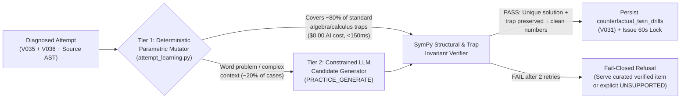

# 84 — Verified Twin Practice and Independent Learning Engine

## Document Metadata

| Field | Value |
|---|---|
| **Document ID** | `DOC-84` |
| **Canonical Path** | `learning/84_VERIFIED_TWIN_PRACTICE_AND_INDEPENDENT_LEARNING_ENGINE.md` |
| **Title** | Verified Twin Practice and Independent Learning Engine |
| **Status** | `CANONICAL_LEARNING_AND_VERIFICATION_SPECIFICATION` |
| **Owner** | Senior Mathematics Verification Engineer & AI Systems Architect |
| **Date / Version** | `2026-11-07` / `v1.0.0` |
| **Baseline Commit** | `e39bafe88ea369f98c96a65497a94462dc79ef33` (`main`) |
| **Governing ADRs** | `adr/ADR-004_SEPARATE_PYTHON_MATH_VERIFIER.md`, `adr/ADR-003_PROVIDER_NEUTRAL_AI.md`, `adr/ADR-009_CANONICAL_SOLUTION_SET_ALGEBRA_AND_DOMAIN_GUARD.md`, `adr/ADR-011_FOCUSED_V1_COMMERCIAL_LAUNCH_GATE_BEFORE_PHASE_08_13.md` |

---

## 1. Purpose

This specification defines the **Verified Twin Practice and Independent Learning Engine**: the subsystem responsible for generating mathematically verified isomorphic practice problems ("Counterfactual Twins") tailored to a learner's exact diagnosed misconception, enforcing the **60-Second Independent Verification Protocol**, and classifying the resulting learning evidence into strict epistemic categories (`INDEPENDENT`, `HINT_ASSISTED`, `SOLUTION_REVEALED_ASSISTED`, `UNSUPPORTED`).

This engine is the core pedagogical defense against the "AI crutch effect" documented by Bastani et al. (2025, `10.1073/pnas.2422633122`): a student who views an explanation or hint on Problem $P$ has **not** demonstrated learning until they independently solve a structurally isomorphic Problem $P'$ that contains the exact same mathematical trap.

---

## 2. Sources and Evidence Classification

- `SOURCE_VERIFIED`: Directly verified against `services/api/src/main/resources/db/migration/platform/V031__add_pedagogical_diagnosis_twin_drills_and_mastery.sql` (`counterfactual_twin_drills`), `services/math-verifier/app/verifiers/attempt_learning.py`, `services/math-verifier/app/counterexample_engine.py`, `services/api/src/main/java/com/verifiedai/attempt/AttemptLearningEvidence.java`, and `services/api/src/main/java/com/verifiedai/attempt/LearnerMasteryPolicy.java`.
- `EMPIRICAL_RESEARCH`: Grounded in Bastani et al. (2025, PNAS `10.1073/pnas.2422633122`), Dunlosky et al. (2013, Retrieval Practice & Interleaved Practice), and Roediger & Karpicke (2006, Testing Effect).
- `ENGINEERING_ESTIMATE`: Latency budgets, deterministic vs. hybrid template fallback rates, and Phase 8 (`Sprint 8.2`) scaling parameters.

---

## 3. Existing Architecture Relationship (`SOURCE_VERIFIED`)

1. **Database Persistence (`V031`):**
   - Table `counterfactual_twin_drills` already exists in `V031` with columns: `id`, `source_attempt_id`, `user_id`, `target_error_code`, `canonical_skill_code`, `twin_prompt_latex`, `twin_canonical_expr`, `expected_solution_latex`, `trap_description`, `verification_hash`, `status` (`ISSUED`, `COMPLETED_PASSED`, `COMPLETED_FAILED`, `EXPIRED`), `lock_until`, `completed_attempt_id`, `created_at`, `completed_at`.
2. **Python Verifier Twin Generator (`services/math-verifier/app/verifiers/attempt_learning.py`):**
   - Currently implements deterministic parameter perturbation for initial error families (`ALG_SIGN_FLIP_DISTRIBUTE`, `INEQ_NEGATIVE_MULT_NO_FLIP`, `ALG_DOMAIN_EXCLUSION_MISSED`, `CALC_CHAIN_RULE_OMITTED`, etc.) and computes SymPy solutions and verification hashes.
3. **Backend Evidence & Mastery Policy (`com.verifiedai.attempt`):**
   - `AttemptLearningEvidence` and `LearnerMasteryPolicy` (`bkt-lite-v1`) already exist in `com.verifiedai.attempt`.
4. **Planned Expansion (`Sprint 7.8` & `Sprint 8.2`):**
   - Expand twin generation into a full 3-variant progressive ladder (**Variant A: Isomorphic Trap Twin**, **Variant B: Masked/Reversed Structural Twin**, **Variant C: Exam-Style Synthesis Twin**) with strict structural invariant verification across all 8 core math families.

---

## 4. Hybrid Generation Architecture: Deterministic-First + SymPy-Verified AI Synthesis

To guarantee **zero mathematical hallucination** and **low unit cost** (`ai/60_AI_UNIT_ECONOMICS_AND_INFERENCE_COST_ENGINEERING.md`), twin generation uses a two-tier pipeline:

### 4.1 Why Never Use Raw LLM Problem Generation?
When an unguarded LLM is asked to *"create a similar math problem,"* it frequently:
- Turns a factorable quadratic $x^2 - 5x + 6 = 0$ into an ugly irrational root equation $x^2 - 5x + 7 = 0$ with $\Delta < 0$.
- Eliminates the exact domain hole or extraneous root that caused the student's mistake.
- Hallucinates the answer key.

Therefore, **Tier 2 (LLM Candidate Synthesis)** only proposes candidate parameters or contextual wrappers; **SymPy (`services/math-verifier/`)** computes the ground-truth solution set (`ADR-009`) and asserts that every structural trap invariant holds before the problem is ever stored or shown to a learner.

---

## 5. Deep Mathematical Invariant Requirements Across 8 Core Families

Every generated twin $P'$ derived from source problem $P$ and mistake code $m$ MUST pass a family-specific **Structural Trap Equivalence Gate** in `services/math-verifier/`:

### 5.1 Rational Expressions & Equations (`ALG_DOMAIN_EXCLUSION_MISSED`, `ALG_INVALID_CANCELLATION`, `ALG_FRACTION_ADD_DENOM`)
- **Required Invariant:** If $P$ has a denominator $D(x)$ with excluded real roots $R_{\text{excl}} = \{x \in \mathbb{R} : D(x) = 0\} \neq \emptyset$ and/or a removable discontinuity (hole) where numerator $N(r) = 0$ and $D(r) = 0$ at $r \in R_{\text{excl}}$, then $P'$ **MUST**:
  1. Possess a non-empty real excluded domain $R'_{\text{excl}} \neq \emptyset$ with integer or simple rational exclusions ($|r'| \le 12$, denominator $\le 6$).
  2. Preserve the removable hole structure $(x - r')$ in both numerator and denominator if the diagnosed mistake was cancelling $(x - r)$ without recording $x \neq r$.
  3. Have a verified canonical solution set $S(P') = S_{\text{naive}}(P') \setminus R'_{\text{excl}}$ where $S_{\text{naive}}(P') \cap R'_{\text{excl}} \neq \emptyset$ (ensuring the trap actually bites if the student forgets the domain restriction!).

### 5.2 Radical & Logarithmic Equations (`ALG_SQUARE_BOTH_SIDES_EXTRANEOUS`, `ALG_LOST_ROOT_DIVISION`)
- **Required Invariant (Extraneous Root Trap):** For $\sqrt{ax + b} = cx + d$, squaring both sides yields a quadratic $Q(x) = 0$ with two roots $\{r_1, r_2\}$. The twin parameters $(a', b', c', d')$ **MUST** be chosen such that:
  1. $\Delta(Q') > 0$ is a perfect square (yielding clean rational/integer candidate roots $r'_1, r'_2$).
  2. Exactly one root satisfies $c'r'_1 + d' \ge 0$ (valid root) and the other satisfies $c'r'_2 + d' < 0$ (extraneous root). If both roots are valid, the extraneous-root trap disappears and the candidate twin is **REJECTED**.
- **Required Invariant (Lost Root Trap):** For equations of the form $(x - a) \cdot F(x) = (x - a) \cdot G(x)$, the twin must preserve a shared variable factor $(x - a')$ where $a'$ is a valid root in the domain, testing whether the student divides by $(x - a')$ and loses $x = a'$.

### 5.3 Absolute Value Equations & Inequalities (`ALG_ABSOLUTE_VALUE_BRANCH_MISSED`)
- **Required Invariant:** For $|A(x)| = B(x)$ or $|A(x)| \lessgtr B(x)$, the twin $P'$ must require splitting into both $A'(x) \ge 0$ and $A'(x) < 0$ branches, with non-trivial boundary check $B'(x) \ge 0$, and must yield clean rational critical points.

### 5.4 Linear & Rational Inequalities (`INEQ_NEGATIVE_MULT_NO_FLIP`)
- **Required Invariant:** The variable term coefficient immediately preceding isolation (or the leading coefficient product in a sign-chart rational inequality) **MUST** be strictly negative ($a' < 0$), so that failing to flip the inequality operator ($< \leftrightarrow >$, $\le \leftrightarrow \ge$) produces the exact complement interval $S_{\text{trap}}(P') \neq S_{\text{true}}(P')$.

### 5.5 Quadratic Equations & Parameter Analysis (`ALG_QUADRATIC_FORMULA_MISAPPLIED`)
- **Required Invariant:** Preserves the discriminant regime ($\Delta > 0$ rational roots, $\Delta > 0$ radical roots $p \pm \sqrt{q}$, or $\Delta = 0$ double root) and sign pattern of coefficients $(a', b', c')$ (specifically $b' < 0$ and $c' < 0$ when testing $-b \pm \sqrt{b^2 - 4ac}$ sign errors).

### 5.6 Differential Calculus (`CALC_CHAIN_RULE_OMITTED`, `CALC_PRODUCT_RULE_MISAPPLIED`)
- **Required Invariant:**
  - For `CALC_CHAIN_RULE_OMITTED` on $f(g(x))$, the inner function $g'(x)$ in the twin **MUST** satisfy $\frac{d}{dx}g'(x) \notin \{0, 1\}$ (so omitting $\cdot g''(x)$ alters the derivative everywhere on the domain).
  - Symbolic verifier pre-computes both the true derivative $\frac{d}{dx}[f'(g'(x))] = f''(g'(x)) \cdot g''(x)$ and the trap derivative $f''(g'(x))$ to immediately recognize if the student repeats the mistake on the twin.

### 5.7 Limits & Integrals (`CALC_CONSTANT_INTEGRATION_OMITTED`, Indeterminate Forms)
- **Required Invariant:**
  - For $0/0$ limits $\lim_{x \to a} \frac{P(x)}{Q(x)}$, the twin must satisfy $P'(a') = 0$ and $Q'(a') = 0$ with $Q''(a') \neq 0$ after factoring $(x - a')$.
  - For indefinite integrals $\int f(x)\,dx$, the verifier enforces canonical equivalence up to additive constant $+ C$ while flagging omission of $+ C$ when initial-value or general antiderivative form is required.

### 5.8 Explicit Fail-Closed Refusal Rule (`INV-TWIN-008`)
- If `services/math-verifier/` cannot synthesize and verify a structurally valid twin within **1,500 ms** (Tier 1 deterministic) or **3,500 ms** (Tier 2 hybrid), or if the source problem belongs to an unsupported non-algebraic geometry domain, the engine **MUST NOT** emit an unverified problem. Instead, it returns `twinStatus = 'UNAVAILABLE_FAIL_CLOSED'` and falls back to a pre-verified curated item from the canonical skill bank or records an explicit refusal without blocking the learner.

---

## 6. The 12-Step Twin Lifecycle & 60-Second Independent Lock

1. **Step 1 (Trigger):** Learner submits attempt $A_1$; `AttemptEvaluation` (`V035`) + `AttemptMistakeClassification` (`V036`) identify primary mistake $m$ at step $i^*$.
2. **Step 2 (Counterexample & Explanation):** Learner views the Step-Diff highlight (`ADR-010`) and concrete counterexample $x = c$.
3. **Step 3 (Twin Synthesis):** Backend invokes `attempt_learning.py` to generate Variant A (`ISOMORPHIC_TRAP_TWIN`) and persists it in `counterfactual_twin_drills` (`V031`) with `status = 'ISSUED'`.
4. **Step 4 (60-Second Solution Lock Initialization):** `lock_until` is set to `created_at + 60 seconds`. During this window, the "Reveal Full Solution" button on the twin is locked; the learner is invited to **Prove It Solo (`Tek Başına Kanıtla`)**.
5. **Step 5 (Attempt Submission on Twin):** Learner submits step-by-step or final work on Twin $A_2$.
6. **Step 6 (Symbolic Verification of Twin Attempt):** `attempt_verification_v2.py` evaluates $A_2$ against the twin's canonical solution set and checks whether trap $m$ was avoided.
7. **Step 7 (Evidence Classification):** The attempt is classified into one of the 4 canonical evidence types (Section 7).
8. **Step 8 (Mastery Update):** `LearnerMasteryPolicy` (`bkt-lite-v1`) applies the evidence-specific transition weight.
9. **Step 9 (Mistake DNA Update):** If `evidence_type == 'INDEPENDENT'` and outcome is `CORRECT`, `learner_mistake_events.remediated` is marked `true` (`remediated_by_twin_id = twin.id`) and the Mistake DNA state advances toward `RESOLVED_PENDING_RETENTION`.
10. **Step 10 (Progressive Ladder Escalation):** If the learner passes Variant A independently, the Coach offers Variant B (**Reversed/Masked Structural Twin**, e.g., *"Given that $x = 3$ is an extraneous root of $\sqrt{2x+k} = x-3$, find $k$"*) or schedules Variant B for the next spaced review window ($+48\text{ hours}$).
11. **Step 11 (Failure Escalation):** If the learner repeats mistake $m$ on Variant A, the system triggers a 90-second interactive **Micro-Lesson (`Sprint 8.5`)** before issuing a fresh Variant A2 twin.
12. **Step 12 (Spaced Retention Check):** 7 days later, `Sprint 8.3` Spaced Repetition Engine schedules a delayed verification twin to confirm transition from `RESOLVED_PENDING_RETENTION` to `STABLE_RESOLVED`.

---

## 7. Epistemic Classification of Learning Evidence (`INV-LRN-EVID-001`)

Every problem or twin completion in Verified AI is recorded with one of four mutually exclusive `LearningEvidenceType` values:

| Evidence Type | Exact Trigger Condition | Mastery Delta (`bkt-lite-v1`) | Mistake DNA Resolution Credit | UI Badge |
|---|---|---|---|---|
| **`INDEPENDENT`** | Learner solved correctly with **0 hints requested**, **no prior solution reveal** on the item, and verified valid steps/answer. | **100% full positive BKT update** ($P(L_t \mid \text{correct}_{\text{ind}})$); eligible to unlock mastery tiers $\ge 0.85$. | **Full credit** toward `RESOLVED_PENDING_RETENTION` and `STABLE_RESOLVED`. | **Verified Independent Shield (`Bağımsız Kanıtlandı`)** |
| **`HINT_ASSISTED`** | Learner solved correctly after requesting 1 or more Socratic/procedural hints, without revealing the bottom-out answer before submission. | **Discounted positive update** (slip/guess adjusted by hint depth factor $\gamma_{\text{hint}} \in [0.25, 0.50]$); **hard-capped at mastery score `0.78`** until an `INDEPENDENT` twin is passed. | Advances state to `IN_REMEDIATION` only; cannot mark a mistake `RESOLVED`. | **Guided Practice (`İpucu Destekli`)** |
| **`SOLUTION_REVEALED_ASSISTED`** | Learner revealed the bottom-out step solution or answer before completing the problem. | **Zero positive mastery gain ($\Delta \le 0$)**; records exposure and triggers mandatory Twin Issuance. | **Zero resolution credit.** | **Solution Viewed — Twin Required (`Çözüm İncelendi — İkiz Soru Bekliyor`)** |
| **`UNSUPPORTED`** | Problem or attempt fell outside symbolic verifier coverage, had illegible OCR (`AMBIGUOUS_INPUT`), or hit a system timeout. | **Strictly `0.0` mastery change** (`confidence` unchanged). | **Zero Mistake DNA change.** | **Unverified / Out of Scope (`Kapsam Dışı / Puan Etkilenmedi`)** |

---

## 8. Requirements, Assumptions, Non-Goals, and Acceptance Criteria

### 8.1 Requirements
- `TWIN-REQ-001`: Every twin stored in `counterfactual_twin_drills` (`V031`) must have a non-null `verification_hash` produced by `services/math-verifier/` confirming that its solution set is non-empty (unless testing no-solution detection) and its target trap is active.
- `TWIN-REQ-002`: `SOLUTION_REVEALED_ASSISTED` completions must never increase `learner_skill_mastery.score`.
- `TWIN-REQ-003`: `HINT_ASSISTED` completions must never push `learner_skill_mastery.score` above `0.78` (`PRACTICING` ceiling) without at least one subsequent `INDEPENDENT` pass on the same `canonical_skill_code`.

### 8.2 Explicit Assumptions & Non-Goals
- **Assumption `A-TWIN-01`:** 80%+ of high-school algebra, equations, functions, inequalities, and introductory calculus twin requests can be fulfilled by Tier 1 deterministic parametric templates in `< 150 ms` at `$0.00` LLM token cost.
- **Non-Goal:** Generating open-ended essay proofs or unverified geometric diagrams.

### 8.3 Acceptance Criteria
1. Golden test suite in `services/math-verifier/tests/` verifies that 100% of generated twins across all 8 families (Section 5) pass symbolic solution verification and preserve the target trap (e.g., extraneous root remains extraneous, negative inequality multiplier remains negative).
2. Backend unit tests in `LearnerMasteryPolicyTest` verify the `0.78` mastery cap for `HINT_ASSISTED` and `0.0` gain for `SOLUTION_REVEALED_ASSISTED`.

---

## 9. Risks and Open Decisions

- **Risk `R-TWIN-01` (Template Memorization on Repeated Failures):** If a student fails 4 twins in a row on the same skill, surface-level coefficient swapping may become predictable.
  - *Mitigation:* Maintain at least 3 distinct structural AST templates per mistake code (Variant A1, A2, B) and route to a 90-second interactive Micro-Lesson after 2 consecutive twin failures.
- **Open Decision `OD-TWIN-01`:** Whether Free-tier users receive 1 free Verified Twin per day or 3 free Verified Twins per week as part of the freemium conversion hook (`roadmap/88_LEARNING_OS_MONETIZATION_GROWTH_AND_VALIDATION_PLAN.md`).

---

## 10. Cross-References

- `domain/47_MATHEMATICAL_CANONICAL_REPRESENTATION.md`
- `learning/30_MISTAKE_INTELLIGENCE.md`
- `learning/31_MASTERY_AND_KNOWLEDGE_GRAPH.md`
- `learning/79_PEDAGOGICAL_DIAGNOSIS_HANDWRITING_UX_AND_RETENTION_ENGINE.md`
- `learning/83_VERIFIED_MISTAKE_DNA_AND_MISTAKE_PASSPORT_SPECIFICATION.md`
- `learning/85_PERSONAL_AI_MATHEMATICS_COACH_AND_DAILY_LEARNING_EXPERIENCE.md`
- `learning/86_LEARNING_OUTCOMES_RETRIEVAL_PRACTICE_AND_MASTERY_EVALUATION.md`
- `sprints/phase08_adaptive_learning_and_study_planning/SPRINT_8.2_ADAPTIVE_PRACTICE_QUESTION_SELECTION_AND_GENERATION.md`
