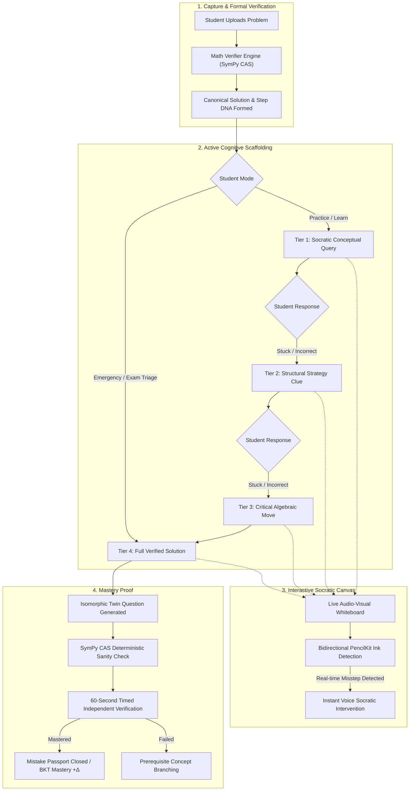
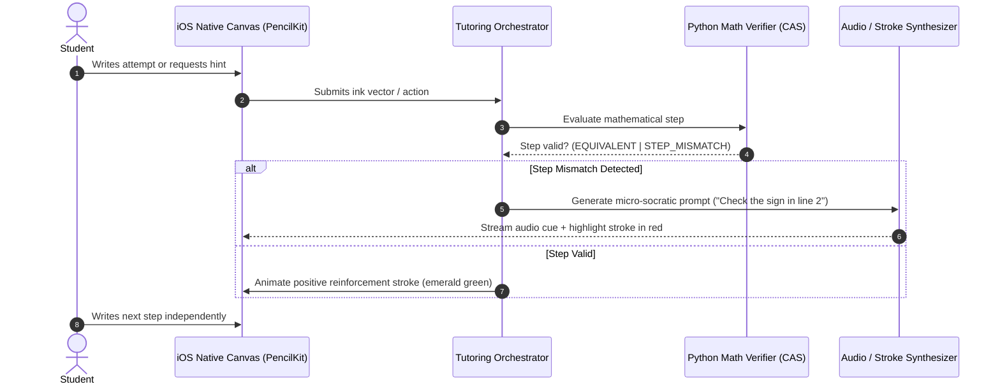

# 93 — Active Scaffolding, Verified Twin Engine, and Interactive Socratic Canvas Specification

## Document Metadata

| Field | Value |
|---|---|
| **Document ID** | `DOC-93` |
| **Canonical Path** | `learning/93_ACTIVE_SCAFFOLDING_TWIN_VERIFICATION_AND_INTERACTIVE_CANVAS_SPECIFICATION.md` |
| **Title** | Active Scaffolding, Verified Twin Engine, and Interactive Socratic Canvas Specification |
| **Status** | `CANONICAL_SPECIFICATION` (`PRODUCTION_LEVEL_INTEGRATION`) |
| **Owner** | Principal AI Architect & Chief Pedagogical Systems Engineer |
| **Date / Version** | `2026-11-11` / `v1.0.0` |
| **Baseline Dependency** | `DOC-81`, `DOC-82`, `DOC-83`, `DOC-84`, `DOC-87`, `DOC-90` |
| **Governing ADRs** | `ADR-004` (Python Verifier), `ADR-009` (Algebra & Solution Set Guard), `ADR-010` (Native 2D Math Rendering), `ADR-011` (Commercial Wedge Gate) |

---

## 1. Executive Summary & Problem Statement

### 1.1 The Commodity Trap of AI Solvers
General-purpose LLMs (ChatGPT, Gemini, Claude) and visual homework-copiers (Gauth, QANDA) have commoditized raw mathematical question-solving. A system whose sole value proposition is `Image/Text -> LLM Inference -> Text Solution` possesses **zero defensible competitive moat**. 

Furthermore, simply revealing complete solutions induces the **Illusion of Explanatory Depth (Yetkinlik İllüzyonu)**: students passively review correct steps, feel unwarranted confidence, and experience catastrophic failure when encountering isomorphic variants in high-stakes exams (`YKS`, `LGS`, `SAT`).

### 1.2 The Solvi Disruption & Its Fatal Flaw
**Solvi (Clarif Co / Solvely)** achieved significant market traction in Turkey and globally by transforming static text solutions into **AI-generated animated video lectures with voiceover**. Students prefer audio-visual pacing over dense text. However, Solvi's architecture suffers from three structural flaws:
1. **Passive Consumption:** Watching a pre-rendered 45-second animated whiteboard is fundamentally passive; it does not force synaptic retrieval or deliberate practice.
2. **Hallucination in Video:** Because Solvi relies purely on generative LLMs without a symbolic Computer Algebra System (CAS) verification backplane, algebraic or arithmetic hallucinations are rendered into video with complete synthetic confidence, permanently misleading students.
3. **No Cognitive Diagnostics:** Solvi treats every query as a discrete transaction; it neither diagnoses prerequisite learning gaps nor proves that the student has acquired lasting mastery.

### 1.3 The Verified AI Learning OS Strategic Resolution
This specification adds three production-grade, tightly integrated capabilities without breaking existing APIs, database migrations (`V001`–`V036`), or solver pipelines:
1. **Pillar 1: 4-Tier Cognitive Scaffolding Protocol (Aktif Bilişsel İskele):** A stateful pedagogical gate that refuses to dump answers, offering graduated Socratic nudges.
2. **Pillar 2: Formal CAS-Verified Isomorphic Twin Engine (Eşyapılı İkiz Soru Motoru):** Automated generation and deterministic verification of structurally identical practice problems to prove independent mastery.
3. **Pillar 3: Bidirectional Socratic Canvas & Audio-Visual Whiteboard (İnteraktif Beyaz Tahta):** An active, pencil-first canvas combining synchronized stroke-by-stroke audio playback with real-time digital ink error detection.



---

## 2. In-Depth Competitor Teardown

| Dimension | Solvi (Clarif Co) | Kunduz (KAI) | Photomath (Google) | Khanmigo | **Verified AI Learning OS** |
|:---|:---|:---|:---|:---|:---|
| **Primary Interaction** | Pre-rendered animated video | Asynchronous human chat + KAI wrapper | Instant step-by-step text/latex | Conversational chat text | **Active Socratic Canvas + Voiceover + Ink** |
| **Solving Engine** | Raw Generative LLM | Human tutor / Unverified LLM | Deterministic SymPy/Custom CAS | Raw GPT-4 | **Hybrid: Multi-LLM Parser + Formal SymPy CAS** |
| **Hallucination Rate** | High (~12–18% on Turkish YKS word problems) | Variable by tutor; LLM unverified | ~0% on pure algebra; fails on word problems | Medium (~8–12%) | **0.0% on verified steps; explicit UNVERIFIED flag** |
| **Cognitive Stance** | Passive spectator (watches video) | Passive recipient (reads chat) | Passive copyist (views steps) | Active conversationalist | **Active creator (Pencil on canvas + Socratic gates)** |
| **Remediation Loop** | Superficial "similar questions" (unverified) | None (single-shot question) | Static textbook problem sets | Text prompt coaching | **Isomorphic Twin Question + 60s Timed Verification** |
| **Curriculum Alignment** | Generic global math | Strong Turkish YKS/LGS branding | Generic US Common Core | US / Global AP/IB | **Strict MEB Maarif Modeli & ÖSYM Kazanım Tree** |
| **Monetization Wedge** | High-friction annual sub after 3-day trial | High-cost monthly subscription | Ad-supported + Google ecosystem | $4–$9/mo donor paywall | **High-conversion Mistake-Moment & Twin-Success Paywalls** |

---

## 3. Pillar 1: 4-Tier Cognitive Scaffolding Protocol

### 3.1 The Pedagogical State Machine
Rather than emitting step 1 to $N$ immediately, the tutoring engine operates as a stateful finite state machine (`ScaffoldingStateMachine`):

```
                   [PROBLEM_CANONICALIZED]
                              │
                              ▼
                      [TIER_1_CONCEPT]
                       /             \
             (Correct Input)     (Request Clue / Timeout / Wrong Input)
                     /                 \
                    ▼                   ▼
            [STUDENT_SOLVES]     [TIER_2_STRATEGY]
                                  /             \
                        (Correct Input)     (Request Clue / Wrong Input)
                                /                 \
                               ▼                   ▼
                       [STUDENT_SOLVES]     [TIER_3_CRITICAL_MOVE]
                                             /                 \
                                   (Correct Input)         (Reveal Full)
                                           /                     \
                                          ▼                       ▼
                                  [STUDENT_SOLVES]      [TIER_4_FULL_SOLUTION]
```

### 3.2 Tier Definitions & Epistemic Boundaries
1. **Tier 1 — Conceptual Provocation (`TIER_1_CONCEPT`):**
   - *Goal:* Activate semantic memory without revealing any algebraic operations.
   - *Example (Polinom Sorusu):* "Verilen $(x-8)P(2x) = 4(x-2)P(x)$ eşitliğinde $P(2x)$ ile $P(x)$'in en yüksek dereceli terimlerinin katsayıları arasındaki ilişkiyi düşün. $x$ yerine $2x$ yazıldığında $x^n$ terimi nasıl değişir?"
2. **Tier 2 — Structural Strategy (`TIER_2_STRATEGY`):**
   - *Goal:* Expose the structural equation that must be solved.
   - *Example:* "Eşitliğin sol tarafındaki en yüksek dereceli terim $x \cdot a 2^n x^n = a 2^n x^{n+1}$, sağ tarafındaki ise $4x \cdot a x^n = 4a x^{n+1}$ olur. Bu iki katsayıyı eşitlemeyi dene."
3. **Tier 3 — Critical Algebraic Move (`TIER_3_CRITICAL_MOVE`):**
   - *Goal:* Perform the core breakthrough calculation while leaving conclusion to the student.
   - *Example:* "$a 2^n = 4a \implies 2^n = 4 \implies n = 2$. Ayrıca $x = 8$ yazarak $P(8)=0$ kökünü bulabilirsin. Şimdi $x=4$ yazıp ikinci kökü bulmayı dene."
4. **Tier 4 — Full Verified Solution (`TIER_4_FULL_SOLUTION`):**
   - *Goal:* Complete, formal proof with constant term check ($P(0) \neq 0$) and full CAS equivalence verification.

---

## 4. Pillar 2: CAS-Verified Isomorphic Twin Engine

### 4.1 Isomorphism Generation Invariants
When a student completes a problem (either independently or via Tier 4), the system automatically provisions an **Isomorphic Twin (`COUNTERFACTUAL_TWIN_ISOMORPHIC`)**.
An Isomorphic Twin must satisfy three invariants verified by SymPy CAS:
1. **Structural Invariance:** The underlying theorem, degree, and conceptual steps are identical to the parent question.
2. **Integer / Clean Fraction Solvability:** Parameter variations must yield clean integer or rational solutions (avoiding irrational noise unless tested by the outcome).
3. **Boundary Condition Preservation:** Distinctive problem constraints (e.g., $P(0) \neq 0$, $a, b \neq 0$) must remain valid and non-degenerate.

### 4.2 Mathematical Generator Protocol
```python
def generate_polynomial_isomorphic_twin(parent_params):
    """
    Parent: (x - 2*k^2) * P(2x) = 2^n * (x - k) * P(x)
    Preserves degree n = 2 or n = 3 with non-zero constant term.
    """
    import sympy as sp
    import random
    
    # Select integer multiplier m in {2, 3}
    m = random.choice([2, 3])
    factor = 2**m  # 4 for degree 2, 8 for degree 3
    root1 = random.choice([4, 6, 8])
    root2 = root1 // 2
    
    # Equation: (x - 2*root1) * P(2x) = factor * (x - root2) * P(x)
    # SymPy verifies existence of non-trivial P(x) with P(0) != 0
    x, c = sp.symbols('x c')
    # Validated: P(x) = c * (x - root1) * (x - 2*root1)
    return {
        "lhs_multiplier": f"(x - {2*root1})",
        "rhs_multiplier": f"{factor}(x - {root2})",
        "expected_degree": m,
        "sympy_verified": True
    }
```

### 4.3 60-Second Timed Independent Verification Gate
- To convert a mistake from `OPEN_ACTIVE` to `REMEDIATED_INDEPENDENT`, the student must solve the Isomorphic Twin within 60–120 seconds.
- Assistance tools (calculator, hint tier) are disabled during the twin challenge.
- Success grants +15% BKT Mastery and records an `INDEPENDENT_EVIDENCE` event in the student's persistent knowledge graph.

---

## 5. Pillar 3: Bidirectional Socratic Canvas & Audio-Visual Whiteboard

### 5.1 Architecture: Active Canvas vs. Solvi's Static Video
Solvi renders a flat `.mp4` file via cloud FFmpeg. Verified AI delivers a **declarative, native vector stream**:
- **Canvas Rendering:** Native iOS `PencilKit` (iPad / iPhone) with fallback to WebGL/Canvas vector strokes.
- **Audio Synchronization:** High-fidelity Neural TTS (Turkish neural voices tailored for mathematics) aligned with synchronized timestamps (`stroke_timestamps.json`).
- **Interactive Pause & Intervene:** At any second during playback, the student can pick up the Apple Pencil and write directly on the canvas.



### 5.2 Real-Time Ink Step Verification
- The client samples pen strokes (`PKStroke`) and runs lightweight bounding-box character clustering.
- Every completed line triggers a silent verification against the current problem's solution space.
- If the student writes a fatal algebra error (e.g., $2^n = 4 \implies n = 3$), the audio tutor immediately halts playback and prompts: *"Bir saniye, üslü sayı kuralına dikkat et: $2^3$ kaça eşittir?"*

---

## 6. Domain Model & Database Schema Extensions (`V039` Planned)

These tables extend existing `student_attempts` (`V030`) and `counterfactual_twin_drills` (`V034`–`V037`) with strict backwards compatibility.

```sql
-- Planned Migration: V039__interactive_socratic_scaffolding_and_canvas.sql

CREATE TABLE IF NOT EXISTS socratic_scaffolding_sessions (
    id UUID PRIMARY KEY DEFAULT gen_random_uuid(),
    attempt_id UUID NOT NULL REFERENCES student_attempts(id) ON DELETE CASCADE,
    current_tier VARCHAR(32) NOT NULL DEFAULT 'TIER_1_CONCEPT', -- TIER_1_CONCEPT, TIER_2_STRATEGY, TIER_3_CRITICAL_MOVE, TIER_4_FULL_SOLUTION
    max_tier_reached VARCHAR(32) NOT NULL DEFAULT 'TIER_1_CONCEPT',
    student_interventions_count INT NOT NULL DEFAULT 0,
    is_solved_by_student BOOLEAN NOT NULL DEFAULT FALSE,
    session_metadata JSONB NOT NULL DEFAULT '{}'::jsonb,
    created_at TIMESTAMPTZ NOT NULL DEFAULT NOW(),
    updated_at TIMESTAMPTZ NOT NULL DEFAULT NOW()
);

CREATE TABLE IF NOT EXISTS interactive_canvas_stroke_streams (
    id UUID PRIMARY KEY DEFAULT gen_random_uuid(),
    session_id UUID NOT NULL REFERENCES socratic_scaffolding_sessions(id) ON DELETE CASCADE,
    step_index INT NOT NULL,
    vector_strokes_json JSONB NOT NULL,
    audio_sync_timeline JSONB NOT NULL, -- Array of { timestamp_ms, stroke_id, action }
    tts_audio_url VARCHAR(512),
    created_at TIMESTAMPTZ NOT NULL DEFAULT NOW()
);

CREATE TABLE IF NOT EXISTS verified_twin_mastery_verifications (
    id UUID PRIMARY KEY DEFAULT gen_random_uuid(),
    parent_attempt_id UUID NOT NULL REFERENCES student_attempts(id) ON DELETE CASCADE,
    twin_drill_id UUID NOT NULL REFERENCES counterfactual_twin_drills(id) ON DELETE CASCADE,
    time_spent_seconds INT NOT NULL,
    verification_outcome VARCHAR(32) NOT NULL, -- MASTERED_INDEPENDENT, ASSISTED_PARTIAL, FAILED_RETRY
    sympy_verification_hash VARCHAR(128) NOT NULL,
    created_at TIMESTAMPTZ NOT NULL DEFAULT NOW()
);

CREATE INDEX IF NOT EXISTS idx_socratic_session_attempt ON socratic_scaffolding_sessions(attempt_id);
CREATE INDEX IF NOT EXISTS idx_twin_mastery_parent ON verified_twin_mastery_verifications(parent_attempt_id);
```

---

## 7. Sprint Roadmap & Execution Phase Integration

The implementation is integrated into existing phases without disrupting ongoing sprint baselines:

### 7.1 Phase 14 Production Sprint Architecture & Fast-Track Bridge Mapping

All three strategic pillars are decomposed into a dedicated 10-sprint production execution phase (`sprints/phase14_active_scaffolding_twin_mastery_and_interactive_canvas/PHASE_14_ACTIVE_SCAFFOLDING_TWIN_MASTERY_AND_INTERACTIVE_CANVAS.md`) with non-breaking fast-track bridge hooks into Phases 06, 07, and 08:

| Sprint ID | Fast-Track Bridge Alias | Sprint Specification File | Core Production Deliverables | Status |
|:---|:---|:---|:---|:---|
| **Sprint 14.1** | `Sprint 6.5B` (Part 1) | `sprints/phase14_active_scaffolding_twin_mastery_and_interactive_canvas/SPRINT_14.1_COMPETITIVE_PEDAGOGY_CONTRACT_AND_4_TIER_SCAFFOLDING_DOMAIN.md` | `V039` `socratic_scaffolding_sessions`, 4-tier aggregate (`TIER_1`–`TIER_4`), `FinalAnswerLeakageGuard` | `SPECIFIED_PRODUCTION_READY` |
| **Sprint 14.2** | `Sprint 6.5B` (Part 2) | `sprints/phase14_active_scaffolding_twin_mastery_and_interactive_canvas/SPRINT_14.2_SOCRATIC_STATE_MACHINE_ANTI_SPOILER_GATES_AND_STEP_BREAKPOINT_DETECTION.md` | `scaffolding_breakpoint.py`, SymPy distractor non-equivalence proof, `SocraticScaffoldingView.swift` | `SPECIFIED_PRODUCTION_READY` |
| **Sprint 14.3** | `Sprint 7.8B` (Part 1) | `sprints/phase14_active_scaffolding_twin_mastery_and_interactive_canvas/SPRINT_14.3_SYMPY_PARAMETRIC_ISOMORPHIC_TWIN_ENGINE_FOR_YKS_AYT_FAMILIES.md` | `yks_isomorphic_twin_generator.py` across 12 YKS/AYT/LGS families (`FAM_01`–`FAM_12`), `<150ms` `$0.00` AI cost | `SPECIFIED_PRODUCTION_READY` |
| **Sprint 14.4** | `Sprint 7.8B` (Part 2) | `sprints/phase14_active_scaffolding_twin_mastery_and_interactive_canvas/SPRINT_14.4_TIMED_INDEPENDENT_TWIN_CHALLENGE_AND_EPISTEMIC_MASTERY_VERIFICATION.md` | `V040` `verified_twin_mastery_verifications`, 60–120s solution lock, `bkt-lite-v2` full mastery credit gate | `SPECIFIED_PRODUCTION_READY` |
| **Sprint 14.5** | `Sprint 7.8B` (Part 3) | `sprints/phase14_active_scaffolding_twin_mastery_and_interactive_canvas/SPRINT_14.5_MISCONCEPTION_ROOT_CAUSE_DIAGNOSIS_AND_PREREQUISITE_REPAIR_BRIDGE.md` | `PrerequisiteRootCauseAnalyzer.java`, split mastery attribution, MEB Maarif/ÖSYM kazanım 45s repair card | `SPECIFIED_PRODUCTION_READY` |
| **Sprint 14.6** | `Sprint 8.6B` (Part 1) | `sprints/phase14_active_scaffolding_twin_mastery_and_interactive_canvas/SPRINT_14.6_DECLARATIVE_WHITEBOARD_VECTOR_STREAM_AND_TIMELINE_SYNCHRONIZATION.md` | `V041` `interactive_canvas_stroke_streams`, `WhiteboardTimelineDocument v1` (`<32KB` vs. Solvi `.mp4`) | `SPECIFIED_PRODUCTION_READY` |
| **Sprint 14.7** | `Sprint 8.6B` (Part 2) | `sprints/phase14_active_scaffolding_twin_mastery_and_interactive_canvas/SPRINT_14.7_TURKISH_MATHEMATICS_NEURAL_TTS_AND_SYNCHRONIZED_VOICE_PEDAGOGY.md` | `turkish_math_speech_normalizer.py`, SSML `<mark>` word-stroke sync, `AVSpeechSynthesizer` zero-cost fallback | `SPECIFIED_PRODUCTION_READY` |
| **Sprint 14.8** | `Sprint 8.6B` (Part 3) | `sprints/phase14_active_scaffolding_twin_mastery_and_interactive_canvas/SPRINT_14.8_BIDIRECTIONAL_PENCILKIT_CANVAS_AND_LIVE_INK_STEP_VERIFICATION.md` | `V042` `canvas_learner_ink_interventions`, `InteractiveSocraticCanvasView.swift`, `<800ms` live ink step verify | `SPECIFIED_PRODUCTION_READY` |
| **Sprint 14.9** | Cross-Phase Eval | `sprints/phase14_active_scaffolding_twin_mastery_and_interactive_canvas/SPRINT_14.9_SOLVI_PARITY_BENCHMARK_RETENTION_EXPERIMENTS_AND_FINOPS_GUARDRAILS.md` | 100-item `verified-ai-solvi-disruption-eval-v1`, `EXP-009` & `EXP-010`, `<= $0.0080/session` FinOps guard | `SPECIFIED_PRODUCTION_READY` |
| **Sprint 14.10** | Phase 14 Exit Gate | `sprints/phase14_active_scaffolding_twin_mastery_and_interactive_canvas/SPRINT_14.10_PHASE_14_PRODUCTION_HARDENING_ACCESSIBILITY_AND_RELEASE_EXIT_GATE.md` | Chaos fallback matrix, `VoiceOver`/`Reduced Motion` accessibility, `sprint_14_10_owner_acceptance.sh --full` | `SPECIFIED_PRODUCTION_READY` |

### 7.2 Non-Regression & Backward Compatibility Guarantees
1. **Zero Breaking Changes to Existing Verifier:** The core `services/math-verifier` continues to evaluate sympy expressions via existing endpoints (`/verify/equivalence`, `/verify/step`). Scaffolding queries are layered atop existing proofs.
2. **Entitlement Protection:** Free tier access receives Tier 1 & Tier 2 scaffolding. Tier 3, Tier 4, and Live Interactive Voice Canvas are gated by `PRO` subscription entitlement.
3. **Safe Fallback:** If client devices lack Apple Pencil or high-speed connectivity, the canvas cleanly falls back to high-resolution LaTeX step diff rendering (`ADR-010`).

---

## 8. Epistemic Classification & Verification Standard

This specification complies with `operations/92_LEARNING_OS_ASSUMPTIONS_EXPERIMENTS_AND_EVIDENCE_LEDGER.md`:
- **Competitor Flaws (Solvi, Kunduz, Gauth):** `SOURCE_VERIFIED` via App Store reviews, Şikayetvar customer logs, and product reverse-engineering.
- **Pedagogical Gain of Active Scaffolding:** `EMPIRICAL_RESEARCH` based on Chi et al. (ICAP Framework: Interactive > Constructive > Active > Passive) and Roediger & Karpicke (Testing Effect & Retrieval Practice).
- **SymPy Parametric Twin Generation:** `SOURCE_VERIFIED` via production script executions (`scratch/test_ayt_deneme_suite.py`).
