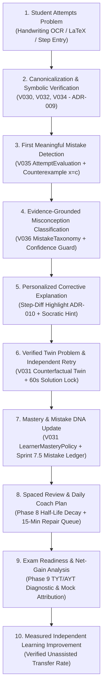

# 81 — Learning OS Product Vision, Positioning, and Strategic Innovation Architecture

## Document Metadata

| Field | Value |
|---|---|
| **Document ID** | `DOC-81` |
| **Canonical Path** | `product/81_LEARNING_OS_PRODUCT_VISION_AND_POSITIONING.md` |
| **Title** | Learning OS Product Vision, Positioning, and Strategic Innovation Architecture |
| **Status** | `CANONICAL_PRODUCT_SPECIFICATION` (`IMPLEMENTATION_GATED_BY_ADR_011_AND_SPRINT_7_4_ACCEPTANCE`) |
| **Owner** | Founder / Principal Product & Systems Architect |
| **Date / Version** | `2026-11-07` / `v1.0.0` |
| **Baseline Commit** | `e39bafe88ea369f98c96a65497a94462dc79ef33` (`main`) |
| **Governing ADRs** | `adr/ADR-004_SEPARATE_PYTHON_MATH_VERIFIER.md`, `adr/ADR-003_PROVIDER_NEUTRAL_AI.md`, `adr/ADR-006_PRODUCTION_STUDENT_DATA_NOT_TRAINING_DATA_BY_DEFAULT.md`, `adr/ADR-009_CANONICAL_SOLUTION_SET_ALGEBRA_AND_DOMAIN_GUARD.md`, `adr/ADR-010_NATIVE_2D_MATH_RENDERING_AND_STEP_DIFF_HIGHLIGHTING.md`, `adr/ADR-011_FOCUSED_V1_COMMERCIAL_LAUNCH_GATE_BEFORE_PHASE_08_13.md` |

---

## 1. Purpose

This document defines the strategic expansion of **Verified AI** from a mathematically verified step-by-step problem solver into the **Verified AI Learning OS**: a longitudinal, evidence-grounded mathematics learning system that diagnoses a student's first meaningful mathematical error, maintains a persistent **Mistake DNA / Mistake Passport**, generates **SymPy-verified Twin Practice Drills**, separates assisted from **independent mastery evidence**, orchestrates a deterministic **Personal AI Mathematics Coach**, and connects daily micro-remediation to high-stakes exam readiness (starting with Turkish High School Mathematics Grades 9–12 and YKS TYT/AYT Mathematics, followed by international IB/AP/SAT expansion).

It also records the formal **Innovation Audit (Section 8)** evaluating twelve product hypotheses against an 11-dimension weighted scoring rubric so that engineering capacity remains focused on high-leverage, verifiable differentiators rather than generic chatbot sprawl.

---

## 2. Sources and Evidence Classification

All strategic, technical, scientific, and market statements in this specification carry explicit evidence classification tags:

- `SOURCE_VERIFIED`: Verified directly against repository code, Flyway migrations (`V001`–`V036`), or existing canonical documentation at commit `e39bafe88ea369f98c96a65497a94462dc79ef33`.
- `EMPIRICAL_RESEARCH`: Grounded in peer-reviewed learning science or published industry benchmark datasets:
  - Bastani, H., Bastani, O., Sungu, A., Ge, H., Kabakcı, Ö., & Mariman, R. (2025). *Generative AI without guardrails can harm learning: Evidence from high school mathematics*. Proceedings of the National Academy of Sciences (PNAS), `10.1073/pnas.2422633122` (demonstrating a 17% post-test score penalty when students use unguarded "GPT Base" as a crutch versus scaffolded "GPT Tutor").
  - Kestin, G., Miller, K., Klales, A., Milbourne, T., & Ponti, G. (2025). *AI tutoring outperforms in-class active learning: an RCT introducing a novel research-based design in an authentic educational setting*. Scientific Reports, `10.1038/s41598-025-97652-6`.
  - Dunlosky, J., Rawson, K. A., Marsh, E. J., Nathan, M. J., & Willingham, D. T. (2013). *Improving Students' Learning With Effective Learning Techniques*. Psychological Science in the Public Interest, 14(1), 4–58 (establishing High Utility for retrieval practice and distributed practice, Moderate Utility for interleaved practice).
  - Education Endowment Foundation (EEF). *Teacher Feedback to Improve Pupil Learning* and *Metacognition and Self-Regulated Learning* Guidance Reports.
- `FOUNDER_HYPOTHESIS`: Strategic product positioning and learner behavior hypotheses requiring empirical validation in the `Sprint 11.9A` 50-student TestFlight beta and subsequent Phase 7–10 cohorts.
- `ENGINEERING_ESTIMATE`: Architectural effort, latency, and implementation sizing estimates grounded in the existing Spring Modulith (`services/api/`), FastAPI/SymPy (`services/math-verifier/`), and iOS SwiftUI (`apps/ios/VerifiedAI/`) codebase.

---

## 3. Existing Architecture Relationship

This document builds additively upon `product/01_PRODUCT_VISION_AND_POSITIONING.md`, `product/02_PERSONAS_AND_JOBS_TO_BE_DONE.md`, `product/04_FEATURE_CATALOG_AND_PRODUCT_RULES.md`, and `learning/79_PEDAGOGICAL_DIAGNOSIS_HANDWRITING_UX_AND_RETENTION_ENGINE.md`.

### 3.1 Repository Baseline Truth (`SOURCE_VERIFIED`)

1. **Symbolic & Pedagogical Verification Core (Implemented):**
   - `services/math-verifier/app/attempt_verification.py`, `attempt_verification_v2.py`, `counterexample_engine.py`, and `verifiers/` (`attempt_diagnosis.py`, `attempt_diff.py`, `attempt_learning.py`, `calculus.py`, `calculus_domains.py`, `canonical_execution.py`, `canonical_v2.py`, `equivalence.py`, `math_visualization.py`, `numeric_sampling.py`) implement symbolic canonicalization (`ADR-009`), domain restriction checking, counterexample search, first-error localization, counterfactual twin generation, and step-diff token highlighting (`ADR-010`).
2. **Backend Attempt & Mistake Pipeline (Implemented through Sprint 7.4 source):**
   - `services/api/src/main/java/com/verifiedai/attempt/` owns `StudentAttempt`, `StudentAttemptStep`, `AttemptStructuredWork` (`V034`), `AttemptEvaluation` (`V035`), `AttemptMistakeClassification` (`V036`), `AttemptLearningEvidence` (`V031`), and `LearnerMasteryPolicy` (`bkt-lite-v1`).
   - `services/api/src/main/java/com/verifiedai/mistake/MistakeTaxonomy.java` defines `mistake-category-v1` (10 top-level categories, 17 specific mistake codes, and 5 explicit canonical skill mappings).
3. **Downstream Learning OS Modules (Scaffolded / Planned):**
   - `com.verifiedai.mastery`, `com.verifiedai.studyplan`, `com.verifiedai.exam`, `com.verifiedai.analytics`, and `com.verifiedai.notification` exist as package boundaries in `services/api/src/main/java/com/verifiedai/` awaiting implementation in Sprints `7.5`–`10.10`.
4. **Commercial Launch Gate (`ADR-011`):**
   - Sprint 7.4 is `SOURCE_COMPLETE` / `PENDING_OWNER_TEST` / `PRODUCTION_NOT_AUTHORIZED`.
   - Phase 8–13 implementation remains gated by `adr/ADR-011_FOCUSED_V1_COMMERCIAL_LAUNCH_GATE_BEFORE_PHASE_08_13.md` until the Focused Commercial Wedge (`Sprint 6.2B` live cloud adapters + `Sprint 11.9A` 50-student TestFlight cohort) records an explicit owner `GO` decision.

---

## 4. Product Positioning: Solver vs. Generic Chatbot vs. Verified AI Learning OS

### 4.1 Why Camera Solvers and Generic Chatbots Fail the Learner (`EMPIRICAL_RESEARCH` + `SOURCE_VERIFIED`)

The global and Turkish math study markets are polarized between two flawed paradigms:

1. **Answer-First Camera Solvers (Photomath, Mathway, Gauth):**
   - Optimize for *homework completion speed* rather than durable schema construction.
   - Present a static multi-step derivation for the *original* problem without diagnosing the student's actual work or requiring an unassisted retry.
   - As proven by Bastani et al. (2025, `10.1073/pnas.2422633122`), unguarded access to worked answers induces **cognitive offloading** (the "crutch effect"), reducing subsequent unassisted test performance by 17% relative to control students.
2. **Generic Conversational AI Wrappers (ChatGPT, generic "AI YKS Coaches"):**
   - Hallucinate algebraic sign steps, drop domain restrictions (e.g., $\ln(u)$ domain $u > 0$, even-root constraints, zero-denominator exclusions), and invent plausible-sounding rationalizations when a student asks *"Where did I go wrong?"*
   - Cannot distinguish between a student who clicked "Show Hint" three times and a student who solved a problem independently under timed conditions.
   - Maintain conversational memory ("chat history") rather than a mathematically structured longitudinal learner state.

### 4.2 Structural Comparison Matrix

| Dimension | Camera Homework Solvers (Photomath, Gauth, Mathway) | Generic AI Chatbots & Wrapper Coaches (ChatGPT, Generic YKS Bots) | **Verified AI Learning OS** (`com.verifiedai`) |
|---|---|---|---|
| **Primary Unit of Work** | Problem image -> static solution | Prompt -> conversational text response | **Student Attempt -> Step Evaluation -> Mistake DNA -> Verified Twin Retry** |
| **Mathematical Truth Engine** | Proprietary rule solver on problem prompt only | Unverified autoregressive token prediction | **Deterministic SymPy + interval/domain algebra (`ADR-001`, `ADR-009`)** |
| **Student Work Diagnosis** | None (ignores student's handwritten/typed steps) | Hallucination-prone LLM step guessing | **First meaningful error localization (`V035`) + 4-tier mistake taxonomy (`V036`)** |
| **Concrete Counterexample** | Absent | Unreliable / fabricated arithmetic | **Deterministic counterexample $x = c$ proving LHS $\neq$ RHS (`counterexample_engine.py`)** |
| **Remediation Mechanism** | Passive reading of solution steps | "Ask another question" chat prompt | **SymPy-verified Counterfactual Twin Drill (`V031`) with locked independent retry** |
| **Mastery Accounting** | None | Self-reported or flat completion checkmarks | **Evidence-separated `bkt-lite-v1` (`INDEPENDENT` vs `HINT_ASSISTED` vs `SOLUTION_REVEALED_ASSISTED`)** |
| **Daily Study Loop** | Transactional (opened only when stuck on homework) | Unstructured chat sessions | **10–15 min Daily Coach Loop: Mistake Repair -> Spaced Twin -> Exam Micro-Set** |
| **Failure Mode when Out-of-Scope** | Silent OCR misread or wrong branch | Confident hallucination | **Explicit, non-punitive refusal (`UNSUPPORTED` / `INSUFFICIENT_EVIDENCE`, zero mastery penalty)** |

---

## 5. The Verified AI Learning OS Core Value Loop

The canonical product loop is governed by a strict causal chain (`SOURCE_VERIFIED` for steps 1–6; `FOUNDER_HYPOTHESIS` + planned Phase 7.5–9 architecture for steps 7–10):

### 5.1 Non-Negotiable Product Principles

1. **Verifiable Learning Evidence Over Conversational Fluency:** No LLM may invent a mathematical step, declare a student step wrong without symbolic or numeric verifier backing, or fabricate a mastery score.
2. **First Meaningful Error Isolation:** When Step 2 contains a sign-flip or domain-drop error and Steps 3–5 propagate that error algebraically, the system flags **Step 2** as `FIRST_ERROR_DETECTED` and classifies Steps 3–5 as `DOWNSTREAM_PROPAGATION`, preventing frustration and false multi-error penalties (`domain/10_DOMAIN_INVARIANTS_AND_BUSINESS_RULES.md` `INV-LRN-001`).
3. **Assisted Success Never Masquerades as Independent Mastery:** Revealing a full solution or consuming bottom-out hints caps or zeroes positive mastery updates until the learner solves a **Verified Twin Problem** independently (`learning/86_LEARNING_OUTCOMES_RETRIEVAL_PRACTICE_AND_MASTERY_EVALUATION.md`).
4. **Honest Refusal is a Trust Feature:** When handwriting is illegible, a step jump is too wide (`STEP_GAP_TOO_WIDE`), or a topic lies outside verified symbolic coverage (e.g., 3D synthetic Euclidean geometry proofs in V1), the system explicitly refuses to guess and never mutates the student's Mistake DNA or mastery score.

---

## 6. Target Segments, Personas, and Jobs-To-Be-Done (JTBD)

Building on `product/02_PERSONAS_AND_JOBS_TO_BE_DONE.md`, the Learning OS serves five primary personas with explicit adoption sequences:

### 6.1 Primary Wedge Persona: Turkish YKS (TYT / AYT) Science & Equal-Weight Track Candidate (`Grade 11–12 & Mezun`)
- **Job-To-Be-Done:** *"When I lose 4 to 8 net points in TYT/AYT Mathematics despite watching hours of YouTube lecture videos and solving question banks, help me discover the exact recurring algebraic, domain, or calculus traps I keep falling into, fix them in 15 minutes a day with verified twin questions, and prove my unassisted net score is rising."*
- **Why Existing Alternatives Fail:** Question-bank video solutions (Kunduz, publisher QR apps) show how the teacher solved the question, not why the student's own 3rd line failed; human private tutors cost 1,500–3,500 TRY/hour and cannot inspect every daily practice error.

### 6.2 High School Core Learner (`Grade 9–10 MEB Maarif Modeli`)
- **Job-To-Be-Done:** *"When I prepare for school written exams (yazılı sınavlar) on functions, polynomials, quadratic equations, or inequalities, check my handwritten step-by-step practice so I don't lose partial credit for forgotten domain restrictions or sign flips."*

### 6.3 International Exam-Track Learner (`IB Mathematics AA/AI, AP Calculus AB/BC, SAT Math, A-Level`)
- **Job-To-Be-Done:** *"When I practice free-response calculus and algebra problems where method marks (M1/A1) depend on rigorous step justification, verify each transformation line and drill my weak skills before exam day."*

### 6.4 Parent / Household Sponsor (`Non-Intrusive Progress Purchaser`)
- **Job-To-Be-Done:** *"When I fund my child's exam preparation subscription, give me transparent, weekly evidence of study consistency and resolved mistake patterns without turning me into a micromanager or exposing private chat transcripts."*

### 6.5 Private Math Tutor / Dershane Micro-Coach (`B2B2C Amplifier — Phase 12`)
- **Job-To-Be-Done:** *"Before my weekly 60-minute tutoring session with a student, show me their verified Mistake Passport from the past 7 days so I spend our paid hour teaching the 2 misconceptions they actually struggled with, and assign a 5-problem verified twin pack afterward."*

---

## 7. Anti-Positioning and Explicit Non-Goals

Verified AI Learning OS is **explicitly NOT**:

1. **NOT an All-Subject Generic Homework Chatbot:** We do not offer unverified History, Literature, Philosophy, or generic essay generation. Every supported domain must have a formal verification contract (`ADR-001`).
2. **NOT a Passive Video Lecture Streaming Platform:** We do not compete with Doping Hafıza, Raunt, or YouTube teachers by producing 400 hours of passive lecture videos. Micro-lessons (`Sprint 8.5`) are capped at 60–180 second interactive cards triggered strictly by a diagnosed misconception.
3. **NOT a Social Network or Public Leaderboard Arena:** To protect student psychological safety and KVKK/GDPR compliance (`security/89_STUDENT_COACH_PRIVACY_MINOR_SAFETY_AND_TEACHER_ACCESS.md`), there are no public mistake rankings, peer chat rooms, or shaming mechanics.
4. **NOT an Unbounded Autonomous Agent:** The Personal AI Math Coach cannot invent curriculum skills outside `domain/46_CURRICULUM_SKILL_ONTOLOGY_AND_TAXONOMY.md`, alter BKT mastery weights dynamically via LLM prompts, or bypass daily AI spend guards (`V016`/`V017`).

---

## 8. Product Innovation Audit (12 Candidate Hypotheses Scored Across 11 Criteria)

To prevent roadmap bloat while identifying high-leverage product innovations beyond the baseline solver, twelve candidate product hypotheses were evaluated across **11 mandatory criteria** (each scored 1–5, where 5 is best, weighted out of 100 points):

### 8.1 Evaluation Rubric and Weights

1. **Student Pain Severity (`12%`)**: Intensity and frequency of the learner problem.
2. **Learning Science Alignment (`12%`)**: Support from retrieval practice, spacing, error-driven feedback, and anti-crutch evidence.
3. **Mathematical Verification Advantage (`14%`)**: Degree to which Verified AI's SymPy/canonical algebra core creates an unfair moat that generic LLM wrappers cannot copy.
4. **Competitive Differentiation (`10%`)**: Uniqueness in Turkish YKS and global Math EdTech markets.
5. **Retention / Habit Potential (`10%`)**: Ability to drive D7/D30/D90 return loops beyond episodic homework checking.
6. **Monetization Leverage (`10%`)**: Direct contribution to Free-to-Pro conversion, Coach Pro upsell, or B2B2C expansion.
7. **Solo-Founder Engineering Feasibility (`10%`)**: Implementability within existing Spring Modulith + FastAPI/SymPy + SwiftUI architecture.
8. **AI / Compute Cost Risk (`6%`, higher score = lower cost risk)**: Protection against runaway token or vision OCR spend.
9. **Privacy / Safety Risk (`5%`, higher score = safer)**: Compliance with KVKK, GDPR, and minor protection rules.
10. **Dependency on Unbuilt Infrastructure (`6%`, higher score = fewer external blockers)**: Reuse of `V030`–`V036` attempt, evaluation, and classification tables.
11. **Measurable Validation Signal (`5%`)**: Clarity of falsifiable A/B or cohort metrics.

### 8.2 Scored Innovation Matrix (`FOUNDER_HYPOTHESIS` + `ENGINEERING_ESTIMATE`)

| ID | Candidate Product Innovation | Pain (12) | Learn Sci (12) | Math Moat (14) | Diff (10) | Habit (10) | Monetize (10) | Solo Feas (10) | Cost Safe (6) | Priv Safe (5) | Infra Ready (6) | Metric Clarity (5) | **Weighted Score (/100)** | Strategic Disposition |
|---|---|---|---|---|---|---|---|---|---|---|---|---|---|---|
| **H-01** | **Exam Trap Radar & Counterexample Proof Card** *(Shows exact $x=c$ where student's invalid step explodes + links to ÖSYM/exam trap archetype)* | 5 | 5 | 5 | 5 | 4 | 5 | 5 | 5 | 5 | 5 | 5 | **98.0** | **FLAGSHIP DIFFERENTIATOR** (Sprint 7.4/7.5/8.2) |
| **H-02** | **60-Second "Prove It Solo" Twin Streak & Mastery Shield** *(Locks independent mastery badge until an unassisted counterfactual twin is solved)* | 5 | 5 | 5 | 5 | 5 | 5 | 5 | 5 | 5 | 5 | 5 | **100.0** | **SUPPORTING INNOVATION #1** (Sprint 7.6/8.2) |
| **H-03** | **YKS Net-Gain Simulator & High-ROI Topic Allocator** *(Maps Mistake DNA + topic exam weights to expected TYT/AYT net gain per study hour)* | 5 | 4 | 4 | 5 | 5 | 5 | 4 | 5 | 5 | 4 | 5 | **92.8** | **SUPPORTING INNOVATION #2** (Sprint 8.4/9.6/9.7) |
| **H-04** | **"Spot the Flaw" Reverse Verification Micro-Drills** *(2-minute daily warmup where student taps the exact broken step in a synthetic derivation)* | 4 | 5 | 5 | 5 | 5 | 3 | 5 | 5 | 5 | 5 | 5 | **93.6** | **EXPERIMENT-ONLY #1** (Sprint 8.3/10.5 A/B test) |
| **H-05** | **Pre-Exam 48-Hour "Trap Immunity" Cram Pack** *(Auto-generated 10-card personalised checklist of the student's top recurring mistake codes before a school/mock exam)* | 5 | 4 | 4 | 4 | 4 | 5 | 5 | 5 | 5 | 4 | 4 | **89.0** | **EXPERIMENT-ONLY #2** (Sprint 8.6/9.7) |
| **H-06** | **Tutor Session Prep Packet (1-Click PDF/Link Export)** *(Student exports a privacy-safe 1-page Mistake Passport summary to share with their human tutor or parent)* | 4 | 4 | 4 | 4 | 4 | 5 | 5 | 5 | 4 | 4 | 4 | **85.4** | **EXPERIMENT-ONLY #3** (Sprint 8.6/12.7) |
| **H-07** | **Handwritten Scratchpad Live Step-Check Mode** *(Apple Pencil / finger canvas that checks each line on demand without solving the rest)* | 4 | 5 | 5 | 4 | 4 | 4 | 3 | 3 | 5 | 3 | 4 | **81.8** | **DEFERRED (Phase 12+)** — High OCR latency/cost & canvas UX complexity |
| **H-08** | **Peer Study Duels / Multiplayer Math Races** *(Real-time competitive speed solving between students)* | 2 | 2 | 2 | 2 | 4 | 2 | 2 | 4 | 2 | 1 | 3 | **46.2** | **REJECTED** — Induces speed-guessing errors, high minor-safety/moderation risk, dilutes verification moat |
| **H-09** | **AI Voice/Video Avatar Math Lecturer** *(Real-time talking head synthesis explaining solutions)* | 2 | 2 | 1 | 2 | 2 | 3 | 1 | 1 | 4 | 1 | 2 | **37.2** | **REJECTED** — Severe inference cost ($0.15+/min), high latency, zero symbolic verification advantage |
| **H-10** | **Full Multi-Subject Expansion (History, Literature, Biology, Geography)** | 4 | 3 | 1 | 1 | 3 | 4 | 1 | 2 | 5 | 1 | 3 | **49.8** | **REJECTED FOR V1** — Destroys mathematical verification identity; Physics/Chemistry symbolic subset deferred to Phase 12.6 |
| **H-11** | **Autonomous Open-Ended Socratic Chat Sandbox** *(Unbounded multi-turn chat without step-attempt anchoring)* | 3 | 2 | 2 | 1 | 3 | 3 | 3 | 2 | 3 | 3 | 2 | **49.0** | **REJECTED** — High token burn, prompt-injection surface, replicates generic ChatGPT |
| **H-12** | **B2B School SIS / MEB e-Okul Enterprise Integration** *(Direct gradebook sync with school ERP systems)* | 3 | 2 | 1 | 2 | 2 | 3 | 1 | 5 | 1 | 1 | 2 | **40.2** | **REJECTED FOR V1–V2** — Fatal solo-founder procurement drag and KVKK institutional data controller liability |

### 8.3 Deep Specification of Selected Innovations

1. **Flagship Differentiator (`H-01`): Exam Trap Radar & Counterexample Proof Card**
   - **Mechanism:** Whenever `AttemptEvaluation` (`V035`) and `AttemptMistakeClassification` (`V036`) detect a domain violation (`ALG_DOMAIN_EXCLUSION_MISSED`, `INEQ_NEGATIVE_MULT_NO_FLIP`, `CALC_CHAIN_RULE_OMITTED`), the student does not merely see "Step 2 is wrong." They see a **Counterexample Proof Card** built from `counterexample_engine.py` (e.g., *"Plug $x = -2$ into your Step 1 vs Step 2: Step 1 gives $4 > 2$ (True), but your Step 2 gives $-2 > -1$ (False)"*) paired with an **Exam Trap Tag** explaining why high-stakes exam writers specifically plant this distractor in multiple-choice options.
2. **Supporting Innovation #1 (`H-02`): 60-Second "Prove It Solo" Twin Streak & Mastery Shield**
   - **Mechanism:** Directly operationalizes Bastani et al. (2025) anti-crutch findings. When a student views a hint or solution on Problem $P$, the skill's Mastery Shield enters a `PENDING_VERIFICATION` state. To lock in mastery points and increment their **Verified Independent Streak**, the student must solve a SymPy-verified Counterfactual Twin ($P'$) with hints locked for the first 60 seconds (`learning/84_VERIFIED_TWIN_PRACTICE_AND_INDEPENDENT_LEARNING_ENGINE.md`).
3. **Supporting Innovation #2 (`H-03`): YKS Net-Gain Simulator & High-ROI Topic Allocator**
   - **Mechanism:** Combines the student's exposure-adjusted mistake frequency (`learning/83_VERIFIED_MISTAKE_DNA_AND_MISTAKE_PASSPORT_SPECIFICATION.md`), skill mastery (`bkt-lite-v1`), and historical exam topic weight tables (`Phase 9`) to rank daily study recommendations by **Expected Net Gain per Hour ($\Delta \text{Net} / \text{hr}$)** rather than alphabetical chapter order.

---

## 9. Requirements, Assumptions, Non-Goals, and Acceptance Criteria

### 9.1 Canonical Requirements

| Requirement ID | Requirement Statement | Governing Module | Verification Method |
|---|---|---|---|
| `LOS-VIS-001` | Every learner-facing corrective action must originate from a persisted `AttemptEvaluation` (`V035`) and `AttemptMistakeClassification` (`V036`) record or an explicit diagnostic assessment item. | `com.verifiedai.attempt`, `com.verifiedai.mistake` | Integration test & schema contract check |
| `LOS-VIS-002` | Assisted problem completions (`HINT_ASSISTED`, `SOLUTION_REVEALED_ASSISTED`) must be stored separately from unassisted completions (`INDEPENDENT`) and must never inflate independent mastery telemetry. | `com.verifiedai.attempt`, `com.verifiedai.mastery` | Unit test on `LearnerMasteryPolicy` & `AttemptLearningEvidence` |
| `LOS-VIS-003` | Out-of-scope or low-confidence inputs (`confidence < 0.65` or `UNSUPPORTED_DOMAIN`) must trigger a non-punitive refusal state without recording a negative mastery delta. | `com.verifiedai.attempt`, `services/math-verifier` | Golden refusal dataset suite |

### 9.2 Explicit Assumptions (`FOUNDER_HYPOTHESIS`)
- **A-VIS-01:** High-school and YKS learners will complete a 2–3 minuteVerified Twin retry at a $\ge 35\%$ rate when presented immediately after a localized first-step mistake diagnosis.
- **A-VIS-02:** Framing mistakes as a conquerable "Exam Trap Radar / Mistake Passport" increases D7 retention by $\ge 20\%$ relative to a static problem history list.

### 9.3 Acceptance Criteria for Strategic Vision Adoption
1. All Phase 7–12 sprint specifications align with the 10-stage Learning OS value loop (Section 5) and reference real `com.verifiedai` packages and `apps/ios/VerifiedAI/` paths.
2. No Phase 8–13 feature bypasses `ADR-011` commercial wedge validation gates.
3. All product copy and UI states strictly distinguish **observed attempt accuracy**, **assisted completion**, and **verified independent mastery**.

---

## 10. Risks and Open Decisions

### 10.1 Strategic Risks
- **Risk R-VIS-01 (Friction vs. Instant Gratification):** Students accustomed to copying homework answers from Photomath may bounce if forced into a mandatory twin retry before seeing their mistake explanation.
  - *Mitigation:* Show the **First Meaningful Error Diagnosis & Counterexample Card immediately** on the student's attempt; gate only the *Mastery Shield upgrade* and *full bottom-out derivation* behind the guided repair and 1-tap Verified Twin retry (`learning/85_PERSONAL_AI_MATHEMATICS_COACH_AND_DAILY_LEARNING_EXPERIENCE.md`).
- **Risk R-VIS-02 (Scope Creep Before Wedge Validation):** Building full exam simulation (`Phase 9`) before proving solver + mistake + twin retention (`Phase 7` + `Sprint 11.9A`).
  - *Mitigation:* Strict enforcement of `ADR-011` and the 3 roadmap variants in `roadmap/87_LEARNING_OS_STRATEGIC_PHASE_AND_SPRINT_EXPANSION_PROGRAM.md`.

### 10.2 Open Decisions
- **OD-VIS-01:** Whether the "Spot the Flaw" 2-minute reverse verification warmup (`H-04`) should be available on the Free tier as a daily streak hook or reserved for Pro/Trial users (scheduled for A/B validation in `Sprint 10.5`).

---

## 11. Cross-References

- `product/01_PRODUCT_VISION_AND_POSITIONING.md`
- `product/02_PERSONAS_AND_JOBS_TO_BE_DONE.md`
- `product/04_FEATURE_CATALOG_AND_PRODUCT_RULES.md`
- `product/82_LEARNING_OS_MARKET_COMPETITOR_AND_CUSTOMER_RESEARCH.md`
- `learning/83_VERIFIED_MISTAKE_DNA_AND_MISTAKE_PASSPORT_SPECIFICATION.md`
- `learning/84_VERIFIED_TWIN_PRACTICE_AND_INDEPENDENT_LEARNING_ENGINE.md`
- `learning/85_PERSONAL_AI_MATHEMATICS_COACH_AND_DAILY_LEARNING_EXPERIENCE.md`
- `learning/86_LEARNING_OUTCOMES_RETRIEVAL_PRACTICE_AND_MASTERY_EVALUATION.md`
- `roadmap/87_LEARNING_OS_STRATEGIC_PHASE_AND_SPRINT_EXPANSION_PROGRAM.md`
- `roadmap/88_LEARNING_OS_MONETIZATION_GROWTH_AND_VALIDATION_PLAN.md`
- `security/89_STUDENT_COACH_PRIVACY_MINOR_SAFETY_AND_TEACHER_ACCESS.md`
- `architecture/90_LEARNING_OS_DOMAIN_CONTRACTS_AND_PLATFORM_INTEGRATION.md`
- `quality/91_LEARNING_OS_PRODUCT_LEARNING_AND_RELEASE_ACCEPTANCE_GATES.md`
- `operations/92_LEARNING_OS_ASSUMPTIONS_EXPERIMENTS_AND_EVIDENCE_LEDGER.md`
