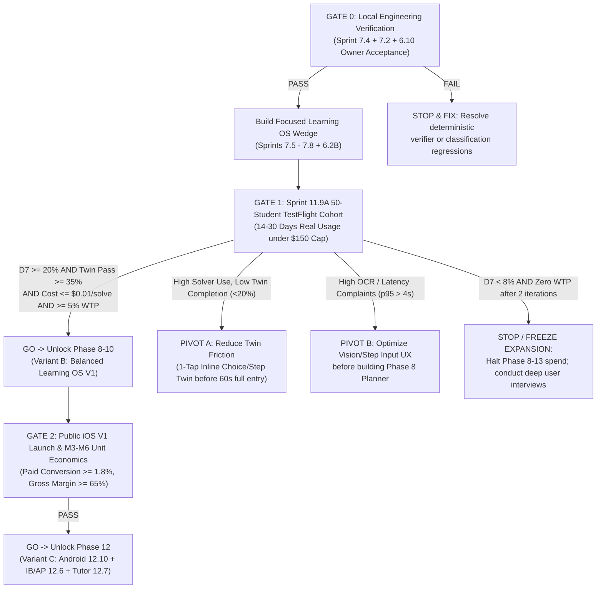

# 87 — Learning OS Strategic Phase and Sprint Expansion Program

## Document Metadata

| Field | Value |
|---|---|
| **Document ID** | `DOC-87` |
| **Canonical Path** | `roadmap/87_LEARNING_OS_STRATEGIC_PHASE_AND_SPRINT_EXPANSION_PROGRAM.md` |
| **Title** | Learning OS Strategic Phase and Sprint Expansion Program |
| **Status** | `CANONICAL_PROGRAM_ROADMAP` (`EXECUTION_GATED_BY_SPRINT_7_4_OWNER_ACCEPTANCE_AND_ADR_011`) |
| **Owner** | Production Engineering Program Manager & Principal Software Architect |
| **Date / Version** | `2026-11-07` / `v1.0.0` |
| **Baseline Commit** | `e39bafe88ea369f98c96a65497a94462dc79ef33` (`main`) |
| **Governing ADRs** | `adr/ADR-004_SEPARATE_PYTHON_MATH_VERIFIER.md`, `adr/ADR-009_CANONICAL_SOLUTION_SET_ALGEBRA_AND_DOMAIN_GUARD.md`, `adr/ADR-010_NATIVE_2D_MATH_RENDERING_AND_STEP_DIFF_HIGHLIGHTING.md`, `adr/ADR-011_FOCUSED_V1_COMMERCIAL_LAUNCH_GATE_BEFORE_PHASE_08_13.md` |

---

## 1. Purpose

This document reconciles the existing 13-phase / 130-sprint repository roadmap (`sprints/00_SPRINT_MASTER_PLAN.md`, `sprints/02_FOCUSED_COMMERCIAL_WEDGE_SPRINT_PROGRAM.md`, `roadmap/43_PRODUCT_AND_TECHNICAL_ROADMAP.md`) with the **Verified AI Learning OS** strategic expansion.

It prevents parallel-roadmap fragmentation by classifying every Learning OS capability into a strict three-way taxonomy (`EXISTING_AND_SUFFICIENT`, `EXISTING_BUT_INCOMPLETE`, `NET_NEW_AND_GATED`), mapping all implementation work into concrete Phase 7–13 sprints (plus a governed conditional Phase 14 boundary), defining three actionable roadmap variants (`FOCUSED`, `BALANCED`, `EXPANSION`), and establishing a formal **Release & Stage-Gate Decision Tree (`GO / PIVOT / STOP`)**.

---

## 2. Sources and Evidence Classification

- `SOURCE_VERIFIED`: Directly verified against Git history (`e39bafe88ea369f98c96a65497a94462dc79ef33`), Flyway migrations (`V001`–`V036`), `sprints/phase07_attempt_mistake_and_mastery_intelligence/SPRINT_7.4_EXECUTION_REPORT.md`, `sprints/02_FOCUSED_COMMERCIAL_WEDGE_SPRINT_PROGRAM.md`, and `adr/ADR-011_FOCUSED_V1_COMMERCIAL_LAUNCH_GATE_BEFORE_PHASE_08_13.md`.
- `ENGINEERING_ESTIMATE`: Sprint scope sizing, migration numbering (`V037+`), and module dependency schedules.
- `FOUNDER_HYPOTHESIS`: Cohort gate thresholds (`D7 >= 20%`, `Twin Completion >= 35%`, `Paid/Trial Interest >= 5%`).

---

## 3. Repository Baseline & Migration Truth (`SOURCE_VERIFIED`)

### 3.1 Git & Sprint Acceptance Ledger at Baseline `f0252b6`

| Sprint / Milestone | Code & Migration State | Owner Acceptance Status | Production Authorization |
|---|---|---|---|
| **Phases 01–05** (`Sprints 1.1–5.10`) | Implemented (`V001`–`V023`, `V027`–`V029`, `V032`) | `OWNER_ACCEPTED` (Local baseline) | Local / Staging only |
| **Sprint 6.1–6.9** | Implemented (`com.verifiedai.tutoring`, `com.verifiedai.solving`) | `LOCAL_ACCEPTANCE_PASSED` | Feature-flagged `false` |
| **Sprint 6.10** *(Phase 6 Exit Gate)* | `SOURCE_COMPLETE` | `PENDING_OWNER_TEST` (`SOURCE_COMPLETE_PENDING_OWNER_ACCEPTANCE`) | `PRODUCTION_NOT_AUTHORIZED` |
| **Sprint 7.1** *(Attempt Lifecycle & Step Persistence)* | Implemented (`V030`, `V031`, `V033`) | `LOCAL_ACCEPTANCE_PASSED` | Feature-flagged `false` |
| **Sprint 7.2** *(Handwritten/Image Attempt Extraction)* | Implemented (`V034` `attempt_structured_work`) | `SOURCE_COMPLETE` / `PENDING_OWNER_TEST` | `PRODUCTION_NOT_AUTHORIZED` |
| **Sprint 7.3** *(Step-by-Step Correctness & First Error)* | Implemented (`V035` `attempt_evaluations`) | `LOCAL_ACCEPTANCE_PASSED` (Run `20261107-025110-XrMKJK`) | Feature-flagged `false` |
| **Sprint 7.4** *(Mistake Taxonomy & Classification Pipeline)* | Implemented (`V036` `attempt_mistake_classifications`) | `LOCAL_ACCEPTANCE_PASSED` | Feature-flagged `false` |
| **Sprint 7.5** *(Longitudinal Mistake DNA Ledger)* | Implemented (`V037` `learner_mistake_dna_profiles`) | `LOCAL_ACCEPTANCE_PASSED` | Feature-flagged `false` |
| **Sprint 7.6** *(Evidence-Stratified Mastery & Prereq Graph)* | Implemented (`V038` `learner_skill_mastery`) | `OWNER_CONFIRMED` | Feature-flagged `false` |
| **Sprint 7.7** *(Mistake Passport iOS UI & Dispute Rollback)* | Implemented (`Features/AttemptAnalysis`) | `LOCAL_ACCEPTANCE_PASSED` (Run `run-QcZF0C`) | Feature-flagged `false` |
| **Sprint 7.8** *(Closed-Loop Twin Remediation Trigger)* | Implemented (`TargetedTwinOrchestrator`) | `LOCAL_ACCEPTANCE_PASSED` (Run `run-8MFfJD`) | Feature-flagged `false` |
| **Sprint 7.9** *(Mastery & Retention Calibration Dashboard)* | Implemented (`MasteryCalibrationRecord`) | `LOCAL_ACCEPTANCE_PASSED` (Run `run-S79ACC`) | Feature-flagged `false` |
| **Sprint 7.10** *(Phase 07 Exit Gate & Brier/ECE Calibration)* | Implemented (`V042` `calibration_records`) | `LOCAL_ACCEPTANCE_PASSED` (Run `run-qb1Xfe`, commit `f4227a0`) | **PHASE 07 EXIT GATE CERTIFIED** |
| **Focused Commercial Wedge (`Sprint 6.2B` + `Sprint 11.9A`)** | Specified in `sprints/02_FOCUSED_COMMERCIAL_WEDGE_SPRINT_PROGRAM.md` | `NOT_STARTED` (0 of 50 TestFlight students tested) | **Blocks Phase 8–13 per `ADR-011`** |
| **Phases 08–13** (`Sprints 8.1–13.10`) | Fully specified in `sprints/phase08..13/` with `LEARNING_OS_PRODUCTION_SPEC_V1` | `BLOCKED_BY_ENTRY_GATE (ADR-011)` | Blocked by `ADR-011` `GO` gate |

### 3.2 Flyway Migration Numbering Reconciliation (`V001`–`V042` vs Planned `V043+`)
- In `services/api/src/main/resources/db/migration/platform/`, active migrations are `V001` through `V023` and `V027` through `V042__mastery_calibration_and_retention_snapshots.sql` (`V024`–`V026` were skipped in historical numbering). Migration head is firmly established at **`V042`**.
- **Mandatory Rule for All Future Sprints:** All net-new database migrations from Sprint `8.1` onward **MUST** allocate sequence numbers starting at **`V043+`** (`PLANNED — exact Flyway version allocated sequentially at implementation time`) and **MUST** extend existing tables rather than re-creating duplicate schemas.

---

## 4. Three-Way Capability Reconciliation Matrix

Before modifying any sprint specification, every Learning OS capability is audited against the repository baseline:

| Learning OS Capability Area | Classification | Existing Repository Assets (`SOURCE_VERIFIED`) | Required Augmentation / Target Sprints |
|---|---|---|---|
| **Canonical Domain & Solution-Set Algebra (`ADR-009`)** | `EXISTING_AND_SUFFICIENT` | `V032`, `canonical_v2.py`, `calculus_domains.py`, `equivalence.py` | Maintain regression suites; no architectural rewrite needed. |
| **Counterexample Generation (`x = c` witness)** | `EXISTING_AND_SUFFICIENT` | `services/math-verifier/app/counterexample_engine.py`, `V030` | Surface directly in Exam Trap Radar Card (`Sprint 7.7`). |
| **2D Native Math Rendering & Step-Diff (`ADR-010`)** | `EXISTING_AND_SUFFICIENT` | `math_visualization.py`, `attempt_diff.py`, iOS `AttemptAnalysis` | Bind token diff highlights to Mistake Passport cards (`Sprint 7.7`). |
| **First Meaningful Error Detection (`V035`)** | `EXISTING_AND_SUFFICIENT` | `AttemptEvaluationService`, `V035__attempt_evaluations.sql` | Passed owner acceptance in `Sprint 7.3`. |
| **Single-Attempt Mistake Classification (`V036`)** | `EXISTING_AND_SUFFICIENT` | `MistakeTaxonomy.java` (17 codes, 5 explicit skill links), `V036` | Completed in `Sprint 7.4`. |
| **Longitudinal Mistake DNA & Mistake Passport** | `EXISTING_AND_SUFFICIENT` | `V037` `learner_mistake_dna_profiles`, Beta-Binomial rate $\theta_{u,m}$, OCR dispute rollback, iOS Passport UI | Completed in `Sprints 7.5, 7.7`. |
| **Verified Counterfactual Twin Engine** | `EXISTING_BUT_INCOMPLETE` | `V031` / `V040` `counterfactual_twin_drills`, `attempt_learning.py` | Expand to 8-family structural invariant verifier + 3-variant ladder (A/B/C) + 60s lock in `Sprint 8.2`. |
| **Evidence-Stratified Mastery (`bkt-lite-v1`/`v2`)** | `EXISTING_AND_SUFFICIENT` | `V038` `learner_skill_mastery`, `V042` Brier/ECE calibration records | Certified in `Sprint 7.6` and `Sprint 7.10`. |
| **Dual-Mode Solver vs Socratic Switcher (`H-13`)** | `NET_NEW_AND_GATED` | Mode enum in `CNT-LOS-06`, Screen 1/2 wireframes | Implement top-level toggle (`SOLVER` vs `SOCRATIC`) in `Sprint 8.4`. |
| **"Snap-to-Plan" Syllabus Ingestion (`H-14`)** | `NET_NEW_AND_GATED` | `CNT-LOS-14` `POST /v1/candidate/syllabus-ingest`, Gemini Flash OCR | Implement camera schedule parser in `Sprint 9.2`. |
| **Pre-Exam 48h Formula & Trap Sheet (`H-15`)** | `NET_NEW_AND_GATED` | `CNT-LOS-15` `cheat-sheet-v1`, on-device `PDFKit` engine | Implement 1-page printable pre-exam digest in `Sprint 9.8`. |
| **Personal AI Math Coach & Daily 15-Min Loop** | `EXISTING_BUT_INCOMPLETE` | `com.verifiedai.tutoring` (`SocraticPolicy`, `HintPolicy`), `HomePlaceholderView.swift` | Replace `HomePlaceholderView.swift` with Daily Coach Hub; wire deterministic `StudyPlanEngine` (`Sprints 8.1, 8.3, 8.4, 8.5`). |
| **YKS (TYT/AYT) Exam Readiness & Net-Gain Simulator** | `EXISTING_BUT_INCOMPLETE` | `sprints/phase09_exam_and_assessment_platform/` (generic templates) | Upgrade Phase 9 (`Sprints 9.1, 9.2, 9.6, 9.7, 9.9`) with credible-interval net formulas (`learning/86`) and high-ROI topic allocator (`H-03`). |
| **StoreKit 2 Monetization & Coach Pro Tiers** | `EXISTING_BUT_INCOMPLETE` | `com.verifiedai.billing` (`EntitlementApplicationService`, `AppleBillingApplicationService`) | Upgrade `Sprints 10.1–10.3` with `COACH_PRO` and `YKS_SEASON_PASS` SKUs, contextual paywalls, and spend guards. |
| **Native Android Client (`Kotlin + Jetpack Compose`)** | `NET_NEW_AND_GATED` | Specified in `Sprint 12.10` (`apps/android/` not yet created) | Execute in `Sprint 12.10` after iOS PMF (`ADR-011` + Phase 11 launch) using shared golden contract fixtures. |
| **B2B2C Teacher / Dershane Co-Pilot & Parent Portal** | `NET_NEW_AND_GATED` | Outlines in `Sprint 12.7` + privacy rules in `security/36` | Execute 1-click PDF share in `Sprint 8.6`, B2B2C coach seat pilot in `Sprint 12.7`, and full institutional workflows in conditional `Phase 14`. |

---

## 5. Phase-by-Phase Augmentation Map (Phases 7–13 + Conditional Phase 14)

1. **Phase 07 (`Attempt, Mistake & Mastery Intelligence` — Active Phase):**
   - **Immediate Gate:** Owner executes `scripts/quality/sprint_7_4_owner_acceptance.sh --full` (and pending `7.2` / `6.10` checks).
   - **Sprints 7.5–7.10 Upgraded Scope:** Deliver the **Verified Mistake DNA Ledger (`Sprint 7.5`)**, **Evidence-Stratified BKT & Prerequisite Graph (`Sprint 7.6`)**, **Mistake Passport iOS Experience & OCR Dispute Rollback (`Sprint 7.7`)**, **Closed-Loop Twin Remediation Trigger (`Sprint 7.8`)**, **Mastery & Retention Calibration Dashboard (`Sprint 7.9`)**, and **Phase 7 Exit Gate (`Sprint 7.10`)**.
2. **Focused Commercial Wedge Gate (`ADR-011` Checkpoint — Parallel or Post-7.8):**
   - Execute `Sprint 6.2B` (Live OpenAI/Anthropic/Gemini adapter validation under `$5/day` spend cap) + `Sprint 11.9A` (50-student Turkish YKS TestFlight cohort over 14–30 days).
   - **Hard Rule:** Phases 08–13 production engineering does **not** unlock until `Sprint 11.9A` records an owner `GO` decision.
3. **Phase 08 (`Adaptive Learning, Verified Twin Practice & Personal AI Coach` — Post-ADR-011 GO):**
   - Transforms generic recommendation templates into the **Daily 15-Minute Personal AI Math Coach (`Sprint 8.1`, `8.4`)**, **8-Family Verified Twin Generator (`Sprint 8.2`)**, **Half-Life Spaced Repetition Scheduler (`Sprint 8.3`)**, **90-Second Triggered Micro-Lessons (`Sprint 8.5`)**, and **Weekly Progress & 1-Click Tutor Share Packet (`Sprint 8.6`)**.
4. **Phase 09 (`Exam Simulation, YKS Readiness & Net-Gain Analytics`):**
   - Delivers **Timed Diagnostic & Mock Engine (`Sprint 9.1`, `9.2`)**, **Post-Exam Mistake Attribution (`Sprint 9.6`)**, **YKS Net-Gain Simulator with 90% Credible Intervals (`Sprint 9.7`)**, and **Psychometric Calibration (`Sprint 9.8`, `9.9`)**.
5. **Phase 10 (`Monetization, Growth Loops & Experimentation`):**
   - Delivers **Free / Pro / Coach Pro / YKS Season Pass Entitlements (`Sprint 10.1`)**, **Contextual Value-First Paywalls (`Sprint 10.2`)**, **Quota & Unit-Economics Enforcement (`Sprint 10.3`)**, and **Randomized Crossover Learning/Monetization Experiments (`Sprint 10.5`, `10.10`)**.
6. **Phase 11 (`Production Hardening, App Store Compliance & Public V1 Launch`):**
   - Enforces KVKK/GDPR/Apple `5.1.2(i)` AI consent and `3.1.2` subscription gates (`Sprint 11.9` / `11.10`).
7. **Phase 12 (`International Curriculum, B2B2C Tutor Co-Pilot & Native Android`):**
   - Delivers **IB/AP/SAT International Track (`Sprint 12.6`)**, **Consent-Gated Tutor/Parent Portal (`Sprint 12.7`)**, and **Native Android Kotlin/Jetpack Compose Parity (`Sprint 12.10`)**.
8. **Phase 13 (`Proprietary ML Evolution & Model Independence`):**
   - Distills opt-in de-identified verification traces (`ADR-006`) into low-cost verifier-guided routing and OCR models (`Sprints 13.1–13.10`).
9. **Conditional Phase 14 Proposal (`Phase 14: Institutional Classroom Mistake Intelligence & Multi-Seat B2B2C Co-Pilot`):**
   - Governed by `operations/70_RELEASE_TRAINS_AND_BACKLOG_PROMOTION.md`. Unlocked **only if** consumer ARR exceeds `$150k` and $\ge 15$ private tutors/institutions sign paid pilot LOIs in `Sprint 12.7`. Covers multi-teacher organization workspaces, bulk verified homework pack assignment, and classroom-level anonymized mistake heatmaps.

---

## 6. Consolidated Sprint Implementation Traceability Table

| Phase | Sprint | Current Status | Learning OS Capability | Primary Backend Modules (`com.verifiedai.*`) | Primary Verifier Modules (`services/math-verifier/`) | iOS Modules (`apps/ios/VerifiedAI/`) | Android Impact (`apps/android/`) | DB Migration Impact (`PLANNED V037+`) | AI Capability Impact | Analytics Impact | Entitlement Impact | Entry Gate | Exit Gate | Owner Acceptance Command |
|---|---|---|---|---|---|---|---|---|---|---|---|---|---|---|
| **P07** | **7.4** | `SOURCE_COMPLETE` / `PENDING_OWNER_TEST` | Single-attempt Mistake Taxonomy & Classifier (`V036`) | `attempt`, `mistake` | `attempt_diagnosis.py` | `Features/AttemptAnalysis` | Parity contract only | `V036` (Exists) | `MISTAKE_CLASSIFY` (optional fallback) | `attempt_mistake_classified` | `FREE` / `PRO` | Sprint 7.3 passed | All A–F gates green | `bash scripts/quality/sprint_7_4_owner_acceptance.sh --full` |
| **P07** | **7.5** | `SOURCE_COMPLETE_PENDING_OWNER_TEST` | Longitudinal Mistake DNA Ledger, Beta-Binomial Rate $\theta_{u,m}$, Recurrence State Machine & OCR Dispute Rollback | `mistake`, `attempt` | `attempt_diagnosis.py` | `Features/AttemptAnalysis` | Shared JSON schema | `V037 SOURCE_ONLY` (`learner_mistake_dna_profiles`, `learner_mistake_dispute_events`) | None (100% deterministic) | `mistake_dna_updated`, `attempt_diagnosis_disputed` | `FREE` (top 2 traps), `PRO` (full ledger) | Sprint 7.4 owner accepted | Zero downstream double-counting; rollback `<250ms` | `bash scripts/quality/sprint_7_5_owner_acceptance.sh --full` |
| **P07** | **7.6** | `PLANNED` | Evidence-Stratified Mastery (`INDEPENDENT` vs `HINT_ASSISTED` `0.78` cap) & Prerequisite Graph Propagation | `mastery`, `attempt`, `curriculum` | `attempt_learning.py` | `Features/AttemptAnalysis` | Shared JSON schema | `PLANNED V038` (`learner_skill_mastery_evidence_log`, prereq cache) | None (100% deterministic) | `skill_mastery_updated` | `FREE` / `PRO` | Sprint 7.5 accepted | Property tests on BKT bounds & caps pass | `bash scripts/quality/sprint_7_6_owner_acceptance.sh --full` |
| **P07** | **7.7** | `PLANNED` | Mistake Passport & Exam Trap Radar API + Native iOS Screens | `mistake`, `attempt` | `counterexample_engine.py` | `Features/AttemptAnalysis`, `Features/Home` | DTO contract | Read-optimized projections on `V036`/`V037` | `EXPLAIN` (cached trap summaries) | `mistake_passport_viewed` | `FREE` preview / `PRO` full | Sprint 7.6 accepted | iOS UI + API contract tests green | `bash scripts/quality/sprint_7_7_owner_acceptance.sh --full` |
| **P07** | **7.8** | `PLANNED` | Closed-Loop Remediation: 60s Locked Twin Retry -> Mistake DNA Resolution | `attempt`, `mistake`, `mastery` | `attempt_learning.py`, `attempt_verification_v2.py` | `Features/ProblemSolving`, `Features/AttemptAnalysis` | DTO contract | Updates `V031` `counterfactual_twin_drills` + `V037` | `PRACTICE_GENERATE` (fallback only) | `twin_challenge_submitted`, `mistake_dna_state_transitioned` | `FREE` (1/day), `PRO` (unlimited) | Sprint 7.7 accepted | 2 independent passes required for resolution | `bash scripts/quality/sprint_7_8_owner_acceptance.sh --full` |
| **P07** | **7.9** | `PLANNED` | Mastery, Retention Half-Life & Mistake Calibration Dashboard | `mastery`, `analytics` | None | `Features/Home`, `Features/ProblemReview` | DTO contract | `PLANNED V039` (`learner_calibration_snapshots`) | None | `mastery_graph_viewed` | `PRO` / `COACH_PRO` | Sprint 7.8 accepted | Brier score $\le 0.20$, ECE $\le 0.08$ | `bash scripts/quality/sprint_7_9_owner_acceptance.sh --full` |
| **P07** | **7.10** | `PLANNED` | Phase 07 Exit Gate & Golden Pedagogical Verification Suite | `attempt`, `mistake`, `mastery` | All `verifiers/` | All Phase 7 views | Contract freeze | Schema audit `V030`–`V039` | Spend & fallback audit | Full Phase 7 funnel telemetry | All tiers | Sprints 7.1–7.9 accepted | 100% Phase 7 exit criteria + privacy cascade green | `bash scripts/quality/sprint_7_10_owner_acceptance.sh --full` |
| **WEDGE** | **6.2B + 11.9A** | `PLANNED` (`ADR-011`) | Live Cloud AI Adapter Validation + 50-Student TestFlight Beta Cohort | `ai`, `solving`, `attempt`, `billing` | Full verifier firewall | TestFlight build | None | `V016`/`V017` spend guards active | Live OpenAI / Anthropic / Gemini | Cohort D1/D7, Twin rate, WTP survey | Beta entitlement | Sprint 7.4 (or 7.8) accepted | Owner records `GO` in `ADR-011` | `bash scripts/quality/focused_wedge_gate_check.sh` |
| **P08** | **8.1** | `BLOCKED_BY_ADR_011` | Deterministic Next-Best-Action Recommendation Engine ($P_{u,m}$ + ROI) | `studyplan`, `mastery`, `mistake` | None | `Features/Home` | DTO contract | `PLANNED V040` (`learner_recommendations`) | None (deterministic ranker) | `recommendation_generated` | `FREE` (1/day), `PRO` | `ADR-011` `GO` + P07 exit | Deterministic ranking reproducibility 100% | `bash scripts/quality/sprint_8_1_owner_acceptance.sh --full` |
| **P08** | **8.2** | `BLOCKED_BY_ADR_011` | 8-Family Verified Twin Generator & Progressive Variant Ladder (A/B/C) | `studyplan`, `attempt` | `attempt_learning.py`, `canonical_v2.py` | `Features/ProblemSolving` | DTO contract | `PLANNED V041` (`twin_template_catalog`, `V031` ext) | `PRACTICE_GENERATE` + SymPy gate | `twin_variant_generated` | `PRO` / `COACH_PRO` | Sprint 8.1 accepted | 100% SymPy trap invariant pass across 8 families | `bash scripts/quality/sprint_8_2_owner_acceptance.sh --full` |
| **P08** | **8.3** | `BLOCKED_BY_ADR_011` | Half-Life Spaced Repetition & 7-Day Trap Immunity Scheduler | `studyplan`, `mastery` | None | `Features/Home` | DTO contract | `PLANNED V042` (`spaced_review_queue`) | None | `spaced_review_completed` | `PRO` / `COACH_PRO` | Sprint 8.2 accepted | Spaced vs massed half-life law verified | `bash scripts/quality/sprint_8_3_owner_acceptance.sh --full` |
| **P08** | **8.4** | `BLOCKED_BY_ADR_011` | Daily 15-Minute Personal AI Coach Session & Goal Planner | `studyplan`, `tutoring` | None | `Features/Home` (replaces placeholder) | DTO contract | `PLANNED V043` (`daily_coach_sessions`) | `EXPLAIN` (session briefing) | `coach_daily_mission_completed` | `FREE` (limited), `COACH_PRO` | Sprint 8.3 accepted | `<200ms` cached load; zero unverified coach claims | `bash scripts/quality/sprint_8_4_owner_acceptance.sh --full` |
| **P08** | **8.5** | `BLOCKED_BY_ADR_011` | 90-Second Triggered Interactive Micro-Lessons for Recurring Traps | `tutoring`, `mistake` | `math_visualization.py` | `Features/Tutor` | DTO contract | `PLANNED V044` (`micro_lesson_cards`) | `TUTOR` + schema guard | `micro_lesson_completed` | `PRO` / `COACH_PRO` | Sprint 8.4 accepted | Triggered after 2nd fail; SymPy-checked examples | `bash scripts/quality/sprint_8_5_owner_acceptance.sh --full` |
| **P08** | **8.6** | `BLOCKED_BY_ADR_011` | Weekly Progress Digest & Privacy-Safe 1-Click Tutor/Parent PDF Packet | `analytics`, `studyplan`, `notification` | None | `Features/Account`, `Features/Home` | DTO contract | `PLANNED V045` (`weekly_learner_digests`) | None | `weekly_tutor_packet_exported` | `FREE` / `PRO` | Sprint 8.5 accepted | Zero PII/chat leakage in exported PDF | `bash scripts/quality/sprint_8_6_owner_acceptance.sh --full` |
| **P09** | **9.1–9.2** | `SPRINT_9.1_LOCAL_ACCEPTANCE_PASSED` / `9.2_LOCAL_ACCEPTANCE_PASSED` | Exam Definitions (`V054`), Candidate Profiles, Accommodations & Snap-to-Plan (`V055`) | `exam`, `curriculum`, `studyplan` | None (pure Java/SQL) | `Features/Exam` | DTO & Draft 2020-12 schemas | `V054` + `V055` (`candidate_profiles`, `candidate_profile_horizon_history`, `candidate_syllabus_uploads`) + `PLANNED V056–V058` | Default `false` (`DeterministicSyllabusVisionGateway`) | `verifiedai.exam.*`, `syllabus_*` metrics | `FREE` (3 scans/mo), `COACH_PRO` | Sprint 9.1 accepted | Weight conservation, horizon feasibility, SHA-256 dedup & BOLA | `bash scripts/quality/sprint_9_2_owner_acceptance.sh --full --require-docker` |
| **P09** | **9.6–9.9** | `BLOCKED_BY_ADR_011` | Post-Exam Mistake Attribution, YKS Net-Gain Simulator & Readiness Credible Intervals | `exam`, `mistake`, `mastery` | `attempt_diagnosis.py` | `Features/Exam`, `Features/Home` | DTO contract | `PLANNED V059–V062` (`exam_readiness_projections`) | `EXPLAIN` (post-exam summary) | `exam_readiness_viewed` | `COACH_PRO` / `YKS_SEASON_PASS` | Sprint 9.2 accepted | 90% credible interval & trap attribution verified | `bash scripts/quality/sprint_9_7_owner_acceptance.sh --full` |
| **P10** | **10.1–10.3** | `BLOCKED_BY_ADR_011` | StoreKit 2 Tiered Entitlements (`Pro`, `Coach Pro`, `YKS Season Pass`), Contextual Paywalls & Quotas | `billing`, `ai` | None | `Features/Subscription` | Billing contract | `PLANNED V048` (`entitlement_quota_ledgers`) | Hard quota & spend caps | `paywall_viewed`, `subscription_started` | Enforces all tiers | Phase 08/09 core ready | Apple `3.1.2` compliance & webhook idempotency | `bash scripts/quality/sprint_10_3_owner_acceptance.sh --full` |
| **P11** | **11.9–11.10**| `BLOCKED_BY_ADR_011` | Production Hardening, KVKK/Apple `5.1.2(i)` Consent & Public V1 Launch | All backend modules | Full verifier service | Full iOS app | None | Production readiness audit | Full circuit-breaker & cost guard | Release health metrics | Live StoreKit 2 | Phase 10 exit gate | Zero P0/P1 defects; legal/privacy sign-off | `bash scripts/quality/sprint_11_10_owner_acceptance.sh --full` |
| **P12** | **12.6–12.10**| `BLOCKED_BY_ADR_011` | International Curricula (`IB/AP/SAT`), Consent-Gated Tutor Portal & Native Android (`Kotlin/Compose`) | `curriculum`, `account`, `billing` | Locale-neutral math AST | Shared parity fixtures | Full `apps/android/` build | `PLANNED V049` (`coach_student_links`, Play Billing) | Multi-locale prompts | Cross-platform parity events | Play Billing + B2B2C seats | Phase 11 V1 launch stable | 100% iOS/Android golden math & rendering parity | `bash scripts/quality/sprint_12_10_owner_acceptance.sh --full` |

### 6.1 Integration of Document 93 & Phase 14 (`SPRINT_14.1`–`SPRINT_14.10`): Active Scaffolding, Verified Twin Engine & Interactive Socratic Canvas

Per `learning/93_ACTIVE_SCAFFOLDING_TWIN_VERIFICATION_AND_INTERACTIVE_CANVAS_SPECIFICATION.md` and `sprints/phase14_active_scaffolding_twin_mastery_and_interactive_canvas/PHASE_14_ACTIVE_SCAFFOLDING_TWIN_MASTERY_AND_INTERACTIVE_CANVAS.md`, three high-leverage pedagogical pillars are specified across a dedicated 10-sprint Phase 14 execution track (`SPRINT_14.1`–`SPRINT_14.10`) with non-breaking fast-track bridge hooks (`Sprint 6.5B`, `Sprint 7.8B`, `Sprint 8.6B`) to decisively out-compete passive AI video solvers (e.g., Solvi / Solvely) while preserving all existing system invariants:

1. **Pillar 1 — 4-Tier Active Cognitive Scaffolding & Misconception Root-Cause Diagnosis (`SPRINT_14.1`, `SPRINT_14.2`, `SPRINT_14.5` / Fast-Track `Sprint 6.5B`):**
   - Implements the 4-tier finite state machine (`TIER_1_CONCEPT` → `TIER_2_STRATEGY` → `TIER_3_CRITICAL_MOVE` → `TIER_4_FULL_SOLUTION`) backed by `V039` (`socratic_scaffolding_sessions`) and SymPy distractor non-equivalence verification (`scaffolding_breakpoint.py`).
   - Prevents immediate answer-dumping; guarantees that the student cognitively engages with the mathematical breakpoint before complete proof exposure, and isolates prerequisite root-cause slips (e.g., $2^n=4 \implies n=3$) via `PrerequisiteRootCauseAnalyzer.java`.

2. **Pillar 2 — SymPy CAS-Verified Parametric Isomorphic Twin Engine & Timed Mastery Challenge (`SPRINT_14.3`, `SPRINT_14.4` / Fast-Track `Sprint 7.8B`):**
   - Augments Sprint 7.8's remediation trigger with `yks_isomorphic_twin_generator.py` covering 12 YKS/AYT/LGS families (`FAM_01`–`FAM_12`) at `<150ms` (`p95`) and `$0.00` LLM token cost.
   - Enforces the 60–120 second timed independent verification challenge (`V040` `verified_twin_mastery_verifications`) required to award `1.00x` `bkt-lite-v2` mastery credit and transition Mistake DNA entries to `MASTERED_CLOSED`.

3. **Pillar 3 — Bidirectional Interactive Socratic Canvas & Turkish Math Neural TTS (`SPRINT_14.6`, `SPRINT_14.7`, `SPRINT_14.8`, `SPRINT_14.9`, `SPRINT_14.10` / Fast-Track `Sprint 8.6B`):**
   - Replaces passive `.mp4` video generation (Solvi's `$0.08–$0.25/video` model) with a `<32KB` 60-fps declarative vector stream (`V041` `interactive_canvas_stroke_streams`), Turkish mathematical speech normalization (`turkish_math_speech_normalizer.py`), and bidirectional `PencilKit` live ink step verification (`V042` `canvas_learner_ink_interventions`) capped at `<= $0.0080/session`.

---

## 7. Three Strategic Roadmap Variants

To give the solo founder explicit operational control over scope, burn rate, and time-to-market, three execution variants are defined:

### 7.1 Variant A: `FOCUSED — SOLO FOUNDER` (Minimum Viable Learning OS Wedge — 6 to 8 Weeks)
- **Objective:** Prove the core **Attempt -> First Mistake -> Counterexample -> Verified Twin -> Mistake Passport** loop with 50 real Turkish YKS students before building multi-month study planners or full exam simulators.
- **Included Scope:**
  1. Complete owner acceptance on `Sprint 7.4`, `Sprint 7.2`, and `Sprint 6.10`.
  2. Implement `Sprints 7.5–7.8` (Mistake DNA Ledger, Evidence-Separated BKT-lite, Mistake Passport iOS screen, and 60s Locked Twin Remediation).
  3. Execute `Sprint 6.2B` (Live cloud AI routing under `$5/day` cap) + `Sprint 11.9A` (50-student TestFlight cohort).
- **Explicitly Deferred Until Cohort `GO`:** Phases 08, 09, 10, 12, 13.

### 7.2 Variant B: `BALANCED — LEARNING OS V1 (RECOMMENDED)` (16 to 24 Weeks Across Gate Checkpoints)
- **Objective:** Deliver the complete consumer **Verified AI Learning OS** for iOS in Turkey (High School + YKS TYT/AYT), unlocking sustainable subscription unit economics.
- **Included Scope:**
  1. Everything in **Variant A** through the `ADR-011` `GO` decision.
  2. **Phase 08 Core (`Sprints 8.1–8.6`):** Daily 15-Minute Personal AI Math Coach, 8-family Twin Engine, Half-Life Spaced Repetition, 90s Micro-Lessons, and 1-Click Weekly Tutor/Parent PDF Share Packet.
  3. **Phase 09 Core (`Sprints 9.1, 9.2, 9.6, 9.7`):** Timed 10-question Diagnostics, Post-Exam Mistake Attribution, and YKS Net-Gain Simulator.
  4. **Phase 10 & 11 Launch (`Sprints 10.1–10.3, 11.9–11.10`):** StoreKit 2 `Pro`, `Coach Pro`, and `YKS Season Pass` monetization + public App Store release.
- **Explicitly Deferred to V1.5+:** Native Android (`Sprint 12.10`), live multi-seat B2B2C teacher dashboards (`Sprint 12.7` / `Phase 14`), and proprietary model fine-tuning (`Phase 13`).

### 7.3 Variant C: `EXPANSION — YKS + ANDROID + B2B2C` (28 to 40 Weeks — Post-PMF Scale)
- **Objective:** Capture the full 65%+ Android segment of the Turkish YKS market, expand internationally to English tier-1 exams (`IB/AP/SAT`), and monetize private tutors/dershanes via B2B2C coach seats.
- **Included Scope:** Everything in **Variant B** + `Sprint 12.6` (International curricula), `Sprint 12.7` (Consent-gated Tutor/Parent Link), `Sprint 12.10` (Native Android Kotlin/Jetpack Compose client with 2D math rendering parity), and conditional `Phase 14`.

---

## 8. Formal Stage-Gate Release Decision Tree (`GO / PIVOT / STOP`)

---

## 9. Requirements, Assumptions, Non-Goals, and Acceptance Criteria

### 9.1 Requirements
- `PROG-REQ-001`: No sprint specification in `docs/verified_ai_learning_platform_docs_v4/sprints/` may reference obsolete package roots (`com.verifiedlearning`) or iOS paths (`apps/ios/VerifiedLearning`) when updated for implementation.
- `PROG-REQ-002`: Every database migration planned after `V036` must be numbered `V037+` (`PLANNED`) and reconcile cleanly with `V030`–`V036`.
- `PROG-REQ-003`: `ADR-011` commercial validation gate remains binding before Phase 8–13 production rollouts.

### 9.2 Acceptance Criteria
1. `sprints/00_SPRINT_MASTER_PLAN.md`, `roadmap/43_PRODUCT_AND_TECHNICAL_ROADMAP.md`, and upgraded Phase 7–12 sprint specs match the Consolidated Traceability Table (Section 6).
2. Static documentation check (`python3 scripts/quality/docs_check.py`, executed manually by owner) passes with zero broken Markdown links or manifest mismatches.

---

## 10. Risks and Open Decisions

- **Risk `R-PROG-01` (Solo-Founder Context Switching Across Backend, Python, and iOS):**
  - *Mitigation:* Execute vertically by user-visible loop (`Sprint 7.5` backend ledger -> `Sprint 7.6` mastery policy -> `Sprint 7.7` iOS Mistake Passport -> `Sprint 7.8` Twin closure) with deterministic acceptance scripts per sprint.
- **Open Decision `OD-PROG-01`:** Whether `Sprint 11.9A` (50-student TestFlight cohort) is triggered immediately after `Sprint 7.4` owner acceptance or after `Sprint 7.8` (recommended: trigger internal TestFlight smoke immediately after `7.4` + `6.2B`, and run the formal 50-student retention measurement once `7.7/7.8` Mistake Passport + Twin closure are in the build).

---

## 11. Cross-References

- `00_MASTER_INDEX.md`
- `sprints/00_SPRINT_MASTER_PLAN.md`
- `sprints/01_SPRINT_EXECUTION_STANDARD.md`
- `sprints/02_FOCUSED_COMMERCIAL_WEDGE_SPRINT_PROGRAM.md`
- `roadmap/43_PRODUCT_AND_TECHNICAL_ROADMAP.md`
- `roadmap/67_PRODUCT_PROGRAM_STRUCTURE.md`
- `roadmap/68_PRODUCTION_V1_CAPABILITY_COVERAGE_MATRIX.md`
- `roadmap/80_UNIT_ECONOMICS_30_DAY_LAUNCH_CONTRACT_AND_EXECUTION_ROADMAP.md`
- `roadmap/88_LEARNING_OS_MONETIZATION_GROWTH_AND_VALIDATION_PLAN.md`
- `operations/70_RELEASE_TRAINS_AND_BACKLOG_PROMOTION.md`
- `adr/ADR-011_FOCUSED_V1_COMMERCIAL_LAUNCH_GATE_BEFORE_PHASE_08_13.md`

### Sprint 7.5 source handoff — 2026-11-09

Implementation, contracts, tests and owner runner are authored; none was executed by the agent. Sprint 7.4's committed
implementation does not establish a passing FULL owner run. That entry gate remains open. See
`sprints/phase07_attempt_mistake_and_mastery_intelligence/SPRINT_7.5_EXECUTION_REPORT.md`.
No source status grants acceptance, rollout authorization, phase completion or permission to start Sprint 7.6.
