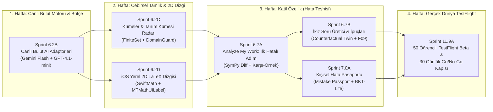

# Focused Commercial Wedge — Production Sprint Program (Sprints 6.2B–11.9A)

- **Publication Date:** 2026-11-01
- **Status:** CANONICAL PRODUCTION EXECUTION SPECIFICATION (V6)
- **Governing Architecture & ADRs:**
  - `adr/ADR-008_MANAGED_CLOUD_API_ROUTING_AND_QWEN_4B_DE_PROMOTION.md`
  - `adr/ADR-009_CANONICAL_SOLUTION_SET_ALGEBRA_AND_DOMAIN_GUARD.md`
  - `adr/ADR-010_NATIVE_2D_MATH_RENDERING_AND_STEP_DIFF_HIGHLIGHTING.md`
  - `adr/ADR-011_FOCUSED_V1_COMMERCIAL_LAUNCH_GATE_BEFORE_PHASE_08_13.md`
  - `architecture/75_PRODUCTION_ARCHITECTURE_AUDIT_AND_EVIDENCE_LEDGER.md`
  - `product/76_COMPETITIVE_INTELLIGENCE_AND_MARKET_POSITIONING_MATRIX.md`
  - `ai/77_PRODUCTION_MATH_MODEL_BENCHMARK_AND_BUILD_VS_BUY_STRATEGY.md`
  - `ai/78_SYMBOLIC_VERIFICATION_ENGINE_V2_AND_DOMAIN_TRAP_RADAR.md`
  - `learning/79_PEDAGOGICAL_DIAGNOSIS_HANDWRITING_UX_AND_RETENTION_ENGINE.md`
  - `roadmap/80_UNIT_ECONOMICS_30_DAY_LAUNCH_CONTRACT_AND_EXECUTION_ROADMAP.md`

---

## 1. Executive Charter & Strategic Intent (Stratejik Amaç ve Kapsam)

### 1.1 Neden Bu Genişletilmiş Sprint Programı Gereklidir?
Mevcut kod tabanı (`e6a928d`), `Sprint 6.2` (Doğrulama Şeffaflığı ve Kanıt Kullanıcı Deneyimi) seviyesine kadar olan 23 Flyway migrasyonunu, PostgreSQL veri modellerini, StoreKit 2 ödeme mutabakatını, S3 presigned yükleme hattını ve sıfır `eval` kullanan deterministik SymPy matematik doğrulayıcısını başarıyla yerel testlerden geçirmiştir.

Ancak derin teknik ve ticari denetim (`architecture/75`, `roadmap/80`), projenin canlıya çıkması önünde **4 kritik mühendislik boşluğu** olduğunu tespit etmiştir:
1. **Canlı Bulut AI Motoru Yokluğu:** Sistemde yalnızca yerel fixture'lar ve dondurulmuş `Qwen3.5-4B` (`vLLM`) adaptörü bulunmaktadır; hiçbir yönetilen bulut modeli (`Gemini 2.5 Flash`, `GPT-4.1-mini`, `o4-mini`) henüz canlı API ile uçtan uca bağlanmamıştır (`ADR-008`).
2. **Cebirsel Tek Kök Kısıtı:** `CanonicalSolution.java` ve `canonical_execution.py`, denklemlerde yalnızca tekil `x = c` eşitliğini desteklemekte; lise ve YKS'nin temeli olan 2. derece çoklu kökleri (`FiniteSet`), boş kümeyi (`EmptySet`), aralıkları (`Interval`) ve paydayı sıfır yapan yalancı kök tuzaklarını (`DomainConstraintGuard`) doğrulamamaktadır (`ADR-009`).
3. **Düz Metin Monospaced Görünüm:** iOS `MathematicalExpressionView.swift` formülleri düz metin basmakta; kesirli, köklü ve integralli ifadeler ders kitabı kalitesinde 2D render edilmemektedir (`ADR-010`).
4. **Katil Farklılaştırıcı Özelliğin Sırası:** Photomath, Symbolab ve ChatGPT'nin yapamadığı en büyük rekabetçi silah olan **"Öğrencinin Kendi El Yazısı Çözümünde İlk Hatalı Adımı Bulma (`Analyze My Work`)"** özelliği eski planda ötelenmiştir.

Bu program, `ADR-011` uyarınca Faz 8–13'ü dondurarak, **30 gün içinde çalışan, canlı AI destekli, 2D matematik gösteren ve 50 gerçek öğrencinin elinde test edilen ticari bir çekirdeği (`Focused Commercial Wedge`)** hayata geçiren 7 üretim seviyesinde sprintten oluşur.

---

## 2. Sprint Sequence & Master Delivery Timeline (Sprint Sırası ve Takvim)

---

## 3. Exhaustive Production Sprint Specifications

---

### Sprint 6.2B — Live Cloud AI Provider Integration & Spend Guard Activation
- **Ana Hedef:** Depodaki `VllmSolveProviderAdapter` (`Qwen/Qwen3.5-4B`) yapısını çevrimdışı CI profiline almak; `GeminiVisionProviderAdapter` (`Gemini 2.5 Flash`) ve `OpenAiSolveProviderAdapter` (`GPT-4.1-mini` + `o4-mini`) sınıflarını yazarak gerçek uçtan uca çözümleri `PostgresAiSpendGuard` atomik bütçe denetimi altında çalıştırmak.
- **Yöneten Karar:** `adr/ADR-008_MANAGED_CLOUD_API_ROUTING_AND_QWEN_4B_DE_PROMOTION.md`, `ai/25_AI_ORCHESTRATION_AND_MODEL_ROUTING.md`, `ai/77_PRODUCTION_MATH_MODEL_BENCHMARK_AND_BUILD_VS_BUY_STRATEGY.md`.
- **Kabiliyet & Gereksinim Haritası:** `CAP-AI-001`, `CAP-SOLVE-003`, `REQ-AI-001`, `REQ-AI-004`, `REQ-AI-005`.

#### Somut Mimari ve Kod Değişiklikleri:
1. **`services/api/src/main/java/com/verifiedai/ai/infrastructure/provider/openai/`:**
   - `OpenAiSolveProviderAdapter.java`: OpenAI HTTP Client / Official SDK entegrasyonu; `Structured Outputs` (`response_format: { type: "json_schema", json_schema: ... }`) ile `CanonicalMathDocument` AST JSON şemasına `%100` uyum.
   - `OpenAiReasoningSolveProviderAdapter.java`: `o4-mini` için akıl yürütme sağlayıcısı (`max_completion_tokens <= 2048`, `reasoning_effort: "medium"`).
2. **`services/api/src/main/java/com/verifiedai/ai/infrastructure/provider/gemini/`:**
   - `GeminiVisionProviderAdapter.java`: Google Vertex AI / AI Studio API entegrasyonu; `VISION_PARSE` ve `PROBLEM_NORMALIZE` için yüksek kaliteli multimodal OCR ve transkripsiyon.
3. **`services/api/src/main/resources/application.yml`:**
   - Canlı sağlayıcı anahtarları (`OPENAI_API_KEY`, `GEMINI_API_KEY`) ortam değişkeni üzerinden okunur.
   - `vllm.enabled: false` kalır; aktif sağlayıcı profili `managed-cloud` yapılır.
4. **`PostgresAiSpendGuard.java` Mutabakatı:**
   - Canlı API yanıtındaki gerçek `prompt_tokens`, `completion_tokens` ve `cached_tokens` metrikleri okunarak veritabanındaki rezervasyon ile kapatılır (`recordSettlement`).
   - Soru başına maksimum harcama tavanı (`$0.025`) aşılırsa çağrı atomik olarak engellenir.

#### Kabul Kriterleri (Acceptance Gates):
- **Kapı A (Birim & Sözleşme Testleri):** `OpenAiSolveProviderAdapterTest` ve `GeminiVisionProviderAdapterTest` mock HTTP yanıtlarıyla şema ayrıştırmasını, ağ hatası geri dönüşlerini (fallback) ve bütçe rezervasyon iptallerini `%100` test eder.
- **Kapı B (Canlı Duman Testi - Opt-in):** Sahip onaylı canlı anahtarla `tests/e2e/live_solve_test` çalıştırıldığında: iOS'tan yüklenen bir fotoğraf -> `Gemini 2.5 Flash` ile OCR edilir -> `GPT-4.1-mini` ile çözülür -> `math-verifier` ile doğrulanır -> iOS ekranına `VERIFIED` döner.
- **Gecikme & Maliyet:** 1 standart denklem çözümü `p95 < 4.5 sn`, maliyet `~ $0.0035`.

---

### Sprint 6.2C — Canonical Solution Set Algebra, Extraneous Root Elimination & Domain Constraint Guard
- **Ana Hedef:** `CanonicalSolution.java` ve Python `canonical_execution.py` bileşenlerini `canonical_v2` şemasına yükseltmek; tekil kök kısıtını kaldırıp çoklu kök kümelerini (`FiniteSet`), boş kümeyi (`EmptySet`), eşitsizlik aralıklarını (`Interval`) ve paydayı/çift kökü bozan yalancı kökleri (`DomainConstraintGuard`) deterministik olarak doğrulamak.
- **Yöneten Karar:** `adr/ADR-009_CANONICAL_SOLUTION_SET_ALGEBRA_AND_DOMAIN_GUARD.md`, `ai/78_SYMBOLIC_VERIFICATION_ENGINE_V2_AND_DOMAIN_TRAP_RADAR.md`.
- **Kabiliyet & Gereksinim Haritası:** `CAP-VERIFY-001`, `CAP-VERIFY-003`, `REQ-MATH-002`, `REQ-MATH-003`.

#### Somut Mimari ve Kod Değişiklikleri:
1. **`services/api/src/main/java/com/verifiedai/solving/domain/model/canonical/`:**
   - `CanonicalSolution.java`: `SOLVE_FINAL_EQUATION_NOT_ISOLATED` kısıtı gevşetilir; `outcomeType: SOLUTION_SET` türü eklenir. `FiniteSet` (`List<CanonicalNode>`), `Interval` (`start`, `end`, `leftOpen`, `rightOpen`), `Union` ve `EmptySet` AST düğümleri tanımlanır.
2. **`services/math-verifier/app/verifiers/domain_guard.py`:**
   - `DomainConstraintGuard`: SymPy `continuous_domain` kullanılarak orijinal problemin doğal tanım kümesi $D_{\text{natural}}$ çıkarılır.
   - Payda sıfır ($\text{denom}(x) = 0$), çift kök içi negatif ($g(x) < 0$), logaritma taban/argüman kısıtları taranır.
   - Çözücünün bulduğu köklerden $r \notin D_{\text{natural}}$ olanlar `extraneous_roots` olarak işaretlenir. Eğer aday çözüm bu kökü doğru kabul etmişse sonuç **`CONTRADICTED` (`SOLVE_EXTRANEOUS_ROOT_INCLUDED`)** döner.
3. **`services/math-verifier/app/verifiers/canonical_execution.py`:**
   - SymPy `solveset(f(x), x, domain=S.Reals)` motoruna bağlanır. Bulunan sonlu kök kümesi adayın sunduğu kök kümesiyle `Set` eşitliği üzerinden doğrulanır.

#### Kabul Kriterleri (Acceptance Gates):
- **Kapı A (İkinci Dereceden Denklemler):** $x^2 - 5x + 6 = 0 \implies x \in \{2, 3\}$ tam olarak `VERIFIED` döner.
- **Kapı B (Yalancı Kök Tuzağı):** $\frac{x^2-4}{x-2} = 0$ sorusunda model $x=2$ ve $x=-2$ derse verifier $x=2$'yi `DENOMINATOR_ZERO` ile reddeder ve çözümü `CONTRADICTED` yapar. Doğru çözüm $x \in \{-2\}$ sunulduğunda `VERIFIED` + ekranda *"Tuzak Kök x=2 Elendi"* rozeti basılır.
- **Kapı C (Eşitsizlik Aralıkları):** $2x - 4 > 6 \implies x \in (5, \infty)$ açık aralık olarak doğrulanır.
- **Python Testleri:** Mevcut 338 teste en az 40 yeni küme ve tanım kümesi testi eklenir (`test_domain_guard.py`, `test_solution_sets.py`).

---

### Sprint 6.2D — Native iOS 2D Mathematical Rendering & Sub-Expression Diff Highlighting
- **Ana Hedef:** iOS `MathematicalExpressionView.swift` bileşenindeki düz metin (`Text` monospaced) görünümünü kaldırıp, CoreGraphics tabanlı yerel 2D matematiksel dizgi motorunu (`SwiftMath` / `MTMathUILabel`) entegre etmek; adım geçişlerindeki değişen terimleri renkli vurgulamak ve VoiceOver erişilebilirliğini korumak.
- **Yöneten Karar:** `adr/ADR-010_NATIVE_2D_MATH_RENDERING_AND_STEP_DIFF_HIGHLIGHTING.md`, `learning/79_PEDAGOGICAL_DIAGNOSIS_HANDWRITING_UX_AND_RETENTION_ENGINE.md`.
- **Kabiliyet & Gereksinim Haritası:** `CAP-SOLUTION-001`, `CAP-UI-002`, `REQ-UI-MATH-001`.

#### Somut Mimari ve Kod Değişiklikleri:
1. **`apps/ios/VerifiedAI/Features/ProblemSolving/Presentation/Components/`:**
   - `NativeMathView.swift`: `UIViewRepresentable` sarmalayıcısı; `MTMathUILabel` kullanarak LaTeX dizesini WebView gecikmesi ve sıçraması (layout jitter) olmadan doğrudan CoreGraphics ile 60fps çizer.
   - `MathematicalExpressionView.swift`: Güncellenir; geçerli LaTeX geldiğinde `NativeMathView` kullanır, geçersiz bir sözdiziminde güvenli geri dönüş (fallback) olarak mevcut monospaced `Text`'e döner.
2. **Alt-İfade ve Terim Farkı Vurgulama (Sub-Expression Diff Highlighting):**
   - İki adım arasındaki değişen terimler `\textcolor{accentBlue}{...}` ile maviye boyanır.
   - Hatalı adımda eşitliği bozan terim `\textcolor{systemRed}{...}` ile kırmızıya boyanır.
3. **Erişilebilirlik (Accessibility):**
   - Mevcut `accessibilityMathematicallySpoken` yerelleştirilmiş Türkçe/İngilizce sesli okuma sözlüğü 2D görünümün `.accessibilityLabel` katmanına aktarılır; görme engelli öğrenciler formülü doğal dille dinler.

#### Kabul Kriterleri (Acceptance Gates):
- **Görsel Kalite:** Kesirler ($\frac{a}{b}$), karekökler ($\sqrt{x^2+1}$), belirli integraller ($\int_0^1 x dx$) ve limitler ders kitabı kalitesinde 2D olarak piksel netliğinde basılır.
- **Performans:** 15 adımlı bir çözüm listesi kaydırılırken (scroll) 60fps korunur; bellek sızıntısı (memory leak) sıfırdır.
- **XCTest:** En az 15 yeni iOS snapshot/view-model testi yazılır.

---

### Sprint 6.7A — Fast-Tracked `Analyze My Work`: Handwritten Attempt Verification & First Wrong Step Pinpointing
- **Ana Hedef:** Öğrencinin defterine karaladığı el yazısı çözümünün fotoğrafını çekip yüklediği, sistemin satır satır cebirsel eşdeğerliği denetlediği ve **ilk hatalı satırı (`First Wrong Step`) somut bir sayısal karşı-örnekle (`CounterexampleEngine`)** yakaladığı imza özelliği devreye almak.
- **Yöneten Karar:** `product/76_COMPETITIVE_INTELLIGENCE_AND_MARKET_POSITIONING_MATRIX.md` (`F01`, `F03`), `learning/79_PEDAGOGICAL_DIAGNOSIS_HANDWRITING_UX_AND_RETENTION_ENGINE.md`.
- **Kabiliyet & Gereksinim Haritası:** `CAP-ATTEMPT-001`, `CAP-ATTEMPT-002`, `REQ-ATTEMPT-001`, `REQ-ATTEMPT-002`.

#### Somut Mimari ve Kod Değişiklikleri:
1. **iOS Deneyimi (`AnalyzeMyWorkView.swift`):**
   - İkili kamera/galeri çekimi: Soru fotoğrafı + Öğrencinin Çözüm Fotoğrafı.
   - Öğrencinin adımları kartlar halinde dökülür; doğru adımlar yeşil tik, ilk hatalı adım parlak kırmızı çerçeve alır.
   - Hatalı satırın altında **"Neden Yanlış? (Somut Karşı-Örnek)"** kartı açılır.
2. **`services/math-verifier/app/verifiers/attempt_verifier.py`:**
   - `verify_student_attempt(problem_ast, steps_ast_list)` fonksiyonu:
     - $L_0 \implies L_1 \implies \dots \implies L_k$ zincirinde her ardışık geçişi sembolik fark $\text{simplify}(L_{i-1} - L_i) == 0$ ve çözüm kümesi $S_{i-1} == S_i$ üzerinden test eder.
     - Eşitliğin bozulduğu ilk indeksi (`first_wrong_step_index = i`) saptar.
3. **`services/math-verifier/app/verifiers/counterexample.py`:**
   - `CounterexampleEngine`: Eşitliği bozan satır için tanım kümesi $D_{\text{natural}}$ içinden deterministik bir $x_0$ noktası bularak sayısal çelişkiyi üretir (`"x=2 için sol taraf 16 iken sağ taraf 8 çıkıyor"`).

#### Kabul Kriterleri (Acceptance Gates):
- **Doğruluk Testi:** Bilerek hata yapılmış 20 farklı lise/Calculus el yazısı denemesinde (işaret hatası, paranteze eksi dağıtmama, yalancı kökü tutma, iç türevi unutmama), ilk hatalı satır en az **17 vakada (`%85+`)** tam isabetle yakalanır.
- **Yanlış Suçlama Sıfır Toleransı:** Öğrencinin matematiksel olarak doğru olan alternatif bir ara adımı asla "Hatalı" olarak işaretlenemez.

---

### Sprint 6.7B — Counterfactual Twin Problem Generator & Socratic Progressive Hint Ladder
- **Ana Hedef:** Öğrenci bir hatayı teşhis ettikten sonra kavramı kalıcı pekiştirmek için aynı cebirsel yapıda ve aynı tuzağı barındıran **SymPy doğrulamalı Karşı-Olgu İkiz Soru (`Counterfactual Twin` — `F04`)** üretmek ve çözümü doğrudan açmak yerine 3 kademeli Sokratik ipucu merdivenini (`F09`) sunmak.
- **Yöneten Karar:** `product/76_COMPETITIVE_INTELLIGENCE_AND_MARKET_POSITIONING_MATRIX.md` (`F04`, `F09`), `learning/79_PEDAGOGICAL_DIAGNOSIS_HANDWRITING_UX_AND_RETENTION_ENGINE.md`.
- **Kabiliyet & Gereksinim Haritası:** `CAP-TUTOR-003`, `CAP-LEARN-004`, `REQ-AI-002`.

#### Somut Mimari ve Kod Değişiklikleri:
1. **İkiz Soru Üretici (`CounterfactualTwinService.java`):**
   - `GPT-4.1-mini` modeline orijinal problem şeması ve öğrencinin düştüğü `MistakeCode` verilir; katsayıları değiştirilmiş ancak aynı çözüm adımlarını ve tanım kümesi tuzağını içeren yeni bir soru üretmesi istenir.
   - **Kritik Güvenlik Kapısı:** Üretilen ikiz soru, `math-verifier` tarafından arka planda çözülüp `%100` doğrulanmadan (`VERIFIED` almadan) öğrencinin ekranına ASLA çıkarılmaz.
2. **Kademeli İpucu Merdiveni (`ProgressiveHintView.swift`):**
   - *1. Kademe (Strateji):* Çözüm yöntemini ve ilk adımı hatırlatır (ör. "Önce paydayı sıfır yapan x değerlerini bir kenara not et").
   - *2. Kademe (Ara Denklem):* Çarpanlara ayrılmış ara formu verir.
   - *3. Kademe (Tam Çözüm):* Doğrulanmış tam çözüm kartını açar.
   - İpucu kullanımı telemetride kaydedilir; tam çözümü doğrudan açan öğrencinin hakimiyet puanı artırılmaz.

#### Kabul Kriterleri (Acceptance Gates):
- Üretilen 10 ikiz sorunun tamamı temiz tamsayı/rasyonel köklere sahip olmalı ve `math-verifier` tarafından onaylanmalıdır.
- İpucu açma butonları kullanıcı deneyiminde kademeli açılmalı; cevabı sızdırmamalıdır.

---

### Sprint 7.0A — Personal Mistake Passport & Deterministic Half-Life Decay Engine
- **Ana Hedef:** Öğrencinin yaptığı tüm hataları 17 YKS & Calculus hata kodu (`MistakeCode`) ile eşleştirip kalıcı **Kişisel Hata Pasaportuna (`F05`)** işlemek; unutma eğrisine dayalı **BKT-Lite + Yarı-Ömür (Half-Life Decay)** algoritmasıyla öğrencinin zayıf olduğu konuları net olarak göstermek.
- **Yöneten Karar:** `learning/79_PEDAGOGICAL_DIAGNOSIS_HANDWRITING_UX_AND_RETENTION_ENGINE.md`, `domain/46_CURRICULUM_SKILL_ONTOLOGY_AND_TAXONOMY.md`.
- **Kabiliyet & Gereksinim Haritası:** `CAP-LEARN-002`, `CAP-LEARN-003`, `CAP-LEARN-004`, `REQ-MASTERY-001`.

#### Somut Mimari ve Kod Değişiklikleri:
1. **PostgreSQL Şeması (`V024__mistake_passport_and_mastery.sql`):**
   - `learner_mistake_events`: `(user_id, problem_session_id, mistake_code, skill_id, counterexample_point, created_at)`.
   - `learner_skill_mastery`: `(user_id, skill_id, mastery_score, stability_half_life_days, last_practiced_at, version)`.
2. **Mastery & Decay Motoru (`MasteryComputationEngine.java`):**
   - Kara kutu yapay zekâ yerine `learning/79` içindeki açıklanabilir Bayesyen formül işletilir:
     $$P_{\text{decayed}}(L_t) = 0.15 + (P(L_{t-1}) - 0.15) \cdot 2^{-\frac{\Delta t}{H_{t-1}}}$$
   - Başarılı ikiz soru çözümü yarı-ömrü uzatır ($H_t = H_{t-1} \cdot 2.2$), hata yapılması yarı-ömrü kısaltır ($H_t = H_{t-1} \cdot 0.5$).
3. **iOS Hata Pasaportu Ekranı (`MistakePassportView.swift`):**
   - Öğrencinin en sık düştüğü 3 tuzak kartı (ör. *"Eşitsizlik yönünü değiştirme hatası: Son 10 günde 3 kez yapıldı"*).
   - "Hatalarımı Temizle" butonuyla doğrudan o hataya özel ikiz soru çözme oturumu başlatma.

#### Kabul Kriterleri (Acceptance Gates):
- Veritabanı migrasyonu geriye dönük uyumlu çalışır; Testcontainers testleri PASS alır.
- Hata yapıldığında ilgili becerinin puanı düşer, ikiz soru ipucusuz çözüldüğünde puan yükselir ve loglarda matematiksel doğruluğu izlenebilir.

---

### Sprint 11.9A — 50-Student Closed TestFlight Beta & 30-Day Go/No-Go Gate
- **Ana Hedef:** Uygulamayı TestFlight üzerinden Türkiye'de YKS'ye hazırlanan ve üniversitede Calculus 101 alan en az **50 gerçek öğrencinin** eline vermek; 150 vakalık `verified-ai-eval-v2` doğrulamasını tamamlayıp 30 günlük objektif **Devam Et / Durdur (`Go / No-Go`)** sözleşmesini değerlendirmek.
- **Yöneten Karar:** `roadmap/80_UNIT_ECONOMICS_30_DAY_LAUNCH_CONTRACT_AND_EXECUTION_ROADMAP.md`, `adr/ADR-011_FOCUSED_V1_COMMERCIAL_LAUNCH_GATE_BEFORE_PHASE_08_13.md`.
- **Kabiliyet & Gereksinim Haritası:** `CAP-LAUNCH-002`, `CAP-BETA-001`, `REQ-LAUNCH-001`, `REQ-LAUNCH-002`.

#### Somut Mimari ve Operasyonel Adımlar:
1. **Üretim Dağıtımı (Production Deployment):**
   - Spring Boot API + Python math-verifier + PostgreSQL + Redis mimarisi tek bir bulut ortamına (ör. AWS / Hetzner / Railway Pro) konuşlandırılır.
   - S3 uyumlu Cloudflare R2 / AWS S3 görsel depolama presigned anahtarları aktif edilir.
2. **Altın Veri Seti Onayı (`verified-ai-eval-v2` Core 150):**
   - 150 çekirdek sınav ve öğrenci hatası vakası koşulur; **sıfır hatalı `VERIFIED`** ($0.000$) ve `>= %88` çözüm başarısı raporlanır.
3. **50 Öğrencilik TestFlight Programı:**
   - 50 hedef öğrenci sisteme kaydedilir; 2 hafta boyunca soru çözümü ve `Analyze My Work` kullanımı canlı telemetriyle (`analytics_events`) izlenir.

#### 30. Gün Çıkış ve Karar Kriterleri:
- **GO (TİCARİ LANSMANA GEÇ):**
  1. 50 beta öğrencisinden en az **15 tanesi (`%30+`)** 2. haftada uygulamayı açıp aktif soru çözmeye devam etmişse.
  2. Desteklenen cebir/kalkülüs kapsamındaki `VERIFIED` çözüm oranı `>= %85` ise.
  3. Öğrencilerden gelen nitel geri bildirimde `Analyze My Work` (Hata bulma) özelliği belirgin şekilde övülüyorsa.
  $\implies$ **Doğrudan App Store ticari lansmanına ve StoreKit ödeme kapılarına geçilir.**
- **NO-GO (DURDUR VEYA PİVOT ET):**
  - Eğer çalışan, 2D LaTeX gösteren, hatasız çalışan ürün 50 öğrenciye verildiği halde 2. hafta tutundurma `< %10` kalıyorsa, Faz 8–13 için tek bir satır dahi yazılmaz; proje kullanıcı geri bildirimine göre dar dikeyde yeniden değerlendirilir.

---

## 4. Capability and Traceability Updates (Kabiliyet ve Gereksinim Matrisi Güncellemeleri)

Bu program kapsamında eklenen yeni üretim kabiliyetleri ve gereksinimleri:

### Yeni Kabiliyetler (`roadmap/68_PRODUCTION_V1_CAPABILITY_COVERAGE_MATRIX.md`):
- `CAP-SOLVE-003`: Yönetilen bulut AI model yönlendirmesi (`Gemini 2.5 Flash` + `GPT-4.1-mini` + `o4-mini`) ve atomik harcama koruyucusu (`Sprint 6.2B`).
- `CAP-VERIFY-003`: Çoklu kök sonlu kümeleri (`FiniteSet`), aralıklar (`Interval`) ve tanım kümesi tuzak radarı (`DomainConstraintGuard`) (`Sprint 6.2C`).
- `CAP-UI-002`: iOS yerel 2D matematiksel dizgi (`SwiftMath`) ve renk kodlu terim farkı vurgulama (`Sprint 6.2D`).
- `CAP-ATTEMPT-002`: `Analyze My Work` — Öğrenci el yazısı çözümünde satır satır sembolik doğrulama ve ilk hatalı adım tespiti (`Sprint 6.7A`).
- `CAP-LEARN-004`: Kişisel Hata Pasaportu (`MistakeCode`) ve doğrulanmış Karşı-Olgu İkiz Soru üretimi (`Sprint 6.7B`, `Sprint 7.0A`).
- `CAP-BETA-001`: 50 öğrencilik kapalı TestFlight beta ve 30 günlük objektif Go/No-Go doğrulama kapısı (`Sprint 11.9A`).

### Yeni Gereksinimler (`quality/69_REQUIREMENTS_TRACEABILITY_MATRIX.md`):
- `REQ-AI-005`: Üretim V1 çözümleri yalnızca yönetilen bulut API adaptörleri üzerinden yürütülür; açık ağırlıklı model öz-barındırması TCO kapılarına kadar dondurulur (`ADR-008`).
- `REQ-MATH-003`: Verifier, ikinci derece çoklu kökleri doğrulamalı ve orijinal ifadenin tanım kümesini ihlal eden yalancı kökleri deterministik olarak reddetmelidir (`ADR-009`).
- `REQ-UI-MATH-001`: Matematiksel ifadeler iOS üzerinde WebView olmaksızın CoreGraphics ile 2D olarak dizilmeli ve VoiceOver sözlüğü korunmalıdır (`ADR-010`).
- `REQ-ATTEMPT-002`: Öğrenci çözümü satır satır incelenmeli; ilk hatalı satır deterministik bir sayısal karşı-örnekle çürütülmelidir (`F01`, `F03`).
- `REQ-LAUNCH-002`: Faz 8–13'e geçmeden önce 50 gerçek öğrenciyle TestFlight doğrulaması ve 30 günlük Go/No-Go kapısı tamamlanmalıdır (`ADR-011`).
