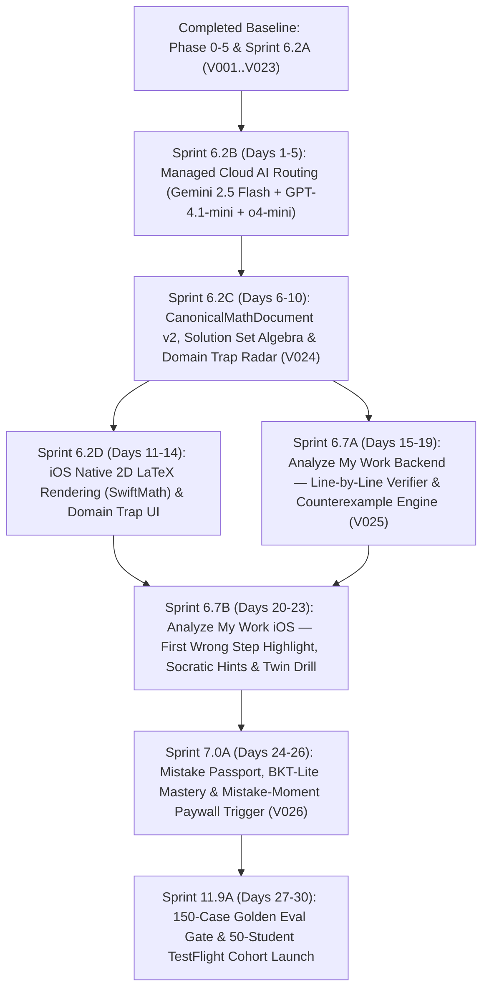

# 02 — Focused Commercial Wedge Sprint Program (30-Day Execution & Master Engineering Specification)

- **Program Baseline Date:** 2026-10-31
- **Audit Revision:** V6.1 (Principal Architect & Technical Auditor — Argon Deepened Specification)
- **Status:** CANONICAL PRODUCTION EXECUTION PROGRAM (V6)
- **Governing ADRs:** `adr/ADR-008_MANAGED_CLOUD_API_ROUTING_AND_QWEN_4B_DE_PROMOTION.md`, `adr/ADR-009_CANONICAL_SOLUTION_SET_ALGEBRA_AND_DOMAIN_GUARD.md`, `adr/ADR-010_NATIVE_2D_MATH_RENDERING_AND_STEP_DIFF_HIGHLIGHTING.md`, `adr/ADR-011_FOCUSED_V1_COMMERCIAL_LAUNCH_GATE_BEFORE_PHASE_08_13.md`
- **Governing Specifications:** `sprints/01_SPRINT_EXECUTION_STANDARD.md`, `architecture/75_PRODUCTION_ARCHITECTURE_AUDIT_AND_EVIDENCE_LEDGER.md`, `ai/77_PRODUCTION_MATH_MODEL_BENCHMARK_AND_BUILD_VS_BUY_STRATEGY.md`, `ai/78_SYMBOLIC_VERIFICATION_ENGINE_V2_AND_DOMAIN_TRAP_RADAR.md`, `learning/79_PEDAGOGICAL_DIAGNOSIS_HANDWRITING_UX_AND_RETENTION_ENGINE.md`, `roadmap/80_UNIT_ECONOMICS_30_DAY_LAUNCH_CONTRACT_AND_EXECUTION_ROADMAP.md`

---

## 1. Strategic Purpose & Argon Architecture Audit Reconciliation

As established in `architecture/75_PRODUCTION_ARCHITECTURE_AUDIT_AND_EVIDENCE_LEDGER.md`, **Phases 0 through 5** and **Sprints 6.1–6.2A** are complete (`commit 63c37bc`). The platform already owns 23 Flyway PostgreSQL migrations (`V001..V023`), Apple Sign-In, StoreKit 2 + App Store Server Notifications V2, S3 presigned media lifecycle, atomic AI spend governance (`PostgresAiSpendGuard.java`), zero-`eval` deterministic `SymPy` verification (`services/math-verifier`), and iOS verification badge surfacing (`SolutionCandidate.swift`).

However, two architectural hazards threatened commercial viability:
1. **Unconnected Cloud AI & Premature Self-Hosting:** Sprint 5.4-RM selected `Qwen/Qwen3.5-4B` (`vLLM`) before any live cloud API (`Gemini 2.5 Flash`, `GPT-4.1-mini`, `o4-mini`) was wired to production.
2. **Solo-Founder Scope Bloat:** Attempting to build all 70+ remaining sprints across Phases 6–13 before testing the core product with 50 real learners.

This document defines the **Focused Commercial Wedge Sprint Program** (**7 high-leverage sprints across 30 calendar days**) in full compliance with the 18-point `sprints/01_SPRINT_EXECUTION_STANDARD.md`.

### 1.1 Argon Codebase Reconciliation Rules (Mandatory Implementation Invariants)

1. **Exact Java AI Package Hierarchy (`com.verifiedai.ai`):**
   - Budget enforcement lives in `services/api/src/main/java/com/verifiedai/ai/infrastructure/persistence/PostgresAiSpendGuard.java` (backed by `V016__create_ai_invocations_and_model_budgets.sql` and `V017__create_ai_budget_reservations.sql`).
   - Capabilities are enumerated in `services/api/src/main/java/com/verifiedai/ai/application/AiCapability.java`: `VISION_PARSE`, `PROBLEM_NORMALIZE`, `PROBLEM_CLASSIFY`, `SOLVE`, `ARBITRATE`, `EXPLAIN`, `MISTAKE_CLASSIFY`, `TUTOR`, `PRACTICE_GENERATE`.
   - All external HTTP model calls must reuse `services/api/src/main/java/com/verifiedai/ai/infrastructure/provider/BoundedInferenceHttp.java`, validate prompt/schema bindings via `PromptRegistry.java` and `OutputSchemaRegistry.java`, and pass `SolverReleaseEvidenceValidator.java` before enabling live traffic.
2. **Exact Flyway Migration Sequencing (`V024`–`V026`):**
   - All platform migrations live in `services/api/src/main/resources/db/migration/platform/` (`V001` through `V023` exist).
   - This program allocates `V024`, `V025`, and `V026` sequentially.
3. **Mandatory Privacy Lifecycle & Training-Exclusion Enforcement (`REQ-PRIV-002`, `CAP-PRIV-001`):**
   - Every new user-owned table (`student_attempts`, `student_attempt_steps`, `learner_mistake_events`, `learner_skill_mastery`, `counterfactual_twin_drills`) must include `training_eligible BOOLEAN NOT NULL DEFAULT FALSE` and register a contributor (analogous to `AiUsageLifecycleContributor.java`) so `/api/v1/me/privacy/export` and `/api/v1/me/privacy/delete` remain 100% compliant.
4. **Canonical iOS Application Path (`apps/ios/VerifiedAI/`):**
   - Older sprint templates in Phases 6–12 referenced `apps/ios/VerifiedLearning/...`. The actual Xcode target and source root in the repository is `apps/ios/VerifiedAI/...`. Every iOS deliverable in this program targets `apps/ios/VerifiedAI/`.

---

## 2. Master 30-Day Wedge Sprint Sequence & Dependency Graph



| Sprint ID | Window | Sprint Title | Primary Capabilities | Flyway Migration | Key Exit Metric |
|---|---|---|---|---|---|
| **Sprint 6.2B** | Days 1–5 | Managed Cloud AI Routing & End-to-End Live Solving | `CAP-AI-001`..`005`, `ADR-008` | Uses `V016`–`V023` | Real photo -> `VERIFIED` solve in `<= 4.5s` P50 (`$0.0058/solve`) |
| **Sprint 6.2C** | Days 6–10 | `CanonicalMathDocument v2`, Solution Set Algebra & Domain Trap Radar | `CAP-VER-001`..`004`, `ADR-009`, `F09`, `F12` | `V024` | `100%` extraneous-root detection; `0` false `VERIFIED` |
| **Sprint 6.2D** | Days 11–14 | iOS Native 2D Mathematical Typesetting (`SwiftMath`) & Domain Trap UI | `CAP-SOL-001`..`004`, `ADR-010` | None | Zero raw ASCII strings on iOS; `60 fps` scroll; VoiceOver passes |
| **Sprint 6.7A** | Days 15–19 | `Analyze My Work` Backend: Step-by-Step Attempt Verifier & Counterexamples | `CAP-ATT-001`, `CAP-MIS-001`, `F01`–`F03` | `V025` | `>= 85%` first-wrong-step recall on 50 seeded handwritten attempts |
| **Sprint 6.7B** | Days 20–23 | `Analyze My Work` iOS Experience, Socratic Hints & Counterfactual Twin Drill | `CAP-TUT-001`, `F01`–`F04`, `F15` | None | Attempt photo -> red step highlight + twin drill in `<= 5.0s` P50 |
| **Sprint 7.0A** | Days 24–26 | Personal Mistake Passport, Deterministic `BKT-Lite` & Mistake-Moment Paywall | `CAP-MAS-001`, `CAP-MON-001`, `F05`, `F29` | `V026` | Real-time Mistake Passport & StoreKit 2 paywall trigger on 2nd mistake |
| **Sprint 11.9A** | Days 27–30 | 150-Case `verified-ai-eval-v2` Gate & 50-Student TestFlight Cohort Launch | `CAP-LAU-001`, `ADR-011` | None | `0` false `VERIFIED` on 150-case gate; 50 students onboarded (`>=30%` W2 retention target) |

---

## 3. Detailed Sprint Specifications (18-Point Production Standard)

---

### SPRINT 6.2B — Managed Cloud AI Routing & End-to-End Live Solving

1. **Sprint Header Block:**
   - **Sprint ID:** `6.2B`
   - **Phase:** Phase 06 — Solution Experience and Tutoring (Commercial Wedge Track)
   - **Duration:** Days 1–5 (5 days)
   - **Dependencies:** Sprint `5.12` (`SolverReleaseEvidenceValidator`), Sprint `6.2A` (`ProblemSessionOrchestrator`, `VllmSolveProviderAdapter`)
   - **Traceability:** `REQ-AI-001`..`005`, `CAP-AI-001`..`005`, `INV-AI-001`..`004`, `ADR-008`
2. **Sprint Objective:**
   - Replace offline stub/local-only `vLLM` execution in the primary production profile with managed cloud API adapters (`Gemini 2.5 Flash` for `VISION_PARSE` / `PROBLEM_NORMALIZE`, `GPT-4.1-mini` for `SOLVE` / `EXPLAIN` / `TUTOR`, and verifier-triggered `OpenAI o4-mini` for `ARBITRATE` / secondary escalation) behind existing provider-neutral ports and `PostgresAiSpendGuard`.
3. **User / Product Value:**
   - Enables the iOS app to photograph a real textbook, YKS (`TYT`/`AYT`) test booklet, or handwritten math problem and receive a live, deterministically `SymPy`-verified step-by-step solution within 4 seconds.
4. **In-Scope Deliverables:**
   - `GeminiVisionParseProviderAdapter.java` and `GeminiProblemNormalizeProviderAdapter.java` calling Google Gemini REST API (`gemini-2.5-flash`) with structured JSON response schema enforcement.
   - `OpenAiSolveProviderAdapter.java` (`gpt-4.1-mini`) and `OpenAiReasoningSolveProviderAdapter.java` (`o4-mini`, `max_completion_tokens <= 2048`) calling OpenAI `/v1/chat/completions` / `/v1/responses` with strict JSON Schema mode (`strict: true`).
   - Conditional R2 -> R3 escalation policy in `VerificationEscalationRouter.java`: invokes `o4-mini` **only** when `GPT-4.1-mini` fails `SymPy` verification, returns `NEEDS_REVIEW`, or problem difficulty is classified as `HARD_TAIL`.
   - Canonical problem hash lookup (`R0` exact + normalized AST cache) in `ProblemSessionOrchestrator.java` to short-circuit repeated textbook/test questions at `$0.00` AI cost.
   - Production release evidence manifest `services/api/src/main/resources/ai/releases/cloud-hybrid-v1-release.json` validated by `SolverReleaseEvidenceValidator.java`.
5. **Explicit Non-Goals:**
   - Deleting `VllmSolveProviderAdapter.java` (retained under `@Profile("local-vllm")` for offline CI).
   - Running paid API calls during automated unit tests (all unit/integration tests use deterministic WireMock/MockServer fixtures).
6. **Architectural Touchpoints:**
   - `services/api/src/main/java/com/verifiedai/ai/application/AiCapability.java`
   - `services/api/src/main/java/com/verifiedai/ai/infrastructure/provider/BoundedInferenceHttp.java`
   - `services/api/src/main/java/com/verifiedai/ai/infrastructure/persistence/PostgresAiSpendGuard.java`
   - `services/api/src/main/java/com/verifiedai/ai/infrastructure/prompt/PromptRegistry.java`
   - `services/api/src/main/java/com/verifiedai/ai/infrastructure/prompt/OutputSchemaRegistry.java`
   - `services/api/src/main/java/com/verifiedai/ai/infrastructure/release/SolverReleaseEvidenceValidator.java`
7. **Exact Repository File Layout:**
   - `services/api/src/main/java/com/verifiedai/ai/infrastructure/provider/GeminiVisionParseProviderAdapter.java` *(new)*
   - `services/api/src/main/java/com/verifiedai/ai/infrastructure/provider/GeminiProblemNormalizeProviderAdapter.java` *(new)*
   - `services/api/src/main/java/com/verifiedai/ai/infrastructure/provider/OpenAiSolveProviderAdapter.java` *(new)*
   - `services/api/src/main/java/com/verifiedai/ai/infrastructure/provider/OpenAiReasoningSolveProviderAdapter.java` *(new)*
   - `services/api/src/main/java/com/verifiedai/ai/application/VerificationEscalationRouter.java` *(new)*
   - `services/api/src/main/resources/ai/releases/cloud-hybrid-v1-release.json` *(new)*
8. **Data Model & Flyway Migrations:**
   - Uses existing `V016__create_ai_invocations_and_model_budgets.sql`, `V017__create_ai_budget_reservations.sql`, and `V021__create_problem_session_verification_lifecycle.sql`.
   - Seeds default model budget policies for `gemini-2.5-flash` (`$0.30/1M` in, `$2.50/1M` out), `gpt-4.1-mini` (`$0.40/1M` in, `$1.60/1M` out), and `o4-mini` (`$1.10/1M` in, `$4.40/1M` out) via application configuration and `ai_model_budgets`.
9. **API & Event Contracts:**
   - Existing `POST /api/v1/problem-sessions/{sessionId}/normalize` and `POST /api/v1/problem-sessions/{sessionId}/solve` endpoints remain contract-compatible; `verificationSummary.providerRoute` reports `"GEMINI_FLASH_GPT41_MINI_SYMPY"` or `"ESCALATED_O4_MINI_SYMPY"`.
10. **AI / Verification / Pedagogical Decisions:**
    - Zero-data-retention headers and `store: false` parameters are sent on all OpenAI/Google API calls.
    - If `o4-mini` also fails `SymPy` verification, the session is marked `VerificationStatus.NEEDS_REVIEW` (`REFINEMENT_REQUIRED`) — never `VERIFIED`.
11. **iOS UX, Accessibility & Localization:**
    - `ProblemSessionDetailView.swift` displays localized progress phases (`"Görsel okunuyor..."` -> `"Cebirsel adımlar çözülüyor..."` -> `"SymPy ile kanıtlanıyor..."`).
12. **Security, Privacy, Cost & Abuse Controls:**
    - `PostgresAiSpendGuard.reserveBudget(...)` is called **before** every `BoundedInferenceHttp` invocation and settled with exact `prompt_tokens`, `completion_tokens`, and `reasoning_tokens` in a `finally` block.
    - Hard daily global ceiling (`$15.00/day` during beta) and per-user tier limits (`FREE`: 3 solves/day, `PRO`: 150 solves/month).
13. **Observability, Metrics & Audit Trail:**
    - Micrometer counters/histograms: `verifiedai.ai.invocation.latency{provider,model,capability}`, `verifiedai.ai.escalation.rate`, `verifiedai.ai.cost.usd.total`, `verifiedai.ai.cache.hit.ratio`.
14. **Failure Modes, Degradation & Rollback:**
    - **OpenAI 5xx / Timeout (`>6,000 ms`):** Circuit breaker trips and routes `SOLVE` to `Gemini 2.5 Flash` structured solver fallback.
    - **Budget Exhausted:** Returns HTTP `429 Too Many Requests` with error code `AI_BUDGET_CAP_REACHED` and graceful iOS upgrade/cooldown banner.
15. **Automated Test Matrix:**
    - `GeminiVisionParseProviderAdapterTest.java` (WireMock happy path, low-confidence `<0.85` OCR gate, malformed JSON rejection).
    - `OpenAiSolveProviderAdapterTest.java` (strict JSON schema validation, token usage settlement in `PostgresAiSpendGuard`).
    - `VerificationEscalationRouterTest.java` (proves `o4-mini` is called if and only if primary `GPT-4.1-mini` fails `SymPy` check).
16. **Verification Commands:**
    - `./gradlew :services:api:test --tests "com.verifiedai.ai.*"`
17. **Definition of Done (DoD):**
    - All provider adapters pass deterministic WireMock suites, `PostgresAiSpendGuard` records exact micro-dollar cost per call, and `VllmSolveProviderAdapter` is disabled in the default production profile.
18. **Owner Acceptance Script:**
    - Start local stack with live API keys in `.env.local`, capture 5 real math photos (1 linear, 1 quadratic, 1 rational equation with domain restriction, 1 derivative, 1 Turkish TYT word problem) on iOS Simulator, and verify that all 5 return `VERIFIED` with `ai_invocations` cost `< $0.01` per solve.

---

### SPRINT 6.2C — `CanonicalMathDocument v2`, Solution Set Algebra & Domain Trap Radar

1. **Sprint Header Block:**
   - **Sprint ID:** `6.2C`
   - **Phase:** Phase 06 — Solution Experience and Tutoring (Commercial Wedge Track)
   - **Duration:** Days 6–10 (5 days)
   - **Dependencies:** Sprint `6.2B`
   - **Traceability:** `REQ-VER-001`..`005`, `CAP-VER-001`..`004`, `INV-VER-001`..`003`, `ADR-009`, Features `F09`, `F12`
2. **Sprint Objective:**
   - Upgrade `CanonicalMathDocument` (`canonical_v1` -> `canonical_v2`) and `services/math-verifier` from single-equality string matching (`x = 4`) to full **Solution Set Algebra** (`FiniteSet`, `Interval`, `Union`, `EmptySet`, `Piecewise`) and deterministic **Domain Restriction Trap Radar** (`extraneous_roots` detection).
3. **User / Product Value:**
   - Eliminates the #1 failure mode of existing homework solvers on high-school and YKS (`TYT`/`AYT`) algebra: false rejection of reordered quadratic roots (`{-2, 3}` vs `{3, -2}`) and false endorsement of extraneous roots that make a denominator zero or an even radical negative.
4. **In-Scope Deliverables:**
   - `CanonicalMathDocumentV2` JSON Schema (`services/api/src/main/resources/ai/schemas/canonical_math_document_v2.schema.json`).
   - Python `SolutionSetVerifier` and `DomainConstraintGuard` inside `services/math-verifier/app/canonical_execution.py` and `services/math-verifier/app/domain_guard.py`.
   - New internal verifier endpoint `POST /internal/v1/verify/canonical-v2`.
   - Flyway migration `V024__add_canonical_v2_solution_set_and_domain_guard.sql` adding structured solution-set and domain-trap columns to `problem_session_solve_attempts` and `problem_session_verification_reports`.
5. **Explicit Non-Goals:**
   - Unbounded multivariable calculus or symbolic theorem proving (`Lean 4` / `Z3`).
6. **Architectural Touchpoints:**
   - `services/math-verifier/app/main.py`
   - `services/math-verifier/app/canonical_execution.py`
   - `services/math-verifier/app/domain_guard.py` *(new)*
   - `services/math-verifier/app/schemas.py`
   - `services/api/src/main/java/com/verifiedai/problemsession/domain/CanonicalSolution.java`
   - `services/api/src/main/java/com/verifiedai/verification/infrastructure/http/HttpMathVerificationClient.java`
7. **Exact Repository File Layout:**
   - `services/api/src/main/resources/db/migration/platform/V024__add_canonical_v2_solution_set_and_domain_guard.sql` *(new)*
   - `services/api/src/main/resources/ai/schemas/canonical_math_document_v2.schema.json` *(new)*
   - `services/math-verifier/app/domain_guard.py` *(new)*
   - `services/math-verifier/tests/test_canonical_v2_and_domain_guard.py` *(new)*
8. **Data Model & Flyway Migrations (`V024`):**
   ```sql
   -- V024__add_canonical_v2_solution_set_and_domain_guard.sql
   ALTER TABLE problem_session_solve_attempts
       ADD COLUMN schema_version VARCHAR(32) NOT NULL DEFAULT 'canonical_v2',
       ADD COLUMN solution_set_kind VARCHAR(32) NOT NULL DEFAULT 'FINITE_SET',
       ADD COLUMN solution_set_sympy TEXT,
       ADD COLUMN domain_constraints_json JSONB NOT NULL DEFAULT '[]'::jsonb,
       ADD COLUMN extraneous_roots_json JSONB NOT NULL DEFAULT '[]'::jsonb,
       ADD COLUMN pedantic_warnings_json JSONB NOT NULL DEFAULT '[]'::jsonb;

   ALTER TABLE problem_session_verification_reports
       ADD COLUMN domain_guard_passed BOOLEAN NOT NULL DEFAULT TRUE,
       ADD COLUMN rejected_extraneous_roots_json JSONB NOT NULL DEFAULT '[]'::jsonb,
       ADD COLUMN counterexample_witness_json JSONB;
   ```
9. **API & Event Contracts:**
   - **Internal Verifier Request (`POST /internal/v1/verify/canonical-v2`):**
     ```json
     {
       "schemaVersion": "canonical_v2",
       "problemFamily": "RATIONAL_EQUATION",
       "variables": ["x"],
       "originalExpressionSympy": "Eq((x**2 - 4)/(x - 2), 5)",
       "extractedDomainConstraints": ["Ne(x - 2, 0)"],
       "steps": [
         {"stepIndex": 1, "operation": "FACTOR_NUMERATOR", "expressionSympy": "Eq((x - 2)*(x + 2)/(x - 2), 5)", "latex2d": "\\frac{(x-2)(x+2)}{x-2} = 5"},
         {"stepIndex": 2, "operation": "SIMPLIFY_DOMAIN_GUARDED", "expressionSympy": "Eq(x + 2, 5)", "latex2d": "x + 2 = 5 \\quad (x \\neq 2)"},
         {"stepIndex": 3, "operation": "SOLVE_LINEAR", "expressionSympy": "Eq(x, 3)", "latex2d": "x = 3"}
       ],
       "candidateSolutionSet": {
         "kind": "FINITE_SET",
         "sympySet": "FiniteSet(3)",
         "latex2d": "ÇK = \\{3\\}",
         "extraneousRoots": [{"valueSympy": "2", "latex2d": "x = 2", "reasonCode": "DENOMINATOR_ZERO", "reasonTr": "Paydayı sıfır yaptığı için tanımsızdır (x ≠ 2)."}]
       }
     }
     ```
   - **Public API Addition (`GET /api/v1/problem-sessions/{sessionId}`):** Adds `domainTrapRadar` (`hasTrap`, `constraints[]`, `extraneousRoots[]`, `pedanticWarnings[]`) to `SolutionCandidateResponse`.
10. **AI / Verification / Pedagogical Decisions:**
    - `DomainConstraintGuard` automatically traverses the AST of `originalExpressionSympy` before step 1 to extract every ` Pow(base, -k)` (denominator `!= 0`), `Pow(base, Rational(p, 2*q))` (even root `>= 0`), and `log(arg, base)` (`arg > 0, base > 0, base != 1`).
    - Every root in `candidateSolutionSet` is substituted into the extracted domain constraints; if any constraint evaluates to `False` or `zoo`/`nan`, verification fails (`CONFLICT_DETECTED`) unless the root is explicitly quarantined in `extraneousRoots`.
    - For indefinite integrals (`PROBLEM_FAMILY = INDEFINITE_INTEGRAL`), equivalence is verified via `simplify(diff(candidate_antiderivative, x) - integrand) == 0`, appending a `MISSING_INTEGRATION_CONSTANT_C` pedantic warning if `+ C` is absent (`F12`).
11. **iOS UX, Accessibility & Localization:**
    - Exposes localized Turkish and English domain trap explanations (`"ÖSYM Tuzak Radarı: Paydayı sıfır yapan x = 2 kökü çözüm kümesinden çıkarıldı"`).
12. **Security, Privacy, Cost & Abuse Controls:**
    - `services/math-verifier` enforces `AST_MAX_NODES = 400`, string length `<= 2,048`, whitelist-only `sympy_parser.parse_expr(..., evaluate=False)` dictionary, and hard `1,500 ms` worker timeout.
13. **Observability, Metrics & Audit Trail:**
    - Metrics: `verifiedai.verifier.domain_trap.detected.count`, `verifiedai.verifier.extraneous_root.quarantined.count`, `verifiedai.verifier.set_equivalence.latency`.
14. **Failure Modes, Degradation & Rollback:**
    - If `SymPy` `solveset` hits the `1,500 ms` timeout on a high-degree polynomial, `DomainConstraintGuard` falls back to exact rational substitution of the candidate roots into the original equation and domain constraints, marking `verificationMethod = "EXACT_ROOT_SUBSTITUTION_AND_DOMAIN_GUARD"`.
15. **Automated Test Matrix:**
    - 40 pytest cases in `test_canonical_v2_and_domain_guard.py` covering quadratic root permutations, rational extraneous roots, radical extraneous roots, logarithmic domain violations, absolute value piecewises, linear inequalities (`Interval.open(-2, 5)`), and indefinite integrals (`+ C`).
16. **Verification Commands:**
    - `pytest services/math-verifier/tests/test_canonical_v2_and_domain_guard.py`
    - `./gradlew :services:api:test --tests "com.verifiedai.verification.*"`
17. **Definition of Done (DoD):**
    - `V024` migration applies cleanly; all 40 symbolic set/domain test cases pass with `0` false positives.
18. **Owner Acceptance Script:**
    - Submit `\frac{x^2 - 4}{x - 2} = 0` and `\sqrt{x + 3} = x - 3` through the API; verify that `x = 2` and `x = 1` are deterministically caught as `extraneousRoots` and surfaced in `domainTrapRadar`.

---

### SPRINT 6.2D — iOS Native 2D Mathematical Typesetting (`SwiftMath`) & Domain Trap UI

1. **Sprint Header Block:**
   - **Sprint ID:** `6.2D`
   - **Phase:** Phase 06 — Solution Experience and Tutoring (Commercial Wedge Track)
   - **Duration:** Days 11–14 (4 days)
   - **Dependencies:** Sprint `6.2C`
   - **Traceability:** `REQ-UX-001`..`004`, `CAP-SOL-001`..`004`, `ADR-010`, Features `F09`, `F12`
2. **Sprint Objective:**
   - Replace the plain `Text(expression).font(.system(.body, design: .monospaced))` placeholder in `MathematicalExpressionView.swift` with native CoreGraphics/CoreText 2D mathematical typesetting (`SwiftMath` `MTMathUILabel`), diff-token color highlighting, and the `DomainTrapRadarBannerView`.
3. **User / Product Value:**
   - Gives students textbook-grade 2D fractions, radicals, integrals, matrices, and solution sets on iOS, plus an unmistakable visual warning card whenever a problem contains an exam domain trap (`Payda != 0`, `Çift Kök >= 0`, `Logaritma > 0`).
4. **In-Scope Deliverables:**
   - Swift Package Manager integration of `SwiftMath` in `apps/ios/VerifiedAI/Package.swift` (or Xcode project dependencies).
   - Re-engineered `apps/ios/VerifiedAI/Features/ProblemSession/MathematicalExpressionView.swift` using `UIViewRepresentable` wrapping `MTMathUILabel` with automatic horizontal `ScrollView(.horizontal, showsIndicators: false)` for wide expressions, Dark/Light mode dynamic `UIColor`, and full preservation of `spokenMathSummary(for:)` for VoiceOver.
   - `apps/ios/VerifiedAI/Features/ProblemSession/DomainTrapRadarBannerView.swift` displaying `domainTrapRadar` constraints, quarantined extraneous roots, and pedantic warnings (`+ C`, absolute value bars `\sqrt{x^2} = |x|`).
5. **Explicit Non-Goals:**
   - Using `WKWebView`, KaTeX, or MathJax inside scrolling solution steps (explicitly banned by `ADR-010`).
6. **Architectural Touchpoints:**
   - `apps/ios/VerifiedAI/Features/ProblemSession/MathematicalExpressionView.swift`
   - `apps/ios/VerifiedAI/Features/ProblemSession/ProblemSessionDetailView.swift`
   - `apps/ios/VerifiedAI/Features/ProblemSession/SolutionCandidate.swift`
7. **Exact Repository File Layout:**
   - `apps/ios/VerifiedAI/Features/ProblemSession/MathematicalExpressionView.swift` *(updated)*
   - `apps/ios/VerifiedAI/Features/ProblemSession/DomainTrapRadarBannerView.swift` *(new)*
   - `apps/ios/VerifiedAI/Tests/VerifiedAITests/MathematicalExpressionViewTests.swift` *(new)*
8. **Data Model & Flyway Migrations:**
   - None (consumes `latex2d` and `domainTrapRadar` fields added in Sprint `6.2C`).
9. **API & Event Contracts:**
   - `SolutionCandidate.swift` decodes `latex2d: String`, `domainTrapRadar: DomainTrapRadar?`, and `stepDiffHighlights: [StepTokenHighlight]?`.
10. **AI / Verification / Pedagogical Decisions:**
    - Every step displays both the 2D rendered mathematical equation (`latex2d`) and a concise pedagogical justification badge (`"Paydalar eşitlendi"`, `"Çarpanlara ayrıldı"`).
11. **iOS UX, Accessibility & Localization:**
    - `accessibilityElement(children: .ignore)` + `.accessibilityLabel(Self.spokenMathSummary(for: latex2d, fallbackDescription: accessibilityDescription))` ensures blind and low-vision learners hear natural spoken math in Turkish/English while sighted learners see 2D typeset math.
    - Supports Dynamic Type scaling (`16pt` base for steps, `20pt` for final solution set).
12. **Security, Privacy, Cost & Abuse Controls:**
    - LaTeX string length capped at `1,024` characters before passing to `MTMathUILabel` to prevent UI layout hangs on malformed strings; automatic graceful fallback to formatted monospaced text if `MTMathUILabel.error != nil`.
13. **Observability, Metrics & Audit Trail:**
    - Client telemetry event `ios_math_render_fallback_count` if any LaTeX expression fails native `SwiftMath` parsing.
14. **Failure Modes, Degradation & Rollback:**
    - If `SwiftMath` encounters an unsupported macro, a pre-normalizer (`LatexMacroSanitizer.swift`) maps `\dfrac` -> `\frac`, `\implies` -> `\Rightarrow`, and falls back to clean monospaced rendering without crashing.
15. **Automated Test Matrix:**
    - `MathematicalExpressionViewTests.swift` verifying 25 complex LaTeX strings (nested fractions, `\sqrt[3]{x^2+1}`, `\int_0^{\pi} \sin(x)\,dx`, `ÇK = (-2, 5] \setminus \{1\}`) render with `error == nil` and non-empty VoiceOver labels.
16. **Verification Commands:**
    - `swift test` / `xcodebuild test -scheme VerifiedAI`
17. **Definition of Done (DoD):**
    - Zero raw ASCII math strings (`x^2/y`) appear in `ProblemSessionDetailView`; `DomainTrapRadarBannerView` renders extraneous roots clearly in both Light and Dark mode.
18. **Owner Acceptance Script:**
    - Open `ProblemSessionDetailView` in iOS Simulator for a rational equation and an indefinite integral; inspect 2D fraction/integral typesetting, toggle Dark Mode, and verify VoiceOver announcement.

---

### SPRINT 6.7A — `Analyze My Work` Backend: Step-by-Step Attempt Verifier & Counterexample Engine

1. **Sprint Header Block:**
   - **Sprint ID:** `6.7A`
   - **Phase:** Phase 06 — Solution Experience and Tutoring (Commercial Wedge Track)
   - **Duration:** Days 15–19 (5 days)
   - **Dependencies:** Sprint `6.2C` (`V024`, `DomainConstraintGuard`)
   - **Traceability:** `REQ-LRN-001`..`004`, `REQ-PRIV-002`, `CAP-ATT-001`, `CAP-MIS-001`, `CAP-PRIV-001`, Features `F01`, `F02`, `F03`
2. **Sprint Objective:**
   - Build the backend and symbolic verification engine for **Handwritten Step-by-Step Mistake Localization (`Analyze My Work`)**: extract ordered lines from a student's handwritten notebook photo (`L_0, L_1, ..., L_k`), verify adjacent steps deterministically in `services/math-verifier`, isolate the **first wrong step (`First Wrong Step Index`)**, classify the mistake taxonomy (`18` deterministic root causes), and generate a concrete **Numeric Counterexample Witness (`CounterexampleEngine`)**.
3. **User / Product Value:**
   - Delivers our #1 competitive wedge over Photomath, Symbolab, Gauth, and ChatGPT: instead of just dumping a solution, Verified AI tells the student *"Your Steps 1 and 2 are mathematically valid, even though you used a different method than the textbook! However, in Step 3 you distributed the minus sign only to the first term. Try substituting `x = 2`: Step 2 gives `7`, but Step 3 gives `11`."*
4. **In-Scope Deliverables:**
   - Flyway migration `V025__create_student_attempt_and_step_verification_lifecycle.sql`.
   - Python `verify_student_attempt` and `CounterexampleEngine` in `services/math-verifier/app/attempt_verification.py` and `services/math-verifier/app/counterexample_engine.py`, exposed at `POST /internal/v1/verify/attempt`.
   - Java `StudentAttemptOrchestrator.java`, `StudentAttemptController.java`, and `GeminiAttemptVisionProviderAdapter.java` (using `AiCapability.VISION_PARSE` + `AiCapability.MISTAKE_CLASSIFY`).
   - `StudentAttemptPrivacyLifecycleContributor.java` implementing export and deletion for `/api/v1/me/privacy/export` and `/api/v1/me/privacy/delete`.
5. **Explicit Non-Goals:**
   - Real-time Apple Pencil stroke-stream recognition (V1 works on camera photos of paper notebooks or tablet screenshots).
6. **Architectural Touchpoints:**
   - `services/math-verifier/app/attempt_verification.py` *(new)*
   - `services/math-verifier/app/counterexample_engine.py` *(new)*
   - `services/api/src/main/java/com/verifiedai/attempt/application/StudentAttemptOrchestrator.java` *(new)*
   - `services/api/src/main/java/com/verifiedai/attempt/presentation/StudentAttemptController.java` *(new)*
   - `services/api/src/main/java/com/verifiedai/attempt/infrastructure/privacy/StudentAttemptPrivacyLifecycleContributor.java` *(new)*
7. **Exact Repository File Layout:**
   - `services/api/src/main/resources/db/migration/platform/V025__create_student_attempt_and_step_verification_lifecycle.sql` *(new)*
   - `services/api/src/main/resources/ai/schemas/student_attempt_extraction_v1.schema.json` *(new)*
   - `services/math-verifier/app/attempt_verification.py` *(new)*
   - `services/math-verifier/app/counterexample_engine.py` *(new)*
   - `services/math-verifier/tests/test_attempt_verification_and_counterexample.py` *(new)*
   - `services/api/src/main/java/com/verifiedai/attempt/...` *(new package)*
8. **Data Model & Flyway Migrations (`V025`):**
   ```sql
   -- V025__create_student_attempt_and_step_verification_lifecycle.sql
   CREATE TABLE student_attempts (
       id UUID PRIMARY KEY,
       problem_session_id UUID NOT NULL REFERENCES problem_sessions(id) ON DELETE CASCADE,
       user_id UUID NOT NULL REFERENCES users(id) ON DELETE CASCADE,
       media_asset_id UUID REFERENCES media_assets(id) ON DELETE SET NULL,
       attempt_status VARCHAR(32) NOT NULL, -- PROCESSING, VERIFIED_CORRECT, MISTAKE_DETECTED, UNREADABLE_HANDWRITING, NEEDS_REVIEW
       overall_outcome VARCHAR(32) NOT NULL, -- FULLY_CORRECT, ALTERNATIVE_VALID_PATH, STEP_ERROR_FOUND, INCOMPLETE_VALID_SO_FAR, DOMAIN_VIOLATION
       first_wrong_step_index INTEGER,
       primary_mistake_code VARCHAR(64),
       counterexample_json JSONB,
       training_eligible BOOLEAN NOT NULL DEFAULT FALSE,
       created_at TIMESTAMPTZ NOT NULL DEFAULT NOW(),
       updated_at TIMESTAMPTZ NOT NULL DEFAULT NOW()
   );

   CREATE INDEX idx_student_attempts_user_created ON student_attempts(user_id, created_at DESC);
   CREATE INDEX idx_student_attempts_session ON student_attempts(problem_session_id);

   CREATE TABLE student_attempt_steps (
       id UUID PRIMARY KEY,
       attempt_id UUID NOT NULL REFERENCES student_attempts(id) ON DELETE CASCADE,
       step_index INTEGER NOT NULL,
       raw_ocr_text TEXT NOT NULL,
       latex_2d TEXT NOT NULL,
       sympy_expression TEXT,
       ocr_confidence NUMERIC(4,3) NOT NULL,
       bbox_json JSONB,
       step_verdict VARCHAR(32) NOT NULL, -- VALID_EQUIVALENT, VALID_ALTERNATIVE_METHOD, FIRST_WRONG_STEP, DOWNSTREAM_TINTED, UNCERTAIN_OCR
       mistake_code VARCHAR(64),
       violated_rule_summary_tr TEXT,
       violated_rule_summary_en TEXT,
       diff_tokens_json JSONB NOT NULL DEFAULT '[]'::jsonb,
       UNIQUE(attempt_id, step_index)
   );
   ```
9. **API & Event Contracts:**
   - **`POST /api/v1/problem-sessions/{sessionId}/attempts`:** Accepts `{ "mediaAssetId": "uuid", "manualStepsLatex": [] }` and returns `StudentAttemptDiagnosisResponse`:
     - `attemptId`, `overallOutcome` (`FULLY_CORRECT`, `ALTERNATIVE_VALID_PATH`, `STEP_ERROR_FOUND`, `INCOMPLETE_VALID_SO_FAR`), `firstWrongStepIndex`, `primaryMistakeCode` (one of the 18 canonical codes in `learning/79_PEDAGOGICAL_DIAGNOSIS_HANDWRITING_UX_AND_RETENTION_ENGINE.md`, e.g., `ALG_SIGN_DISTRIBUTION_ERROR`, `ALG_FRESHMAN_DREAM_POWER`, `ALG_DIVISION_BY_VARIABLE_ROOT_LOSS`), `counterexample` (`variableValues`, `previousStepValue`, `wrongStepValue`, `explanationTr`), and ordered `steps[]`.
   - **`GET /api/v1/problem-sessions/{sessionId}/attempts/{attemptId}`:** Retrieves the persisted attempt diagnosis.
10. **AI / Verification / Pedagogical Decisions:**
    - **Alternative Valid Method Recognition (`F03`):** `attempt_verification.py` checks whether `SolutionSet(L_i) == SolutionSet(L_{i-1})` on the valid domain `D` rather than comparing against a single canonical template. If a student solves `x^2 - 5x + 6 = 0` via completing the square instead of factoring, every valid line receives `step_verdict = "VALID_ALTERNATIVE_METHOD"`.
    - **Counterexample Synthesis (`F02`):** When `SolutionSet(L_{i}) != SolutionSet(L_{i-1})`, `CounterexampleEngine` samples safe integers `x \in \{2, 3, -1, 4, 5, -2\}` inside domain `D` where `val(L_{i-1}, x) != val(L_i, x)` and returns the simplest integer witness.
    - **Handwriting OCR Confidence Gate:** If any line prior to a detected error has `ocr_confidence < 0.82`, the engine returns `step_verdict = "UNCERTAIN_OCR"` and prompts the student to confirm that line before blaming them for a math error.
11. **iOS UX, Accessibility & Localization:**
    - Provides localized Turkish and English mistake explanations grounded in the exact numeric counterexample.
12. **Security, Privacy, Cost & Abuse Controls:**
    - `StudentAttemptPrivacyLifecycleContributor` exports and hard-deletes `student_attempts` and `student_attempt_steps` on user privacy requests; `training_eligible` defaults to `false`.
13. **Observability, Metrics & Audit Trail:**
    - Metrics: `verifiedai.attempt.verdict.count{outcome,mistake_code}`, `verifiedai.attempt.ocr_low_confidence.rate`, `verifiedai.attempt.counterexample.generated.rate`.
14. **Failure Modes, Degradation & Rollback:**
    - If a student's handwriting is too messy to parse into `SymPy` (`UNREADABLE_HANDWRITING`), no quota unit is deducted from their `Analyze My Work` allowance, and the API returns a guided re-capture / line-repair response.
15. **Automated Test Matrix:**
    - 30 pytest cases in `test_attempt_verification_and_counterexample.py` covering all 18 mistake taxonomy codes, valid non-standard solving paths (`F03`), and integer counterexample generation (`F02`).
    - Java integration test verifying `POST /api/v1/problem-sessions/{sessionId}/attempts` and `StudentAttemptPrivacyLifecycleContributor`.
16. **Verification Commands:**
    - `pytest services/math-verifier/tests/test_attempt_verification_and_counterexample.py`
    - `./gradlew :services:api:test --tests "com.verifiedai.attempt.*"`
17. **Definition of Done (DoD):**
    - `V025` migration applies cleanly; `verify_student_attempt` achieves `>= 85%` first-wrong-step recall and `0%` false accusation on valid alternative methods across the 30-case test suite.
18. **Owner Acceptance Script:**
    - Upload a photo of a 4-line handwritten solution containing a sign distribution error on Line 3 (`2x - (x - 4) = 5` -> `2x - x - 4 = 5`); verify that Lines 1–2 return `VALID_EQUIVALENT`, Line 3 returns `FIRST_WRONG_STEP` (`ALG_SIGN_DISTRIBUTION_ERROR`), and `counterexample` proves the discrepancy with `x = 1`.

---

### SPRINT 6.7B — `Analyze My Work` iOS Experience, Socratic Hints & Counterfactual Twin Drill

1. **Sprint Header Block:**
   - **Sprint ID:** `6.7B`
   - **Phase:** Phase 06 — Solution Experience and Tutoring (Commercial Wedge Track)
   - **Duration:** Days 20–23 (4 days)
   - **Dependencies:** Sprints `6.2D`, `6.7A`
   - **Traceability:** `REQ-LRN-005`..`008`, `CAP-TUT-001`, `CAP-STU-001`, Features `F01`, `F02`, `F03`, `F04`, `F15`
2. **Sprint Objective:**
   - Build the complete iOS user experience for **`Analyze My Work` (`Çözümümü Kontrol Et`)**, **3-Stage Progressive Socratic Hints**, **Exam-Speed vs. Rigorous Dual-Track Tabs (`F15`)**, and the **60-Second Counterfactual Twin Drill (`F04`)**.
3. **User / Product Value:**
   - Transforms the student from a passive solution reader into an active learner: they photograph their work, see green checkmarks on their valid lines, see the exact mutated token highlighted in red on their first wrong line, read the numeric counterexample card, and immediately solve a 60-second `SymPy`-verified twin question testing that exact algebraic rule.
4. **In-Scope Deliverables:**
   - `POST /api/v1/problem-sessions/{sessionId}/hints` (3-level progressive hint endpoint: `LEVEL_1_CONCEPT_NUDGE`, `LEVEL_2_SETUP_EQUATION`, `LEVEL_3_FIRST_STEP_REVEAL`).
   - `POST /api/v1/problem-sessions/{sessionId}/attempts/{attemptId}/counterfactual-twin` generating a `SymPy`-verified twin problem (`F04`) parameterized around the student's `primaryMistakeCode`.
   - iOS `AnalyzeMyWorkCaptureView.swift`, `FirstWrongStepDiffView.swift`, `CounterexampleProofCardView.swift`, `SocraticHintDrawerView.swift`, and `CounterfactualTwinSheetView.swift`.
5. **Explicit Non-Goals:**
   - Multi-turn open-ended free-chat chatbots (keeps cost bounded and prevents prompt-injection/off-topic jailbreaks).
6. **Architectural Touchpoints:**
   - `services/api/src/main/java/com/verifiedai/tutoring/application/SocraticHintService.java` *(new)*
   - `services/api/src/main/java/com/verifiedai/attempt/application/CounterfactualTwinGeneratorService.java` *(new)*
   - `apps/ios/VerifiedAI/Features/AttemptAnalysis/...` *(new feature module)*
   - `apps/ios/VerifiedAI/Features/Tutoring/SocraticHintDrawerView.swift` *(new)*
7. **Exact Repository File Layout:**
   - `apps/ios/VerifiedAI/Features/AttemptAnalysis/AnalyzeMyWorkCaptureView.swift` *(new)*
   - `apps/ios/VerifiedAI/Features/AttemptAnalysis/FirstWrongStepDiffView.swift` *(new)*
   - `apps/ios/VerifiedAI/Features/AttemptAnalysis/CounterexampleProofCardView.swift` *(new)*
   - `apps/ios/VerifiedAI/Features/AttemptAnalysis/CounterfactualTwinSheetView.swift` *(new)*
   - `apps/ios/VerifiedAI/Features/Tutoring/SocraticHintDrawerView.swift` *(new)*
8. **Data Model & Flyway Migrations:**
   - Uses `student_attempts` and `student_attempt_steps` (`V025`); twin drill persistence is finalized in `V026` (Sprint `7.0A`).
9. **API & Event Contracts:**
   - **`POST /api/v1/problem-sessions/{sessionId}/hints`:** Request `{ "hintLevel": 1 | 2 | 3 }`, returns `{ "hintLevel": 1, "titleTr": "Kavramsal İpucu", "latex2d": "...", "explanationTr": "..." }`.
   - **`POST /api/v1/problem-sessions/{sessionId}/attempts/{attemptId}/counterfactual-twin`:** Generates a new `SymPy`-verified mini-problem isolating the exact `primaryMistakeCode` with 4 multiple-choice distractors (where 1 distractor corresponds to repeating the same mistake) plus optional step-input verification.
10. **AI / Verification / Pedagogical Decisions:**
    - **Verification-Gate on Twin Drills (`INV-VER-001`):** A generated Counterfactual Twin Drill (`F04`) is **never** shown to the student unless `services/math-verifier` confirms the twin question's canonical solution set is `VERIFIED`.
    - **Exam-Speed Shortcut vs. Rigorous Method (`F15`):** On eligible YKS (`TYT`/`AYT`) problems, `ProblemSessionDetailView` displays a segmented toggle: `[ Garantili Adım Adım Çözüm ]` vs. `[ ÖSYM Sınav Hızı Pratik Yol (30 sn) ]` (e.g., Vieta's root-sum/product formulas `x_1 + x_2 = -b/a`, degree symmetry, or graphical sign tables).
11. **iOS UX, Accessibility & Localization:**
    - `FirstWrongStepDiffView` renders valid steps with a subtle emerald border (`#10B981`), the first wrong step with a coral-red border (`#EF4444`) and token highlight, and downstream steps as dimmed (`0.55` opacity) with badge `"Önceki satırdaki hatadan etkilendi"`.
12. **Security, Privacy, Cost & Abuse Controls:**
    - Socratic hints (`L1`, `L2`, `L3`) are generated in a single batched `GPT-4.1-mini` call cached per `(problem_session_id)` so tapping Level 2 or Level 3 incurs `0 ms` latency and `$0.00` extra API cost.
13. **Observability, Metrics & Audit Trail:**
    - Metrics: `verifiedai.tutor.hint.requested{level}`, `verifiedai.twin_drill.generated.count`, `verifiedai.twin_drill.completed_correct.rate`.
14. **Failure Modes, Degradation & Rollback:**
    - If a twin drill fails `SymPy` verification on the first LLM generation attempt, the service falls back to a deterministic template-instantiated twin problem for that `mistake_code` from `services/math-verifier` (guaranteed `100%` valid in `<20 ms`).
15. **Automated Test Matrix:**
    - Unit and UI tests for `FirstWrongStepDiffView`, `SocraticHintDrawerView`, and `CounterfactualTwinGeneratorServiceTest.java`.
16. **Verification Commands:**
    - `./gradlew :services:api:test --tests "com.verifiedai.attempt.*"`
    - `xcodebuild test -scheme VerifiedAI`
17. **Definition of Done (DoD):**
    - End-to-end iOS flow from `Analyze My Work` camera capture -> red step highlight + counterexample card -> 60-second Twin Drill completion works smoothly in `< 5.0s` P50.
18. **Owner Acceptance Script:**
    - Photograph a flawed handwritten quadratic solution on iOS, inspect the red token diff and numeric counterexample card, tap `"60 Saniyede İkiz Soruyla Kapat"`, solve the generated twin drill, and verify the success celebration state.

---

### SPRINT 7.0A — Personal Mistake Passport, Deterministic `BKT-Lite` Mastery & Mistake-Moment Paywall

1. **Sprint Header Block:**
   - **Sprint ID:** `7.0A`
   - **Phase:** Phase 07 — Attempt, Mistake and Mastery Intelligence (Commercial Wedge Track)
   - **Duration:** Days 24–26 (3 days)
   - **Dependencies:** Sprints `6.7A`, `6.7B`, and existing Phase 3 StoreKit 2 entitlements (`V012`, `V013`)
   - **Traceability:** `REQ-LRN-009`..`012`, `REQ-MON-001`..`003`, `CAP-MAS-001`, `CAP-MON-001`, Features `F05`, `F29`
2. **Sprint Objective:**
   - Implement the **Personal Mistake Passport (`Kişisel Hata Pasaportu` — `F05`)**, the deterministic **`BKT-Lite` + Exponential Forgetting-Curve Mastery Engine**, and the high-conversion **Mistake-Moment Paywall Trigger** connected to the existing StoreKit 2 entitlement infrastructure.
3. **User / Product Value:**
   - Gives every student a persistent, quantifiable mathematical error profile (*"Son 2 haftada 4 kez Negatif Parantez Dağıtma Hatası ve 2 kez Payda Kökü Unutma Tuzak Hatası yaptın; İkiz Sorularla 3 tanesini kalıcı olarak kapattın"*) and presents the `PRO` (`199.99 TL/ay` / `\$9.99/mo`) upgrade at the exact moment of maximum perceived value.
4. **In-Scope Deliverables:**
   - Flyway migration `V026__create_mistake_passport_twin_drills_and_mastery_v1.sql`.
   - Deterministic `BktLiteMasteryCalculator.java` implementing the exact Bayesian mastery update (`P(L_0)=0.25, P(T)=0.12, P(S)=0.10, P(G)=0.05`) and half-life decay (`P_eff(t) = 0.10 + (P(L_n) - 0.10) * 2^(-dt / H_n)`) from `learning/79_PEDAGOGICAL_DIAGNOSIS_HANDWRITING_UX_AND_RETENTION_ENGINE.md`.
   - `GET /api/v1/me/mistake-passport` endpoint returning top recurring mistake codes, mastery scores by topic, due spaced-repetition twin drills, and estimated exam net impact (`+1.5 TYT/AYT Net Potansiyeli`).
   - `LearningStatePrivacyLifecycleContributor.java` registering `learner_mistake_events`, `learner_skill_mastery`, and `counterfactual_twin_drills` for GDPR/KVKK export and deletion.
   - iOS `MistakePassportDashboardView.swift` and `MistakeMomentPaywallView.swift` wired to existing StoreKit 2 product IDs.
5. **Explicit Non-Goals:**
   - Deep-learning knowledge tracing (`DKT`) or multi-month automated calendar scheduling (frozen until Phase 8 gate).
6. **Architectural Touchpoints:**
   - `services/api/src/main/java/com/verifiedai/learning/domain/BktLiteMasteryCalculator.java` *(new)*
   - `services/api/src/main/java/com/verifiedai/learning/presentation/MistakePassportController.java` *(new)*
   - `services/api/src/main/java/com/verifiedai/learning/infrastructure/privacy/LearningStatePrivacyLifecycleContributor.java` *(new)*
   - `apps/ios/VerifiedAI/Features/MistakePassport/MistakePassportDashboardView.swift` *(new)*
7. **Exact Repository File Layout:**
   - `services/api/src/main/resources/db/migration/platform/V026__create_mistake_passport_twin_drills_and_mastery_v1.sql` *(new)*
   - `services/api/src/main/java/com/verifiedai/learning/...` *(new package)*
   - `apps/ios/VerifiedAI/Features/MistakePassport/MistakePassportDashboardView.swift` *(new)*
   - `apps/ios/VerifiedAI/Features/Monetization/MistakeMomentPaywallView.swift` *(new)*
8. **Data Model & Flyway Migrations (`V026`):**
   ```sql
   -- V026__create_mistake_passport_twin_drills_and_mastery_v1.sql
   CREATE TABLE learner_mistake_events (
       id UUID PRIMARY KEY,
       user_id UUID NOT NULL REFERENCES users(id) ON DELETE CASCADE,
       attempt_id UUID REFERENCES student_attempts(id) ON DELETE SET NULL,
       problem_session_id UUID NOT NULL REFERENCES problem_sessions(id) ON DELETE CASCADE,
       topic_code VARCHAR(64) NOT NULL,
       mistake_code VARCHAR(64) NOT NULL,
       severity VARCHAR(16) NOT NULL DEFAULT 'HIGH',
       resolved_by_twin_drill BOOLEAN NOT NULL DEFAULT FALSE,
       training_eligible BOOLEAN NOT NULL DEFAULT FALSE,
       occurred_at TIMESTAMPTZ NOT NULL DEFAULT NOW()
   );

   CREATE INDEX idx_learner_mistake_events_user_code ON learner_mistake_events(user_id, mistake_code, occurred_at DESC);

   CREATE TABLE learner_skill_mastery (
       id UUID PRIMARY KEY,
       user_id UUID NOT NULL REFERENCES users(id) ON DELETE CASCADE,
       topic_code VARCHAR(64) NOT NULL,
       p_learned NUMERIC(5,4) NOT NULL DEFAULT 0.2500,
       half_life_days NUMERIC(6,2) NOT NULL DEFAULT 2.00,
       verified_independent_solves INTEGER NOT NULL DEFAULT 0,
       solution_peek_count INTEGER NOT NULL DEFAULT 0,
       last_practiced_at TIMESTAMPTZ NOT NULL DEFAULT NOW(),
       next_review_due_at TIMESTAMPTZ NOT NULL DEFAULT NOW(),
       training_eligible BOOLEAN NOT NULL DEFAULT FALSE,
       UNIQUE(user_id, topic_code)
   );

   CREATE TABLE counterfactual_twin_drills (
       id UUID PRIMARY KEY,
       user_id UUID NOT NULL REFERENCES users(id) ON DELETE CASCADE,
       source_attempt_id UUID REFERENCES student_attempts(id) ON DELETE SET NULL,
       target_mistake_code VARCHAR(64) NOT NULL,
       topic_code VARCHAR(64) NOT NULL,
       question_latex_2d TEXT NOT NULL,
       sympy_canonical_expr TEXT NOT NULL,
       verified_solution_latex_2d TEXT NOT NULL,
       options_json JSONB NOT NULL,
       drill_status VARCHAR(32) NOT NULL DEFAULT 'PENDING', -- PENDING, COMPLETED_CORRECT, COMPLETED_WRONG
       completed_at TIMESTAMPTZ,
       training_eligible BOOLEAN NOT NULL DEFAULT FALSE,
       created_at TIMESTAMPTZ NOT NULL DEFAULT NOW()
   );
   ```
9. **API & Event Contracts:**
   - **`GET /api/v1/me/mistake-passport`:** Returns `MistakePassportResponse` (`totalAnalyzedAttempts`, `resolvedTwinCount`, `topMistakeSignatures[]`, `topicMastery[]`, `dueReviewDrills[]`, `paywallTriggerContext`).
10. **AI / Verification / Pedagogical Decisions:**
    - **Anti-Cheating Mastery Rule:** Viewing the full solution without submitting an attempt or passing a Twin Drill increments `solution_peek_count` and leaves `p_learned` unchanged (`0.0` mastery gain). Only verified attempts (`FULLY_CORRECT` / `ALTERNATIVE_VALID_PATH`) or completed Twin Drills (`COMPLETED_CORRECT`) increase `p_learned` and double `half_life_days`.
    - **Mistake-Moment Paywall Trigger:** When a `FREE` user hits their 2nd recurring mistake signature or exhausts their daily `1` free `Analyze My Work` diagnosis, `MistakeMomentPaywallView` displays their personalized Mistake DNA card and offers a 7-day free trial of `PRO` (`199.99 TL/ay` TR / `\$9.99/mo` Global).
11. **iOS UX, Accessibility & Localization:**
    - `MistakePassportDashboardView` displays visual progress rings for each algebraic/calculus topic and a "Bugünün 3 Dakikalık Hata Kapatma Antrenmanı" card.
12. **Security, Privacy, Cost & Abuse Controls:**
    - `BktLiteMasteryCalculator` is 100% deterministic Java math (`0` LLM tokens, `<2 ms` execution).
    - `LearningStatePrivacyLifecycleContributor` ensures complete user data export and erasure.
13. **Observability, Metrics & Audit Trail:**
    - Metrics: `verifiedai.mastery.bkt_update.count`, `verifiedai.paywall.mistake_moment.impression.count`, `verifiedai.paywall.mistake_moment.conversion.count`.
14. **Failure Modes, Degradation & Rollback:**
    - If App Store StoreKit 2 product fetch fails offline, `MistakeMomentPaywallView` degrades gracefully to showing remaining free daily quota reset time.
15. **Automated Test Matrix:**
    - `BktLiteMasteryCalculatorTest.java` verifying exact posterior probability updates, half-life doubling (`2 -> 4 -> 8 days`), and zero-gain on solution peeking.
    - `LearningStatePrivacyLifecycleContributorTest.java` verifying export and deletion of all 3 `V026` tables.
16. **Verification Commands:**
    - `./gradlew :services:api:test --tests "com.verifiedai.learning.*"`
17. **Definition of Done (DoD):**
    - `V026` migration applies cleanly; Mistake Passport updates in real time after every attempt and twin drill; StoreKit 2 sandbox purchase unlocks `PRO` quotas immediately.
18. **Owner Acceptance Script:**
    - Complete 2 `Analyze My Work` attempts with sign errors on a `FREE` account, verify `GET /api/v1/me/mistake-passport` aggregates the pattern (`count = 2`), trigger the Mistake-Moment Paywall, complete a sandbox StoreKit 2 `PRO` upgrade, and solve the Twin Drill to watch `resolved_by_twin_drill` flip to `true`.

---

### SPRINT 11.9A — 150-Case `verified-ai-eval-v2` Gate & 50-Student TestFlight Cohort Launch

1. **Sprint Header Block:**
   - **Sprint ID:** `11.9A`
   - **Phase:** Phase 11 — Production Hardening, Beta and Launch (Accelerated Commercial Wedge Gate)
   - **Duration:** Days 27–30 (4 days)
   - **Dependencies:** Sprints `6.2B`, `6.2C`, `6.2D`, `6.7A`, `6.7B`, `7.0A`
   - **Traceability:** `REQ-QA-001`..`004`, `CAP-LAU-001`, `ADR-011`, `ai/73_MATH_MODEL_EVALUATION_PLAN.md`, `roadmap/80_UNIT_ECONOMICS_30_DAY_LAUNCH_CONTRACT_AND_EXECUTION_ROADMAP.md`
2. **Sprint Objective:**
   - Execute the **150-case Core Golden Benchmark (`verified-ai-eval-v2` Subset)** against the live cloud routing stack (`Gemini 2.5 Flash` + `GPT-4.1-mini` + `o4-mini` + `SymPy`), verify all 6 release gates (`0` false `VERIFIED`), deploy the TestFlight build to **50 real target students** (35 Turkish YKS `TYT`/`AYT` learners + 15 University Calculus 101 learners), and measure the **Day-30 Go/No-Go Contract**.
3. **User / Product Value:**
   - Validates our product with real students and real exam problems within 30 days, replacing speculation with empirical retention, accuracy, and unit-cost telemetry.
4. **In-Scope Deliverables:**
   - 150-case stratified evaluation dataset (`services/math-verifier/tests/golden_v2_150_core.jsonl`: 40 phone photos, 35 handwritten `Analyze My Work` attempts with planted errors, 35 Turkish YKS `TYT`/`AYT` problems, 25 domain-restriction traps, 15 adversarial/out-of-scope prompts).
   - Automated benchmark runner `scripts/eval/run_golden_v2_release_gate.py` producing a signed release report in `docs/verified_ai_learning_platform_docs_v4/quality/reports/`.
   - In-app 1-tap feedback sheet (`"Bu hata teşhisi işine yaradı mı?"` + `"Hatalı adım bildir"`) and TestFlight cohort telemetry dashboard.
5. **Explicit Non-Goals:**
   - Paid performance marketing or Android development before the 50-student TestFlight gate passes.
6. **Architectural Touchpoints:**
   - `services/api/src/main/java/com/verifiedai/ai/infrastructure/release/SolverReleaseEvidenceValidator.java`
   - `scripts/eval/run_golden_v2_release_gate.py` *(new)*
7. **Exact Repository File Layout:**
   - `scripts/eval/run_golden_v2_release_gate.py` *(new)*
   - `services/math-verifier/tests/golden_v2_150_core.jsonl` *(new)*
8. **Data Model & Flyway Migrations:**
   - Uses existing evaluation and feedback tables (`V018`, `V022`, `V023`).
9. **API & Event Contracts:**
   - Uses existing `POST /api/v1/problem-sessions/{sessionId}/feedback` (`Sprint 6.9` / `V022`).
10. **AI / Verification / Pedagogical Decisions:**
    - **Hard Release Gate Criteria (`ADR-008`, `ADR-011`):**
      1. False-Verified Rate (Mathematically wrong solution marked `VERIFIED`): **`0.0%` (`0 / 150`)**.
      2. End-to-End Verified Solve Rate on supported algebra/calculus scope: **`>= 85.0%`**.
      3. Extraneous-Root Trap Catch Rate (`25` trap cases): **`100.0%` (`25 / 25`)**.
      4. `Analyze My Work` First-Wrong-Step Localization Recall (`35` handwritten attempts): **`>= 85.0%`**.
      5. P50 End-to-End Latency: **`<= 4.5s`** (P95 `<= 9.5s`).
      6. Mean Cost per Verified Solve: **`<= $0.0075`**.
11. **iOS UX, Accessibility & Localization:**
    - TestFlight onboarding screen clearly sets expectations for the beta cohort and highlights the two hero actions: `[ Soruyu Çöz & Kanıtla ]` and `[ Çözümümü Kontrol Et (Hata Bulucu) ]`.
12. **Security, Privacy, Cost & Abuse Controls:**
    - Global beta spend guard set to `$15.00/day` in `PostgresAiSpendGuard`; per-tester cap set to `25 solves/day` + `15 attempt analyses/day`.
13. **Observability, Metrics & Audit Trail:**
    - Cohort dashboard tracking: `W1_active_learners`, `W2_retained_learners`, `verified_solve_ratio`, `analyze_my_work_usage_ratio`, `twin_drill_completion_ratio`, `mean_cost_per_active_learner_usd`.
14. **Failure Modes, Degradation & Rollback:**
    - Any single false `VERIFIED` case discovered during the 150-case gate or TestFlight beta is immediately added as a permanent regression fixture in `test_canonical_v2_and_domain_guard.py` before the next build.
15. **Automated Test Matrix:**
    - Full 150-case evaluation suite + full Gradle and pytest verification suites.
16. **Verification Commands:**
    - `python3 scripts/eval/run_golden_v2_release_gate.py --suite services/math-verifier/tests/golden_v2_150_core.jsonl`
17. **Definition of Done (DoD):**
    - All 6 quantitative release gates pass; 50 real students have installed the TestFlight build and completed `>= 500` cumulative problem/attempt sessions.
18. **Owner Acceptance Script (The Day-30 Go/No-Go Decision):**
    - Review the 14-day TestFlight cohort report:
      - **GO TO COMMERCIAL APP STORE LAUNCH & PHASE 07–12 EXPANSION:** `W2 retention >= 30%` (`>= 15/50` active learners in Week 2), `>= 85%` verified solve rate, and `>= 40%` of active learners voluntarily using `Analyze My Work`.
      - **PIVOT / RE-SCOPE:** If `W2 retention < 10%`, freeze all Phase 7–13 code and pivot directly based on student interview transcripts.
